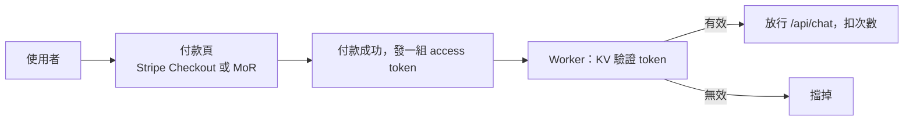

# 金流方案

> 把 Mini-Lang 專家放到網路上之後，金流有兩個方向：(A) 你要付錢給平台；(B) 你想向使用者收錢。這篇整理兩邊的選項，以及這個專案建議的導入路徑。

## 1. 付錢給平台（升級用）

| 平台 | 付款方式 |
|---|---|
| Cloudflare（Workers Paid $5/月） | **需要國際信用卡**（Visa/Mastercard），台灣發行的信用卡可用；不支援 PayPal、超商繳費 |
| Linode/Akamai | 國際信用卡、部分地區支援 PayPal；新帳號常被要求驗證身分（文件審查） |

兩者都沒有台灣本地金流（超商、ATM 轉帳）。**沒有國際信用卡的話，這本身就是個門檻**——Cloudflare 比較硬，一定要卡。

## 2. 向使用者收錢

兩個平台**都沒有內建「幫你向你的使用者收費」的機制**——Workers 的帳單是你和 Cloudflare 之間的，不會幫你做使用者的訂閱管理。要收費要另外接金流服務。

### 2.1 Stripe：不用美國公司，但台灣要商業登記

常見誤解是「Stripe 要登記一間美國公司」。正確的規則：

| 問題 | 答案 |
|---|---|
| 要美國公司嗎？ | **不用**。Stripe Taiwan（stripe.com/tw）是「跨境收款」模式：交易由 Stripe 美國實體處理，錢撥到你的台灣銀行帳戶 |
| 要什麼資格？ | **台灣的商業登記**：公司登記或商業登記（行號）都可以。**純個人（沒有登記）不能開台灣 Stripe 帳戶** |
| 收什麼幣別？ | 向使用者收 USD（台灣版以美元計價），撥款時換成 TWD 入帳，有匯差與手續費（約 2.8% + 固定費） |
| 網站要露出的資訊？ | 條款、退款政策等，Stripe 會要求營業人名稱與統編 |

所以：**用 Stripe → 要在台灣做商業登記（公司或行號），不是美國公司**。設立行號成本不高（幾千元、一兩週），但對個人 side project 是個摩擦點。

### 2.2 Merchant of Record：個人名義就能用

**MoR 平台**——法律上「賣東西的人」是平台，不是你，所以**個人名義就能用**，它們幫你處理收款、發票、全球稅務：

| 服務 | 個人可用 | 撥款方式 | 抽成 |
|---|---|---|---|
| **Paddle** | ✓ | Payoneer / 銀行電匯 | 約 5% + $0.5 |
| **Lemon Squeezy**（已併入 Stripe，仍獨立運作） | ✓ | PayPal / 銀行 | 約 5% + $0.5 |
| **Gumroad** | ✓ | PayPal / 銀行 | 約 10% |

代價是抽成比 Stripe 高（Stripe 約 2.8%），但換到的是：**零設立成本、零稅務處理**——全球的增值稅/銷售稅由平台申報繳納。

### 2.3 台灣本地金流

| 服務 | 個人 | 說明 |
|---|---|---|
| **綠界 ECPay** | ✓（個人可申請，功能受限；信用卡收款建議有營登） | 超商代碼、ATM 對台灣使用者最友善 |
| **藍新 NewebPay** | 類似 | 有訂閱扣款 |
| **Line Pay** | — | 滲透率高，但只覆蓋 Line 用戶 |

缺點：這些是「台灣的服務」，使用者是全球的話體驗反而差。

## 3. 接到這個專案：架構

以 Workers 為例（Linode 也一樣，收款都在平台外）：

* Worker 用 **KV** 存 token 與剩餘次數，驗證只是一行 `KV.get(token)` 等級的查表，免費額度內跑得動（KV 限制見 [cpu-limit.md](cpu-limit.md) 第 6 節）。
* `wrangler.jsonc` 已有 KV 綁定的註解範例，加一個 namespace 就能開始。

## 4. 成本結構：定價要想清楚的事

真正的成本不是 Cloudflare/Linode 的 $5，而是**每一次對話燒掉的 NVIDIA API 額度**（系統提示詞 2.3 萬字元 + 回答）。所以：

1. **別做純訂閱，做額度制**：每次對話成本是變動的，按次數/字數計量才不會虧（例如一組 token 用 100 次）。
2. **KV 記次數**：每次請求減 1，用完擋掉——成本端可控，收費端好定價。
3. **更省的替代**：如果使用者量真的起來，把 NVIDIA NIM 換成有免費額度的小模型供應商，或讓使用者自帶金鑰（BYOK，網頁上填自己的 key，你完全不碰金流和成本）。

## 5. 建議的導入路徑

| 階段 | 做法 | 為什麼 |
|---|---|---|
| 1. 先不上金流 | Workers 免費檔 + **BYOK**（使用者填自己的 NVIDIA key，存 localStorage，直接從瀏覽器打 API） | 零金流門檻、零成本，先驗證有沒有人要用 |
| 2. 有人想付錢了 | **MoR**（Lemon Squeezy / Paddle）：個人名義、賣額度 token，錢進 PayPal 或台灣帳戶 | 不用設公司、不處理跨國稅務 |
| 3. 量大到值得設公司（例如月收入數萬元以上） | 登記行號 → 改用 **Stripe 台灣版** | 手續費從 5% 降到 2.8%，能開發票給企業客戶 |

**稅務提醒**：不管用哪條路，收入在台灣是所得，要申報；MoR 平台會開 1099-K 或對應文件，報稅時列入（外國所得）。真要規模化時找會計確認一次。

## 6. 免費方案下 BYOK 的隱私注意

BYOK 模式中金鑰由瀏覽器直接送到 NVIDIA，不經過你的伺服器——這對隱私是好事（金鑰不落地），但：

* 網頁要從前端直接呼叫 `integrate.api.nvidia.com`，該 API 對瀏覽器的 CORS 政策要事先確認（不行就得退回「金鑰經 Worker 轉發但只在記憶體使用」的模式）；
* 金鑰存在 localStorage，共用電腦上要提醒使用者用完清除。
