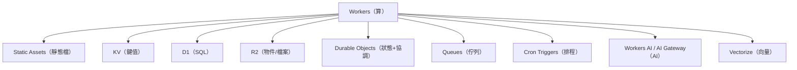

# Cloudflare 產品線：跑應用會碰到的每一個

> Cloudflare 不只是 CDN。整個「Workers 平台」家族可以從靜態網頁做到資料庫、佇列、AI。這篇按「做什麼用的」整理，標出 mini-lang-expert 用到哪些。

## 1. 總覽

## 2. 算與呈現

| 產品 | 是什麼 | 什麼時候用 | mini-lang-expert |
|---|---|---|---|
| **Workers** | 在全球邊緣節點跑 JS/TS/Python/WASM，請求進來→執行→回應 | API、代理、動態網頁 | ✓ 核心 |
| **Static Assets** | 和 Worker 綁在一起的靜態檔案目錄（`wrangler.jsonc` 的 `assets`），請求比對到檔案就直接回，沒有才進 Worker | 前端 SPA、HTML/JS/CSS | ✓ 前端就靠它 |
| **Pages** | 上一代的靜態網站+函式產品，和 Git 整合好 | 已建議新專案用 Workers + Static Assets 取代 | 不用 |
| **Cron Triggers** | 定時喚醒 Worker（`* * * * *` 語法） | 排程抓資料、清理 | 不用 |
| **Durable Objects** | 單一實例、有狀態、可協調的物件：強一致性、WebSocket、鎖 | 即時協作、計數器、rate limiter、狀態機 | 不用（工具循環在一次請求內完成） |

## 3. 資料

| 產品 | 是什麼 | 什麼時候用 | 備註 |
|---|---|---|---|
| **KV** | 全球複製的鍵值儲存，最終一致（讀取最長 60 秒延遲生效） | 設定、提示詞、token 額度、快取 | mini-lang-expert 預留 `PROMPTS` 綁定：改提示詞不用重新部署 |
| **D1** | 邊緣 SQLite：真的 SQL、有索引、交易 | 使用者資料、關聯資料、需要 `JOIN` 的 | KV 不適合的結構化資料 |
| **R2** | 物件儲存（相容 S3 API），**出口流量免費** | 檔案、圖片、模型檔、備份 | 放「會被大量下載的東西」比 S3 省很多 |
| **Vectorize** | 向量資料庫 | 語意搜尋、RAG | 通常配 Workers AI 的 embedding 模型 |
| **Hyperdrive** | 連外部既有資料庫（Postgres/MySQL）的加速層 | 資料庫在別處（如 Supabase）想從 Worker 快速查 | 不用 |

## 4. AI 相關

| 產品 | 是什麼 | 什麼時候用 |
|---|---|---|
| **Workers AI** | Cloudflare 自家的推論服務：內建開源模型（Llama、embedding、Whisper、圖像），邊緣執行 | 想不另外找供應商、模型夠用時 |
| **AI Gateway** | 代理層：放在你和 OpenAI/Anthropic/NVIDIA… 之間，統一記 log、快取、限流、重試、fallback | 用外部 LLM 時幾乎都值得加——mini-lang-expert 的下一步可以考慮 |
| **AutoRAG** | 綁 R2 + Vectorize 的現成 RAG 管線 | 文件問答不想自己拼 |

注意：mini-lang-expert 直接打 NVIDIA 的 `integrate.api.nvidia.com`。換成 AI Gateway 只要把 URL 換成 gateway 端點，就多拿到 log、快取與限流。

## 5. 串接與安全

| 產品 | 是什麼 | 什麼時候用 |
|---|---|---|
| **Queues** | 訊息佇列，Worker 之間非同步傳訊 | 慢工作（送信、批次處理）丟到背景做 |
| **Rate Limiting binding** | Worker 內建限流 | 保護公開 API（我們 README 建議的做法之一） |
| **Secrets / Variables** | 密鑰（`wrangler secret put`）與環境變數 | NVIDIA_API_KEY 就是這樣放 |
| **Web Analytics / Observability** | 無 cookie 的流量分析 / Worker log 與 trace | `observability.enabled = true` 已開 |

## 6. 選型速查

| 需求 | 用 |
|---|---|
| 靜態網頁 | Static Assets |
| 設定值、提示詞、簡單狀態 | KV |
| 多張表、要 SQL | D1 |
| 檔案、模型、備份 | R2 |
| 即時協作、強一致計數 | Durable Objects（需 Paid） |
| 背景慢工作 | Queues |
| 定時任務 | Cron Triggers |
| 呼叫 LLM 想要 log/快取/限流 | AI Gateway |
| 內建模型推論 | Workers AI |
| 語意搜尋/RAG | Vectorize（+ Workers AI embedding） |

## 7. 對 mini-lang-expert 的下一步建議

1. **AI Gateway**：包住 NVIDIA 呼叫，拿到請求 log 與回應快取（247 字檢查類的問題答案重複率高，快取省錢）。
2. **Rate Limiting binding**：公開 API 加每 IP 限流，保護 NVIDIA 額度。
3. **KV**（已預留）：正式部署時啟用，提示詞更新不用重新部署。
