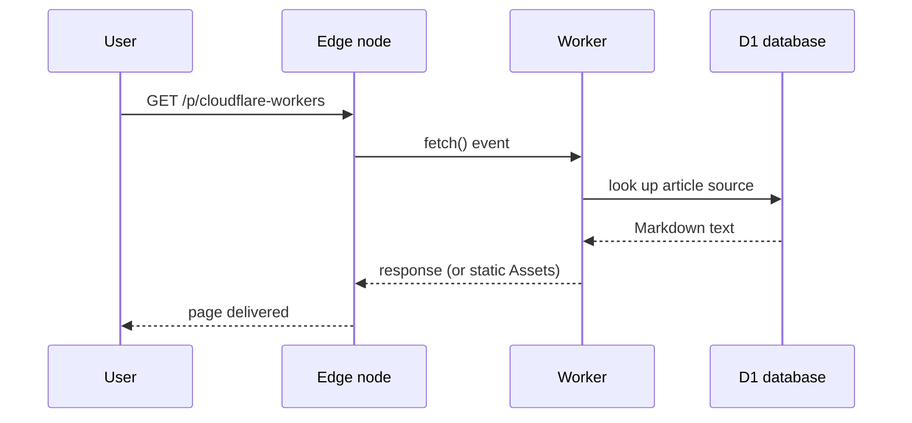

> Filed under: [Engineering & Technology](#/p/cat-gong) › [Information technology](#/p/cat-info-tech)

## Overview

**Cloudflare Workers** is Cloudflare's serverless compute platform: your code is deployed
to hundreds of data centers worldwide, and every request executes at the edge node closest
to the user, with millisecond cold starts and no servers to manage.

## Life of a request

## Common bindings

| Binding | Description | Usage in Markpedia |
| --- | --- | --- |
| D1 | SQLite database at the edge | Stores article sources and titles |
| KV | Globally replicated key-value store | (not used by this site) |
| Assets | Static file hosting | Home page, styles and frontend code |
| Secrets | Encrypted environment variables | (not used by this site) |

## CPU limits

The free plan caps CPU time at **10 milliseconds per request**. Heavy computation is not a
fit, but an app like Markpedia -- query a database, return text -- fits comfortably.
Leaving math and diagram rendering to the browser is a deliberate design choice.

## Related articles

- [Markpedia](#/p/markpedia)
- [Markdown syntax](#/p/markdown)
