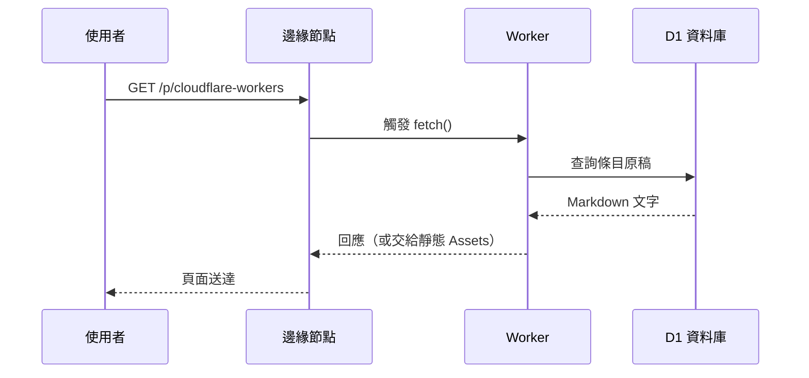

> 分類：[工學門](#/p/cat-gong) › [資訊技術](#/p/cat-info-tech)

## 簡介

**Cloudflare Workers** 是 Cloudflare 的無伺服器（serverless）運算平台：
程式碼部署到全球數百個資料中心，每個請求都在離使用者最近的邊緣節點執行，
冷啟動以毫秒計，不需要自己管理任何伺服器。

## 一個請求的生命週期

## 常用的綁定

| 綁定 | 說明 | Markpedia 的用法 |
| --- | --- | --- |
| D1 | 邊緣上的 SQLite 資料庫 | 存放條目原稿與標題 |
| KV | 全球複製的鍵值儲存 | （本站未使用） |
| Assets | 靜態檔案託管 | 首頁、樣式與前端程式 |
| Secrets | 加密的環境變數 | （本站未使用） |

## CPU 限制

免費方案每個請求的 CPU 時間上限是 **10 毫秒**，Heavy computation 不適合，但
Markpedia 這種「查資料庫、回字串」的應用綽綽有餘；把數學與圖表渲染留在瀏覽器端
也是有意的設計選擇。

## 相關條目

- [Markpedia](#/p/markpedia)
- [Markdown 記法](#/p/markdown)
