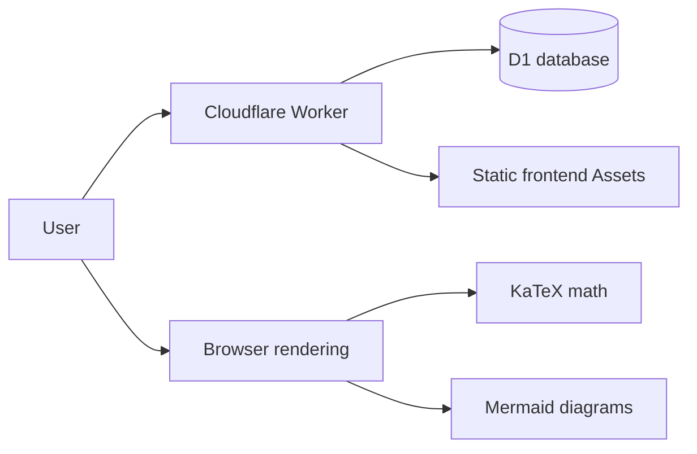

> Site meta article; [category portal](#/p/home) · [article list](#/)

## What this is

**Markpedia** is a wiki-style knowledge base where every article is a plain **Markdown** source,
written in [GitHub Flavored Markdown](#/p/markdown) and rendered with tables, code blocks,
math formulas and mermaid diagrams.

Every article exists in two language versions side by side:
**Traditional Chinese (zh)** and **English (en)**. Use the buttons above the title to switch.

## What you can do

| Action | How |
| --- | --- |
| Read | Click any article; full GFM, math and diagram support |
| Search | The search box in the top bar, e.g. type `cloud` to find [Cloudflare Workers](#/p/cloudflare-workers) |
| Create | The "新增" (create) link in the top bar |
| Update | The "編輯此頁" (edit) link at the top of each article |
| Delete | The red "刪除" (delete) button at the top of each article |

## How it runs

Both the frontend and the backend of Markpedia run on Cloudflare.
Article sources are stored in a D1 database.

## Writing tips

Inline math `$...$` must be surrounded by **spaces** so both GitHub and Markpedia render it
correctly. Both statements below follow the rule: Coulomb's law reads $F = k \dfrac{q_1 q_2}{r^2}$
while Newton's second law reads $F = ma$.

## Related articles

- [Markdown syntax](#/p/markdown)
- [Mermaid diagrams](#/p/mermaid)
- [Mass-energy equivalence](#/p/mass-energy-equivalence)
- [Cloudflare Workers](#/p/cloudflare-workers)
