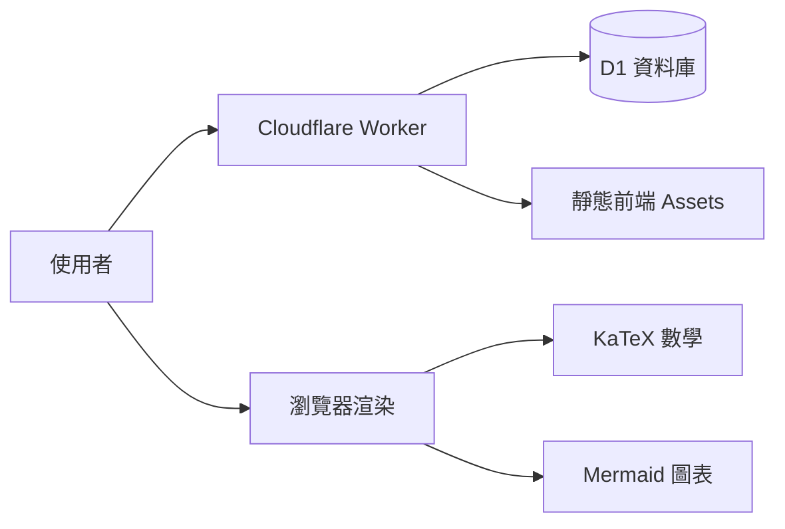

> 這裡是站務說明條目；[分類入口](#/p/home) · [所有條目](#/)

## 這是什麼站

**Markpedia** 是一個「維基百科式」的知識庫，但每篇條目都是一份 **Markdown** 原稿：
用 [GitHub Flavored Markdown](#/p/markdown) 語法撰寫，支援表格、程式碼、數學公式與 mermaid 圖表。

每個條目同時擁有 **繁體中文版** 與 **英文版** 兩種語言版本，可從條目上方的按鈕互相切換。

## 能做什麼

| 功能 | 方式 |
| --- | --- |
| 閱讀條目 | 直接點選條目即可，完整支援 GFM、數學、圖表 |
| 查詢條目 | 右上角搜尋框，例如輸入 `cloud` 可以找到 [Cloudflare Workers](#/p/cloudflare-workers) |
| 新增條目 | 右上角的「新增」連結 |
| 修改條目 | 每篇條目頁上方的「編輯此頁」連結 |
| 刪除條目 | 每篇條目頁上方的紅色「刪除」按鈕 |

## 技術架構

Markpedia 的前端與後端都跑在 Cloudflare 上，條目原稿存在 D1 資料庫裡。

## 寫條目的注意事項

行內數學 `$...$` 的**前後記得留一個空白**，GitHub 與本站才會正確顯示。
例如下面這句就符合慣例：庫侖定律寫作 $F = k \dfrac{q_1 q_2}{r^2}$ 與 牛頓力學 $F = ma$ 皆是好示例。

## 相關條目

- [Markdown 記法](#/p/markdown)
- [Mermaid 圖表](#/p/mermaid)
- [質能等價](#/p/mass-energy-equivalence)
- [Cloudflare Workers](#/p/cloudflare-workers)
