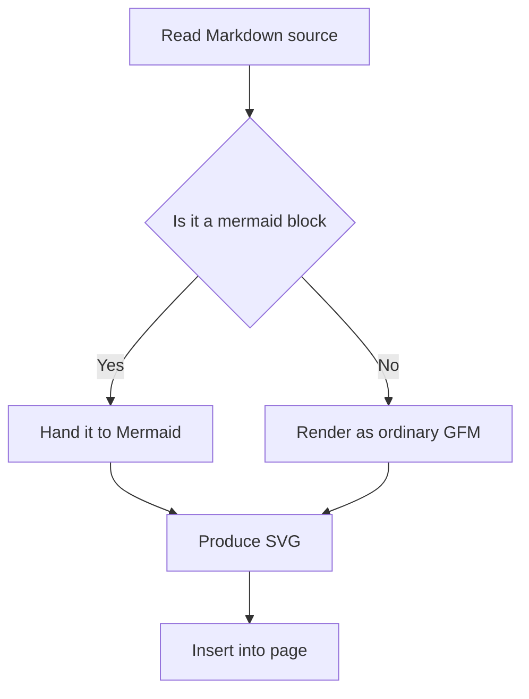
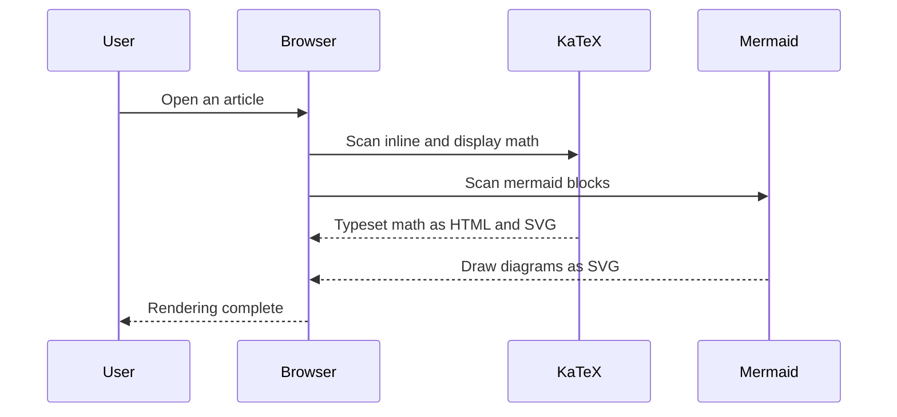
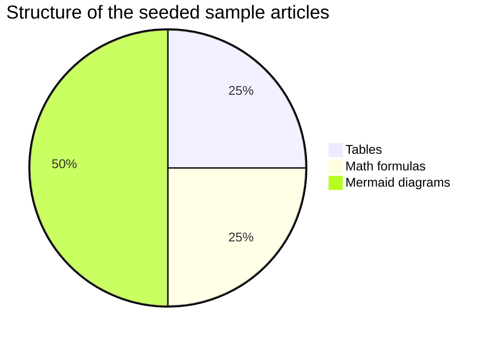

> Filed under: [Engineering & Technology](#/p/cat-gong) › [Information technology](#/p/cat-info-tech)

## What Mermaid is

**Mermaid** lets you describe flowcharts, sequence diagrams and Gantt charts as plain text,
right inside a ```` ```mermaid ```` code fence in Markdown; the frontend renders them as SVG.
Because the source is plain text it is friendly to version control, which is why articles on
Markpedia can embed diagrams directly.

## Flowchart



## Sequence diagram



## Pie chart



## Notes

- A block starts with the triple-backtick ```` ```mermaid ```` fence; syntax errors fail the whole block.
- For safety this site renders mermaid in strict mode, so embedded HTML is escaped.

## Related articles

- [Markdown syntax](#/p/markdown)
- [Cloudflare Workers](#/p/cloudflare-workers)
