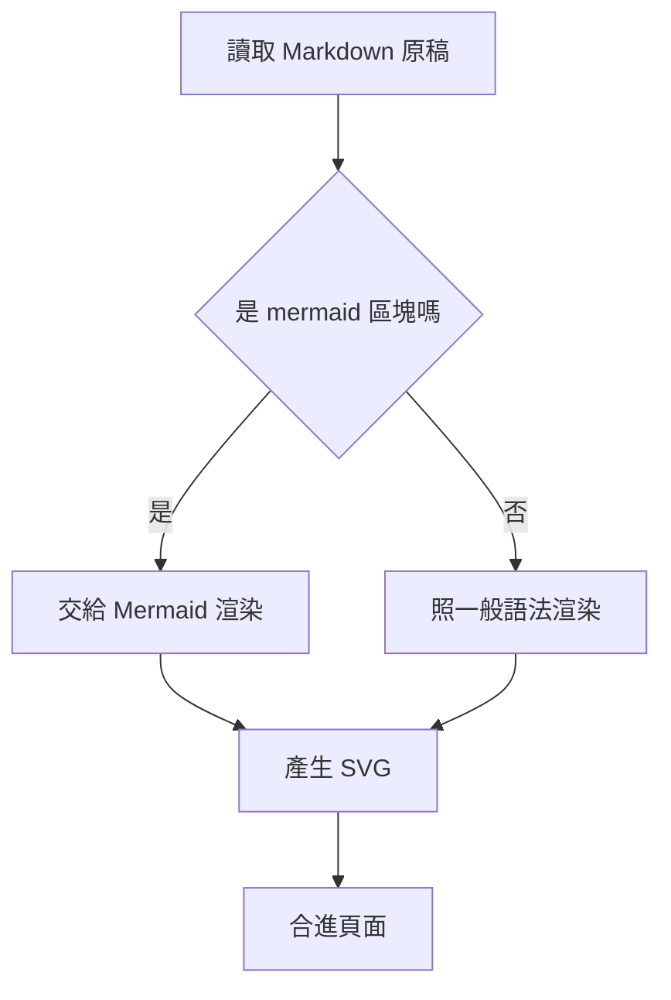
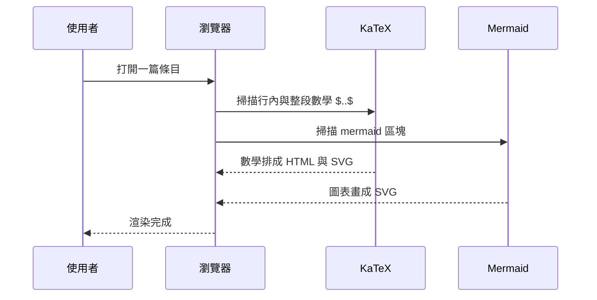
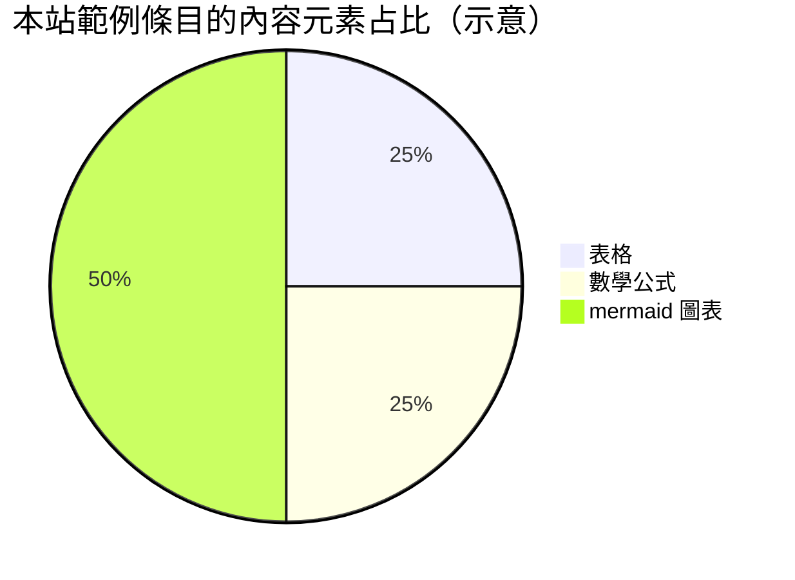

> 分類：[工學門](#/p/cat-gong) › [資訊技術](#/p/cat-info-tech)

## Mermaid 是什麼

**Mermaid** 讓你用純文字描述流程圖、時序圖、甘特圖……直接寫在 Markdown 的
```` ```mermaid ```` 程式碼區塊裡，由前端渲染成 SVG。原始碼就是文字，
適合放進版本控制，Markpedia 的條目因此能直接內嵌圖表。

## 流程圖



## 時序圖



## 圓餅圖



## 寫法備忘

- 區塊以 ```` ```mermaid ```` 三個反引號開頭，語法錯誤會整塊渲染失敗。
- 安全考量：本站以 strict 模式渲染，mermaid 內的 HTML 會被跳脫。

## 相關條目

- [Markdown 記法](#/p/markdown)
- [Cloudflare Workers](#/p/cloudflare-workers)
