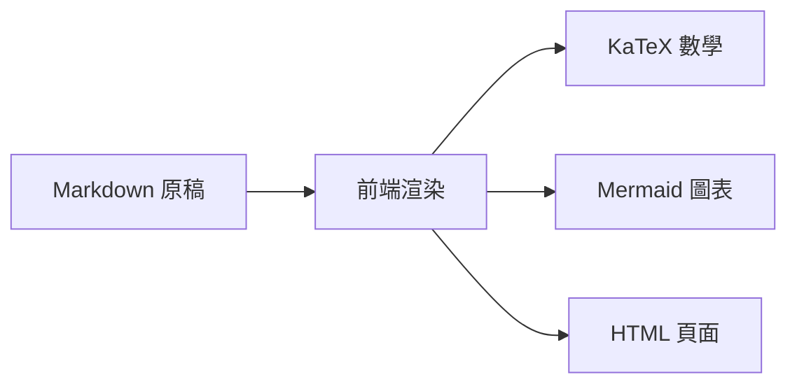
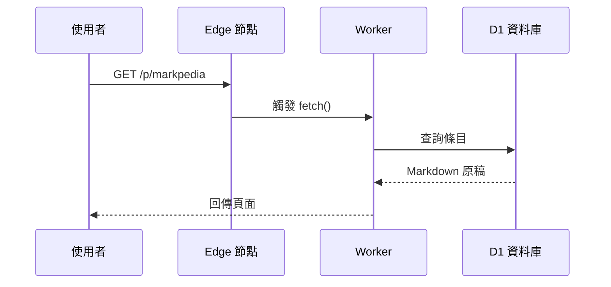
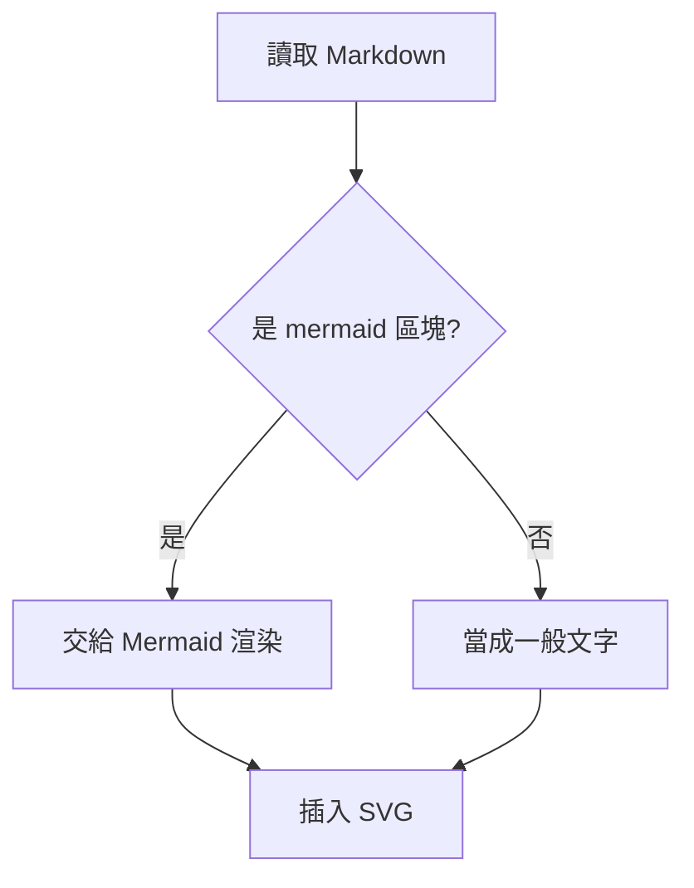
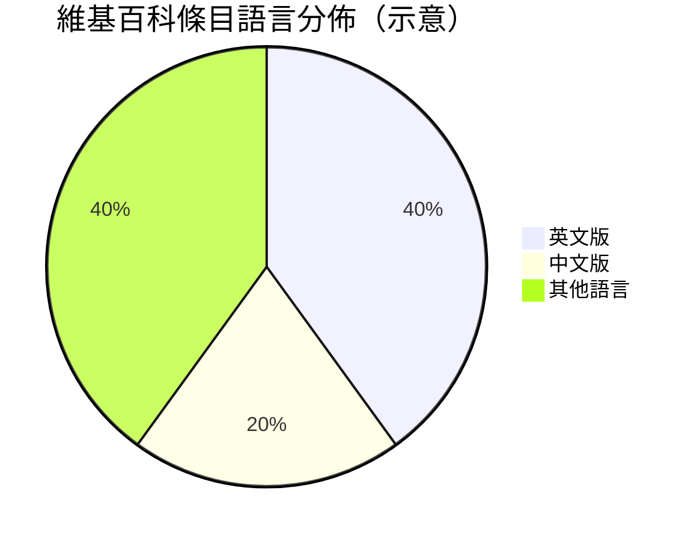
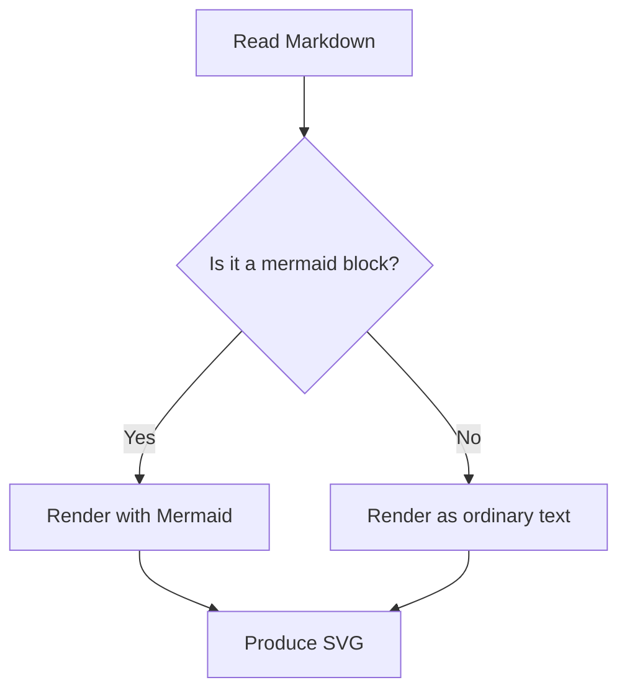
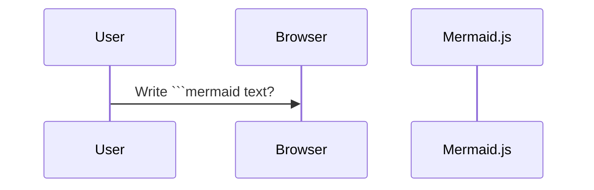
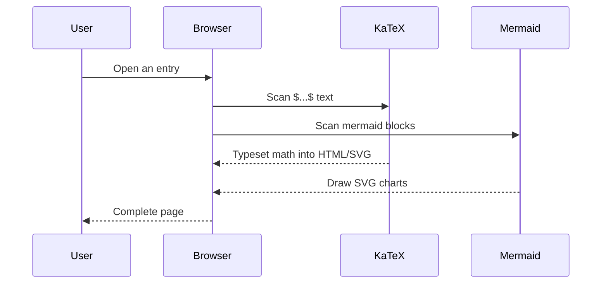
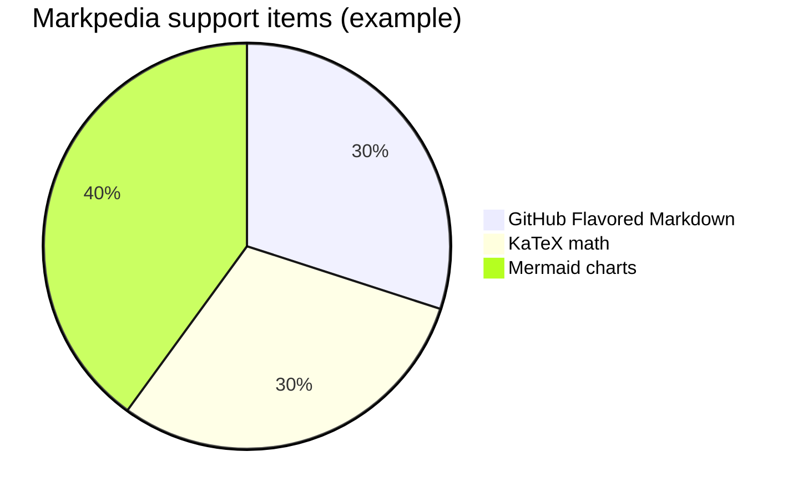

# Markdown 維基系統：雙語條目 CRUD

**Session ID:** ses_e565c2ee1ffensyDi74dLoCbvY
**Created:** 11/5/2026, 10:57:27 AM
**Updated:** 11/5/2026, 11:37:44 AM

---

## User

請在 /Users/ccc/Desktop/ccc/cloudflare/test-apps/markpedia/ 下，寫一個類似維基百科的系統，但是用 markdown 寫，要先放一些條目進去，有『繁體中文版＋英文版』，可新增，修改，刪除，查詢。

markdown 要支援 github flaveord markdown，包含 tex, mermaid, table

記得測試條目的 $...$ 前後都要留空白，github 才能正確呈現。


---

## Assistant (Build · GLM-5.3-Flash Free · 2.8s)

_Thinking:_

The user wants me to create a Wikipedia-like system using markdown, in /Users/ccc/Desktop/ccc/cloudflare/test-apps/markpedia/. It's a Cloudflare Worker app presumably (based on the repo structure). Let me look at existing apps to understand conventions

---

## User

要放上 cloudflare 的

---

## Assistant (Build · GLM-5.3-Flash Free · 12.2s)

_Thinking:_

The user wants a wiki system in /Users/ccc/Desktop/ccc/cloudflare/test-apps/markpedia/, deployed on Cloudflare. Requirements:

- Markdown-based wiki (like Wikipedia)
- Pre-populated with some entries
- Traditional Chinese + English versions
- CRUD: create, read (query/view/search), update, delete
- Support GitHub Flavored Markdown including TeX (KaTeX), Mermaid, tables
- Test entries must have spaces around $...$ for GitHub rendering
- Deploy to Cloudflare (Workers, presumably — following repo conventions)

Let me look at existing apps to understand conventions first. Let me check myshop and friendbook since they use D1, which would be appropriate for a wiki. Actually, for a wiki on Cloudflare Workers, D1 (SQL) or KV storage would work. Let me look at the existing app structure.

Let me plan:

1. Look at existing app (friendbook/myshop) structure for conventions
2. Create markpedia app: wrangler.toml (D1 database), src/worker.js, public/index.html+app.js+markdown libs
3. Pre-populate entries (bilingual: zh + en) with markdown content, including tables, math ($...$ with spaces), mermaid
4. Features: list, search, view, edit, delete — admin/auth? The user didn't ask for auth. myshop/friendbook have auth with AUTH_SECRET. For a wiki, maybe simple — but adding delete/modify without auth is risky. The user didn't mention auth. Keep it simple: open editing (like a personal wiki). Hmm, but repo conventions... The user asked for 新增修改刪除查詢 without auth mention. I'll add a simple auth? That adds complexity. Let me ask? No — better to just build it simple without auth, similar to how they described. Actually to be safe on the public internet, maybe add a simple shared-password auth like friendbook's AUTH_SECRET? The user said "要放上 cloudflare 的" — deploy to Cloudflare. I should ask before deploying per AGENTS.md ("不主動 git commit / deploy"). So I'll build, test locally, then ask user whether to deploy.

For markdown rendering with KaTeX and Mermaid, front-end libraries:
- marked or markdown-it with GFM support, plus KaTeX auto-render extension
- Mermaid via CDN

Use CDN: marked, katex (auto-render), mermaid. The monitoring $...$ with spaces — use katex auto-render with delimiters $$...$$ and $...$? Actually to be safe use KaTeX auto-render selecting `\(...\)` `\[...\]` and `$$...$$` and `$...$`. GitHub now supports $...$ math with spaces around. We'll instruct entries to keep spaces.

Storage: D1 database? For simplicity could use KV, but D1 gives nice queries and myshop/friendbook use D1. Wiki entries: id (slug), lang (zh/en), title, body, updated_at. Full-text search: simple LIKE query suffices.

Let me structure:

- wrangler.toml: name markpedia, main src/worker.js, d1 binding DB, assets? Existing apps serve public/ statically. Let me check how friendbook serves assets.

I need to read an existing app to copy conventions. Let me read friendbook worker.js and wrangler.toml.

Let me start exploring.

**Tool: bash**

**Input:**
```json
{
  "command": "ls friendbook myshop && cat friendbook/wrangler.toml 2>/dev/null"
}
```

**Output:**
```
friendbook:
README.md
doc
package-lock.json
package.json
public
schema.sql
src
wrangler.jsonc

myshop:
README.md
package-lock.json
package.json
public
schema.sql
src
wrangler.jsonc

```

**Tool: read**

**Input:**
```json
{
  "filePath": "/Users/ccc/Desktop/ccc/cloudflare/test-apps/friendbook/src/worker.js",
  "limit": 120
}
```

**Output:**
```
<path>/Users/ccc/Desktop/ccc/cloudflare/test-apps/friendbook/src/worker.js</path>
<type>file</type>
<content>
1: // friendbook 的 Cloudflare Worker：
2: //   小紅書形式的內容（短筆記、按讚、留言、追蹤、熱門）＋ Threads 的美術風格。
3: //   /api/*  帳號、貼文、留言、讚、追蹤（D1）
4: //   KV     讚數快取（like:*）、瀏覽數（views:*）、熱門排行（hot:*），避免每頁都 COUNT
5: //   其他    靜態檔案（public/，由 Assets 提供）
6: 
7: const COOKIE = 'session';
8: const SESSION_DAYS = 30;
9: const enc = new TextEncoder();
10: const PAGE_SIZE = 20;
11: 
12: const json = (obj, status = 200, headers = {}) => new Response(JSON.stringify(obj), {
13:   status,
14:   headers: { 'Content-Type': 'application/json; charset=utf-8', ...headers },
15: });
16: 
17: const hex = (buf) => [...new Uint8Array(buf)].map((b) => b.toString(16).padStart(2, '0')).join('');
18: const unhex = (h) => new Uint8Array(h.match(/../g).map((b) => parseInt(b, 16)));
19: const randomHex = (bytes) => hex(crypto.getRandomValues(new Uint8Array(bytes)));
20: 
21: async function hmacHex(data, secret) {
22:   const key = await crypto.subtle.importKey('raw', enc.encode(secret), { name: 'HMAC', hash: 'SHA-256' }, false, ['sign']);
23:   return hex(await crypto.subtle.sign('HMAC', key, enc.encode(data)));
24: }
25: 
26: async function hashPassword(password, saltHex) {
27:   const key = await crypto.subtle.importKey('raw', enc.encode(password), 'PBKDF2', false, ['deriveBits']);
28:   return hex(await crypto.subtle.deriveBits(
29:     { name: 'PBKDF2', salt: unhex(saltHex), iterations: 100_000, hash: 'SHA-256' }, key, 256));
30: }
31: 
32: // ---------- session cookie：userId.expiry.hmac，不查資料庫 ----------
33: 
34: function getCookie(request, name) {
35:   const m = (request.headers.get('Cookie') || '').match(new RegExp('(?:^|;\\s*)' + name + '=([^;]*)'));
36:   return m && decodeURIComponent(m[1]);
37: }
38: 
39: async function sessionCookie(userId, env) {
40:   const exp = Date.now() + SESSION_DAYS * 86400_000;
41:   const payload = `${userId}.${exp}`;
42:   const token = `${payload}.${await hmacHex(payload, env.AUTH_SECRET)}`;
43:   return `${COOKIE}=${token}; Path=/; HttpOnly; Secure; SameSite=Lax; Max-Age=${SESSION_DAYS * 86400}`;
44: }
45: 
46: async function currentUserId(request, env) {
47:   const token = getCookie(request, COOKIE);
48:   if (!token) return null;
49:   const [id, exp, sig] = token.split('.');
50:   if (!id || !exp || !sig || Number(exp) < Date.now()) return null;
51:   if ((await hmacHex(`${id}.${exp}`, env.AUTH_SECRET)) !== sig) return null;
52:   return Number(id);
53: }
54: 
55: // ---------- 共用 ----------
56: 
57: class HttpError extends Error {
58:   constructor(status, message) { super(message); this.status = status; }
59: }
60: 
61: async function readJson(request) {
62:   try { return await request.json(); } catch (e) { throw new HttpError(400, '格式不對'); }
63: }
64: 
65: async function handle(fn) {
66:   try { return await fn(); } catch (e) {
67:     if (e instanceof HttpError) return json({ error: e.message }, e.status);
68:     return json({ error: `伺服器錯誤：${e.message}` }, 500);
69:   }
70: }
71: 
72: // KV 上的讚數快取：讀取時用快取值，沒有才 COUNT 一次並寫回
73: async function likeCount(db, kv, postId) {
74:   const cached = await kv.get(`like:${postId}`);
75:   if (cached !== null) return Number(cached);
76:   const row = await db.prepare('SELECT COUNT(*) AS n FROM likes WHERE post_id = ?').bind(postId).first();
77:   const n = row.n;
78:   await kv.put(`like:${postId}`, String(n), { expirationTtl: 86400 * 7 });
79:   return n;
80: }
81: 
82: // 按讚時直接對快取 +1（PROCESSê頻率最高的動作，不必每次去 D1 數）
83: async function bumpLike(kv, postId, delta) {
84:   const key = `like:${postId}`;
85:   const n = Math.max(0, Number(await kv.get(key) || 0) + delta);
86:   await kv.put(key, String(n), { expirationTtl: 86400 * 7 });
87:   return n;
88: }
89: 
90: // 熱門排行：每次按讚都把這篇的分數記進當天的 hot:{day} rank
91: async function bumpHot(kv, postId) {
92:   const day = new Date().toISOString().slice(0, 10).replace(/-/g, '');
93:   const key = `hot:${day}`;
94:   const rank = new Map(Object.entries(await kv.get(key, 'json') || {}).map(([k, v]) => [Number(k), Number(v)]));
95:   rank.set(postId, (rank.get(postId) || 0) + 1);
96:   await kv.put(key, JSON.stringify(Object.fromEntries([...rank.entries()]
97:     .sort((a, b) => b[1] - a[1]).slice(0, 20))), { expirationTtl: 86400 * 2 });
98: }
99: 
100: // ---------- 顯示層：把資料列轉成前端格式 ----------
101: 
102: async function decoratePost(db, kv, post, meId) {
103:   const [likes, commentCount, liked, author] = await Promise.all([
104:     likeCount(db, kv, post.id),
105:     db.prepare('SELECT COUNT(*) AS n FROM comments WHERE post_id = ? AND deleted = 0').bind(post.id).first(),
106:     meId ? db.prepare('SELECT 1 AS x FROM likes WHERE post_id = ? AND user_id = ?').bind(post.id, meId).first() : Promise.resolve(null),
107:     db.prepare('SELECT id, name, bio FROM users WHERE id = ?').bind(post.user_id).first(),
108:   ]);
109:   return {
110:     id: post.id,
111:     text: post.text,
112:     image: post.image || '',
113:     createdAt: post.created_at,
114:     author,
115:     likes,
116:     comments: commentCount.n,
117:     likedByMe: !!liked,
118:     mine: meId === post.user_id,
119:   };
120: }

(Showing lines 1-120 of 449. Use offset=121 to continue.)
</content>
```

---

## Assistant (Build · GLM-5.3-Flash Free · 1.9s)

**Tool: bash**

**Input:**
```json
{
  "command": "cat friendbook/wrangler.jsonc friendbook/package.json friendbook/schema.sql && ls friendbook/public"
}
```

**Output:**
```
// wrangler 設定：https://developers.cloudflare.com/workers/wrangler/configuration/
{
	"$schema": "node_modules/wrangler/config-schema.json",
	"name": "friendbook",
	"main": "src/worker.js",
	"compatibility_date": "2025-11-01",
	// 部署前先建立資料庫並把 id 填進來：
	//   npx wrangler d1 create friendbook-db
	//   npx wrangler d1 execute friendbook-db --remote --file=schema.sql
	"d1_databases": [
		{
			"binding": "DB",
			"database_name": "friendbook-db",
			"database_id": "81aa65a8-6de9-4fca-9485-cb37fd131de2"
		}
	],
// 部署前先建立 namespace 並把 id 填進來（本機 wrangler dev 用 dummy id 也會自動建本地 KV）：
//   npx wrangler kv namespace create CACHE
"kv_namespaces": [
  {
    "binding": "KV",
    "id": "613f4397eb42402da8cc87a89f08ec7b"
  }
],
	"assets": {
		"directory": "./public",
		"binding": "ASSETS",
		"run_worker_first": [
			"/api/*",
			"/img/*"
		]
	},
	"observability": {
		"enabled": true
	}
	// 登入的 cookie 用 HMAC 簽章，部署前要設定密鑰：
	//   npx wrangler secret put AUTH_SECRET
}
{
  "name": "friendbook",
  "private": true,
  "scripts": {
    "dev": "wrangler dev",
    "deploy": "wrangler deploy",
    "db": "wrangler d1 execute friendbook-db --local --file=schema.sql",
    "db-remote": "wrangler d1 execute friendbook-db --remote --file=schema.sql"
  },
  "devDependencies": {
    "wrangler": "^4"
  }
}
-- friendbook 的資料庫結構。線上部署時執行：
--   npx wrangler d1 execute friendbook-db --remote --file=schema.sql
-- 本機開發：
--   npx wrangler d1 execute friendbook-db --local --file=schema.sql

CREATE TABLE IF NOT EXISTS users (
  id INTEGER PRIMARY KEY AUTOINCREMENT,
  email TEXT NOT NULL UNIQUE,
  name TEXT NOT NULL UNIQUE,             -- @handle，顯示與個人頁網址用
  pass_hash TEXT NOT NULL,               -- PBKDF2-SHA256 的十六進位雜湊
  pass_salt TEXT NOT NULL,
  bio TEXT NOT NULL DEFAULT '',
  created_at TEXT NOT NULL DEFAULT (datetime('now'))
);

CREATE TABLE IF NOT EXISTS posts (
  id INTEGER PRIMARY KEY AUTOINCREMENT,
  user_id INTEGER NOT NULL REFERENCES users(id),
  text TEXT NOT NULL,                    -- 短筆記本文（Threads 風格），內含 #標籤
  image TEXT NOT NULL DEFAULT '',        -- R2 圖片網址 /img/{key}，沒圖就是空字串
  deleted INTEGER NOT NULL DEFAULT 0,    -- 軟刪除
  created_at TEXT NOT NULL DEFAULT (datetime('now'))
);
CREATE INDEX IF NOT EXISTS idx_posts_user ON posts(user_id);

CREATE TABLE IF NOT EXISTS likes (
  post_id INTEGER NOT NULL REFERENCES posts(id),
  user_id INTEGER NOT NULL REFERENCES users(id),
  PRIMARY KEY (post_id, user_id)
);

CREATE TABLE IF NOT EXISTS comments (
  id INTEGER PRIMARY KEY AUTOINCREMENT,
  post_id INTEGER NOT NULL REFERENCES posts(id),
  user_id INTEGER NOT NULL REFERENCES users(id),
  text TEXT NOT NULL,
  deleted INTEGER NOT NULL DEFAULT 0,
  created_at TEXT NOT NULL DEFAULT (datetime('now'))
);
CREATE INDEX IF NOT EXISTS idx_comments_post ON comments(post_id);

CREATE TABLE IF NOT EXISTS follows (
  follower_id INTEGER NOT NULL REFERENCES users(id),
  followee_id INTEGER NOT NULL REFERENCES users(id),
  created_at TEXT NOT NULL DEFAULT (datetime('now')),
  PRIMARY KEY (follower_id, followee_id)
);
app.js
index.html
style.css

```

---

## Assistant (Build · GLM-5.3-Flash Free · 327.5s)

_Thinking:_

Now I understand the conventions. Let me plan markpedia:

- wrangler.jsonc: D1 database (markpedia-db), assets from ./public
- src/worker.js: API for entries CRUD + search. No auth (user didn't ask). Simple design.
- schema.sql: entries table — slug, lang, title, body, updated_at. Projection: content = wiki articles with a title per language version.
- seed entries directly into schema.sql as INSERTs? Or a seed.sql. Put sample articles in seed SQL with bilingual versions: one entry concept per slug, with lang rows. Samples: "Markdown", "Cloudflare Workers", "Cat"/"貓"? Include tables, math ($...$ with spaces), mermaid diagrams.

Frontend: 
- index.html: search box, article list, article view with zh/en tab switch, edit/create/delete UI.
- app.js: fetch API, render markdown with marked (GFM), KaTeX auto-render ($ and $$ delimiters), mermaid.

Use CDN libraries to keep it simple (Cloudflare Workers assets are static; CDN is fine over HTTPS):
- marked: https://cdn.jsdelivr.net/npm/marked/marked.min.js
- katex css + js + auto-render: https://cdn.jsdelivr.net/npm/katex@0.16.x/dist/...
- mermaid: https://cdn.jsdelivr.net/npm/mermaid@11/dist/mermaid.min.js

Search: LIKE '%q%' on title/body per lang.

Worker API:
- GET /api/entries?lang=zh&q=... → list {slug, title, updated_at}
- GET /api/entry/:slug?lang=zh → {slug, lang, title, body, updatedAt, versions: {zh: title, en: title}}
- POST /api/entries {slug, lang, title, body} (create; upsert? create)
- PUT /api/entry/:slug {lang, title, body}
- DELETE /api/entry/:slug?lang= or all lang

Slug validation: /^[a-z0-9-]+$/. Title validation. Sanitize markdown output: rendering raw HTML in markdown can be XSS; marked escapes HTML by default? marked has no sanitize deprecated; I can strip HTML tags in render via setOptions? Better: use `marked.parse(text, { gfm: true })` and rely on client-side DOMPurify? Simpler: keep it personal use; but be careful. I'll add DOMPurify CDN too — cheap and safe.

Mermaid rendering: after markdown parse, find `pre code.language-mermaid` and replace with mermaid.run/render.

Math: KaTeX auto-render on the rendered HTML container with delimiters $$/$, each with spaces convention.

Note about "$...$ 前後都要留空白" — that's in the sample entries; GitHub requires space around $ for inline math. I'll write entries accordingly, e.g. "若 $x > 0$ 則...".

Local dev: need D1. `npm run db` creates tables locally with seed. I'll put seed data in schema.sql (INSERT OR IGNORE) so local db gets samples automatically. But re-running schema would... CREATE IF NOT EXISTS + INSERT OR IGNORE — fine.

Actually for the remote, they'd run db-remote.

Delete: soft or full? Simple: DELETE row.

Editing UI routes: hash-based SPA? Use hash routing like #/view/slug?lang=zh, #/edit/slug, #/new. Simple.

Let me also update doc/README.md? AGENTS.md says documents go in doc/ — not needed here. AGENTS.md repo structure mentions apps; maybe add markpedia to AGENTS.md list? It updates the repo conventions. I could add it. Reasonable — add a line.

Deploy: ask user before deploying. Also creating D1/namespace requires wrangler commands. To deploy I need: npm install, wrangler d1 create markpedia-db, fill id, d1 execute remote, deploy, ask first wrangler whoami to check auth. Let me do everything, then ask about deploy.

I need wrangler installed locally. Check if wrangler is globally available.

Version/naming: markpedia. Title "Markpedia — 馬克百科".

Let me create files:

markpedia/
  package.json
  wrangler.jsonc
  schema.sql
  src/worker.js
  public/index.html
  public/app.js
  public/style.css
  README.md

Worker code (plain JS, no bundler, follow style of friends):

```js
const json = ...
class HttpError ...
async function handle(fn) ...

const SLUG_RE = /^[a-z0-9][a-z0-9-]{0,79}$/;

routes:
GET  /api/entries?lang=zh&scope=all
GET  /api/entry/{slug}?lang=zh
POST /api/entries
PUT  /api/entry/{slug}
DELETE /api/entry/{slug} (?lang=zh delete one / no lang delete all)
GET /api/random? maybe wiki-like random page. Fun, cheap: ORDER BY RANDOM() LIMIT 1. Add it, wikipedia-feel. Also /api/all for "所有條目" index page.
```

Search returns both languages or filter by lang. For "查詢" search in current lang plus show other lang result. Keep: query searches title/body LIKE, returns across both languages with lang field; UI shows list grouped.

Schema:

```sql
CREATE TABLE IF NOT EXISTS entries (
  slug TEXT NOT NULL,
  lang TEXT NOT NULL CHECK (lang IN ('zh','en')),
  title TEXT NOT NULL,
  body TEXT NOT NULL,
  updated_at TEXT NOT NULL DEFAULT (datetime('now')),
  PRIMARY KEY (slug, lang)
);
```

Seed entries — bilingual markdown with GFM tables, tex math, mermaid:

1. slug: markpedia / 「關於本站」? Use homepage "首頁"? The default view: list of entries. Maybe slug "welcome"? Let's do entries:
   - "markdown" 繁中版〈Markdown 記法〉+ 英文版 "Markdown Syntax" — includes table, math.
   - "cloudflare-workers" — includes mermaid diagram showing request flow.
   - "cat"? Let's do "euler-formula" or "pythagoras"? Math content helps showcase $\LaTeX$. Maybe entry "質能方程" mass-energy equivalence — good for math. Bilingual: zh "質能等價" / en "Mass–energy equivalence".
   - "mermaid" entry showing mermaid diagrams sample.
   
So 3-4 entries, each zh+en = 7-8 rows. Each includes: heading, paragraph, list, table, math with spaces around $...$, and at least one mermaid across entries.

Writing entries in SQL as INSERT with long markdown strings — quoting single quotes (apostrophes in English text) must be escaped as ''. Keep English text careful or use Python to generate? Just write carefully with escaped ''.

Alternatively store seed as a separate file seed.sql executed after. Simpler: embed in schema.sql with INSERT OR IGNORE.

Frontend design: wiki look — simple, clean. index.html with header (title + search), main content area, sidebar? Keep single-column Wikipedia-ish.

app.js flow:
- state: route from location.hash
- routes:
  - `#/` home: show search results or all entries list
  - `#/p/{slug}?lang=zh`: view article, language tabs (zh/en if exist), edit / history? no history. rerender markdown.
  - `#/edit/{slug}/{lang}` editor with big textarea
  - `#/new` create form (slug, initial lang, title)
- render markdown: 
  ```js
  marked.use({ gfm: true, breaks: false });
  const html = marked.parse(src);
  el.innerHTML = DOMPurify.sanitize(html);
  // katex auto-render
  renderMathInElement(el, {delimiters: [{left:'$$',right:'$$',display:true},{left:'$',right:'$',display:false}], throwOnError:false});
  // mermaid
  const blocks = el.querySelectorAll('pre code.language-mermaid'); → create div.mermaid with textContent; mermaid.render
  ```
  Order: mermaid blocks extraction first (before katex, since mermaid content might contain $).

Mermaid init: `mermaid.initialize({ startOnLoad: false, theme: 'neutral' })` then use mermaid.run({nodes}) after inserting.

CDN versions: 
- marked 12
- purify 3
- katex 0.16 (css, katex.min.js, auto-render.min.js)
- mermaid 11

Delete confirmation: confirm() dialog.

Edit textarea with live preview? Keep simple: textarea + save/cancel; maybe a "預覽" toggle. Simple moderate: render preview below when clicked.

Also add "首頁" listing all entries with lang badges.

Let me now write the files. Also package.json similar to friendbook (wrangler ^4).

Check wrangler availability: node? Let me just create files and run npm install in markpedia.

Worker code:

```js
// markpedia 的 Cloudflare Worker：
//   /api/*  條目 CRUD 與搜尋（D1，繁中＋英文兩種語言版本）
//   其他    靜態檔案（public/，由 Assets 提供）

const json = (obj, status = 200, headers = {}) => new Response(JSON.stringify(obj), {
  status,
  headers: { 'Content-Type': 'application/json; charset=utf-8', ...headers },
});

class HttpError extends Error {
  constructor(status, message) { super(message); this.status = status; }
}

async function readJson(request) { ... }

async function handle(fn) { ... }

const SLUG_RE = /^[a-z0-9][a-z0-9-]{0,79}$/;
const LANGS = ['zh', 'en'];

async function getEntry(db, slug, lang) {
  return db.prepare('SELECT slug, lang, title, body, updated_at FROM entries WHERE slug = ? AND lang = ?').bind(slug, lang).first();
}

async function listLangs(db, slug) {
  const rows = await db.prepare('SELECT lang, title FROM entries WHERE slug = ?').bind(slug).all();
  return Object.fromEntries(rows.results.map(r => [r.lang, r.title]));
}

export default {
  async fetch(request, env, ctx) {
    return handle(async () => {
      const url = new URL(request.url);
      const { pathname } = url;
      const db = env.DB;
      if (pathname.startsWith('/api/')) { ... }
      return env.ASSETS.fetch(request);
    })();
  }
}
```

API design details:

- GET /api/entries?lang=&q= → list rows {slug, lang, title, updated_at} filtered; if q, LIKE on title OR body. limit 100.
- GET /api/entry/SLUG?lang=zh → {slug, lang, title, body, updatedAt, langs:{zh:title,en:title}}; 404 if missing.
- POST /api/entries {slug, lang, title, body} → conflict=409 if exists (that slug+lang). But what if slug exists in other lang? Allow (add other-language version) — good.
- PUT /api/entry/SLUG {lang, title, body} → 404 if missing.
- DELETE /api/entry/SLUG?lang=zh → delete one; ?lang=all or none param → delete both. Return {deleted: n}.

Validation: slug regex, lang in LANGS, title non-empty ≤ 200 chars, body ≤ 100_000 chars.

Now the frontend. index.html head links CDNs, style, app. Body:

```html
<header>
  <a href="#/" class="logo">Markpedia</a>
  <form id="searchForm"><input id="searchInput" placeholder="搜尋條目…"><button>🔍? no emoji</button></form>
</header>
<main id="main"></main>
```

No emoji rule — avoid emojis in files. Use text button "搜尋".

app.js SPA. Let me write carefully.

renderArticle: 
```js
async function renderMarkdown(el, src) {
  mermaid blocks: replace \`\`\`mermaid before marked? marked will output <pre><code class="language-mermaid">. Then:
  el.innerHTML = DOMPurify.sanitize(marked.parse(src));
  for (const code of el.querySelectorAll('pre > code.language-mermaid')) {
    const text = code.textContent;
    const holder = document.createElement('div');
    holder.className = 'mermaid';
    holder.textContent = text;
    code.closest('pre').replaceWith(holder);
  }
  if (el.querySelector('.mermaid')) await mermaid.run({nodes: [...]});
  renderMathInElement(el, {...});
}
```
DOMPurify keeps class attributes by default — yes.

Order matters for math: KaTeX auto-render scans text nodes; mermaid blocks were removed from code so their content won't be math-processed. Do mermaid first, then katex — but katex might touch mermaid div content if mermaid not yet run: $...$ inside mermaid code? Unlikely; fine. Actually process katex before replacing mermaid is riskier. Current order fine.

Language switcher on article view: if both versions exist, show tabs "繁體中文 / English". View other version route `#/p/slug?lang=en`. Hash query parsing: `#/p/cloudflare-workers` + `?lang=en`. Parse hash: split on '?', use URLSearchParams.

Home: list all entries, grouped: each row shows title + lang chips + updated date; click opens zh (or available) version. Search: show matching.

New entry form: slug, lang select, title, body textarea; on submit POST; if 409 and same slug+other lang exists, offer to open? Just show error message.

Edit page: title, body textarea, save PUT; delete button (with confirm) — deletes current lang version; if other version remains, note it; option "刪除所有語言版本" checkbox? Simpler: delete button deletes all versions of that slug with confirm message stating that. Hmm but maybe user wants delete one lang. I'll do two: "刪除此語言版本" and if other version exists "刪除全部版本". Keep simple: one delete button = delete whole entry (all languages) with clear confirm text. That matches 新增/刪除 of an entry concept. Plus editing per-language. Good.

Preview in edit page: button "預覽" toggles rendering.

style.css: simple wiki style, serif? Wikipedia-ish: sans-serif, blue links, border header. Also styles for .mermaid centering, tables, katex.

Now write seed content. Language: 繁中 for zh entries, English for en. Math with spaces: "…… $a^2 + b^2 = c^2$ 因此……"

Entry 1: slug `markdown`, zh title `Markdown 記法`, en title `Markdown Syntax`.
Entry 2: slug `cloudflare-workers`, zh `Cloudflare Workers`, en same.
Entry 3: slug `mass-energy-equivalence`, zh `質能等價`, en `Mass–energy equivalence`.
Entry 4: slug `mermaid`, zh `Mermaid 圖表`, en `Mermaid Diagrams`.

4 slugs = 8 rows. Each bilingual.

Now, writing these INSERT statements in schema.sql — long body strings with quotes. Apostrophes in English ('s) need doubling. To reduce pain, avoid apostrophes in text, or escape carefully. I'll escape.

Alternatively: worker could seed on first run (if table empty, insert from embedded constant). That's neat: seed data lives in JS (template literals), no SQL quoting pain. I'll do that: `SEED` array in worker.js; on /api/* request (or a ensureSeed helper) check count, insert if empty. This also makes remote DB seeding automatic after schema execution. Nice.

Docs: README.md with 慣例 (繁中), deployment steps.

Also add to AGENTS.md list? AGENTS.md is instructions-from-file; editing it adds info. I'll add a bulleted line for markpedia. That seems in the spirit (repo structure list mentions "目前有兩個應用" then four apps listed... actually it lists 4 apps). I'll add markpedia line.

Let me create everything now.

Worker.js full code:

```js
// markpedia 的 Cloudflare Worker：
//   /api/*  百科條目的新增、修改、刪除、查詢（D1，每條目有繁體中文版與英文版）
//   其他    靜態頁面（public/，由 Assets 提供）
//   資料表是空的時候會自動灌入範例條目（見 SEED）

const SLUG_RE = /^[a-z0-9][a-z0-9-]{0,79}$/;
const LANGS = ['zh', 'en'];

const json = (obj, status = 200, headers = {}) => new Response(JSON.stringify(obj), {
  status,
  headers: { 'Content-Type': 'application/json; charset=utf-8', ...headers },
});

class HttpError extends Error {
  constructor(status, message) { super(message); this.status = status; }
}

async function readJson(request) {
  try { return await request.json(); } catch (e) { throw new HttpError(400, '格式不對'); }
}

async function handle(fn) {
  try { return await fn(); } catch (e) {
    if (e instanceof HttpError) return json({ error: e.message }, e.status);
    return json({ error: `伺服器錯誤：${e.message}` }, 500);
  }
}

// 首次使用時把範例條目灌進去（表格為空才執行）
async function ensureSeed(db) {
  const row = await db.prepare('SELECT COUNT(*) AS n FROM entries').first();
  if (row.n > 0) return;
  for (const { slug, lang, title, body } of SEED) {
    await db.prepare('INSERT INTO entries (slug, lang, title, body) VALUES (?, ?, ?, ?)')
      .bind(slug, lang, title, body).run();
  }
}
```

SEED content as JS template literals (backtick strings). Markdown contains backticks for code fences! Careful: use template literal with escaped \` or build with array join? Markdown code fences use ``` — inside a backtick string, backticks must be escaped \`. Tedious but fine, or avoid code fences except mermaid ones, which need ```mermaid. I'll escape backticks: \`mermaid. Alternatively write fences using String.raw with placeholder? Simplest: escape.

Actually alternative: keep seed in schema.sql INSERT and carefully escape single quotes (only apostrophes). Markdown backticks fine in SQL. Which is less error-prone? SQL quoting: every ' becomes ''. My English text will have few apostrophes. But template literals in JS: every ` and ${ need escaping — code fences appear in multiple entries. Hmm, math $...$ inside JS template literal: `${` would be interpolation — `$ a` fine since `$` followed by space or letters is fine; only `${` is special. Math like `$\pi$` fine. But `$$` fine too. Danger: `${` occurs in `$\{`? LaTeX braces `|\{...\}|`? Unlikely.

SQL approach with INSERT OR IGNORE INTO in seed.sql run via `npm run seed`. But then deploying remote requires running schema + seed; with ensureSeed in JS, remote seeding is automatic. I'll go with JS SEED and escape backticks. count only code fences in mermaid entries; markdown entry wants code fence examples too. Escape with \` — few instances, careful writing.

Let me draft seed bodies.

--- Entry: markdown (zh: Markdown 記法)

````md
## 概要

**Markdown** 是一種輕量級標記語言，用簡單的符號描述文件結構，寫作時不必碰 HTML。Markpedia 的每一篇條目都是用 GitHub Flavored Markdown（GFM）寫的。

## 常用語法

| 語法 | 效果 |
| --- | --- |
| `**粗體**` | **粗體** |
| `*斜體*` | *斜體* |
| `` `行內程式碼` `` | `行內程式碼` |
| `> 引用` | 引用文字 |
| `1. 清單` | 編號清單 |

## 表格與程式碼

GFM 的表格用直線與減號畫出欄位，程式碼區塊用三個反引號包起來：

```javascript
function hello(name = 'world') {
  return `Hello, ${name}!`;
}
```

## 數學公式

行內數學用 `$...$` 前後留空白，例如：質能方程 $E = mc^2$ 其中 $c$ 是光速。整段公式用 `$$...$$`：

$$
\int_{-\infty}^{\infty} e^{-x^2} \, dx = \sqrt{\pi}
$$

## 相关条目? 

- [Cloudflare Workers](#/p/cloudflare-workers)：本站的執行環境
- [Mermaid 圖表](#/p/mermaid)：在 Markdown 裡畫流程圖
```
Careful: `${name}` inside code block — in JS template literal that WOULD interpolate! So escape as `\${name}`. And backticks everywhere escape. This is getting error-heavy.

Alternative cleanly solve quoting: define SEED bodies with normal single-right-quoted SQL strings... In SQL, `${}` and backticks are fine; only `'` needs doubling. And in JavaScript code inside markdown content, 'Hello' single quotes conflict with SQL quoting — need doubling there too.

Better idea: avoid embedded JS string quoting pain by putting seed markdown in separate files at build? No bundler. Could fetch(/seed/xx.md)? Static assets in public/seed/*.md — worker reads via ASSETS binding! That solves all quoting: seed bodies are plain .md files in public/seed/{slug}.{lang}.md, worker fetches from ASSETS at first request and inserts into D1. But then seed files are also exposed as static URLs ( GET /seed/xxx.md) — harmless.

Hmm, but makes deployment slightly more complex (files must exist). It's within same repo; fine.

Or simplest and most robust: template literals, escape backticks and ${. There will be maybe 10 special spots across 8 seed docs. I'll take care. Actually fewer: keep code-fence examples limited: markdown entry has one javascript fence (with ${name} and backticks — 2 escapes... `return \`Hello, \${name}!\`` plus the fence itself = 3 escapes inside one line). mermaid entries have mermaid fences (2 backticks each line of fence): ```mermaid → \`\`\`mermaid and closing \`\`\`. cloudflare-workers entry maybe no fence needed. mass-energy: no fences. Overall manageable ~10 escapes. I'll go JS template literals with escapes, careful verification with node --check and a smoke test of rendered content via curl.

decide JS seed.

Also front-end editor content: when user edits, textarea holds raw markdown; fetch PUT JSON — no quoting issues.

Now write everything. Also style.

Worker routes implement via pattern matching on pathname with split('/api') etc.

Let me write worker.js in full:

```js
export default {
  async fetch(request, env) {
    return handle(async () => {
      await ensureSeed(env.DB);
      const url = new URL(request.url);
      const path = url.pathname;
      if (!path.startsWith('/api/')) {
        return env.ASSETS.fetch(request);
      }
      const parts = path.split('/').filter(Boolean); // ['api', ...]
      if (parts[0] !== 'api') return env.ASSETS.fetch(request);

      if (request.method === 'GET' && path === '/api/entries') return listEntries(request, env.DB, url);
      if (request.method === 'POST' && path === '/api/entries') return createEntry(request, env.DB);

      if (parts[1] === 'entry' && parts.length === 3 && /^[a-z0-9][a-z0-9-]{0,79}$/.test(parts[2])) {
        const slug = parts[2];
        if (request.method === 'GET') return getEntry(env.DB, slug, url);
        if (request.method === 'PUT') return updateEntry(request, env.DB, slug);
        if (request.method === 'DELETE') return deleteEntry(env.DB, slug, url);
      }

      if (request.method === 'GET' && path === '/api/random') return randomEntry(env.DB, url);
      throw new HttpError(404, '找不到這個 API');
    })();
  },
};
```

listEntries: params lang, q. 
```js
async function listEntries(request, db, url) {
  const lang = url.searchParams.get('lang');
  const q = (url.searchParams.get('q') || '').trim();
  const conditions = [];
  const binds = [];
  if (lang && LANGS.includes(lang)) { conditions.push('lang = ?'); binds.push(lang); }
  if (q) { conditions.push('(title LIKE ? OR body LIKE ?)'); binds.push(`%${q}%`, `%${q}%`); }
  const where = conditions.length ? ' WHERE ' + conditions.join(' AND ') : '';
  const { results } = await db.prepare(`SELECT slug, lang, title, updated_at FROM entries${where} ORDER BY slug, lang`).bind(...binds).all();
  // attach companion lang
  return json({ entries: results });
}
```

D1 LIKE is case-sensitive for non-ASCII? For zh meaningful. For english uppercase: use LIKE with UPPER? SQLite LIKE is case-insensitive for ASCII only by default. Fine.

getEntry: lang param default 'zh', fallback other lang if missing. return entry + langs titles map + slug.

updateEntry validates lang/title/body, UPDATE ... WHERE slug,lang; 404 if not exists. Return updated row summary.

createEntry: validate; check exists both slug+lang → 409; insert; return entry data.

deleteEntry: lang param 'all' default... spec: DELETE /api/entry/:slug?lang=all deletes both; ?lang=zh deletes one. Default: all (front-end explicit with confirm). Return {deleted:n}.

randomEntry: `SELECT slug FROM entries WHERE lang='zh' ORDER BY RANDOM() LIMIT 1` fallback any. Return {slug}.

Frontend app.js: sizable. Write it carefully.

index.html:

```html
<!DOCTYPE html>
<html lang="zh-Hant">
<head>
<meta charset="utf-8">
<meta name="viewport" content="width=device-width, initial-scale=1">
<title>Markpedia</title>
<link rel="stylesheet" href="style.css">
<link rel="stylesheet" href="https://cdn.jsdelivr.net/npm/katex@0.16.11/dist/katex.min.css">
<script src="https://cdn.jsdelivr.net/npm/marked@12.0.2/marked.min.js"></script>
<script src="https://cdn.jsdelivr.net/npm/dompurify@3.1.6/dist/purify.min.js"></script>
<script src="https://cdn.jsdelivr.net/npm/katex@0.16.11/dist/katex.min.js"></script>
<script src="https://cdn.jsdelivr.net/npm/katex@0.16.11/dist/contrib/auto-render.min.js"></script>
<script src="https://cdn.jsdelivr.net/npm/mermaid@11.4.1/dist/mermaid.min.js?v=1"></script>
defer? marked etc need loading before app.js runs; app.js at end body; scripts in head without defer load in order. OK.
</head>
<body>
<header>
  <a href="#/" id="logo">Markpedia</a>
  <form id="search-form">
    <input id="search-input" type="search" placeholder="搜尋 Markpedia" autocomplete="off">
  </form>
  <a href="#/new" id="new-link">新增</a>
</header>
<nav id="tabs" hidden></nav>
<main id="app">載入中…</main>
<footer>
  <a href="#/p/markpedia">關於本站</a> · <a href="#/all">所有條目</a> · <a id="random-link" href="#/">隨機條目</a>
</footer>
<script src="app.js"></script>
</body>
</html>
```

Add an "markpedia"/about entry in seed? Add slug `markpedia` zh "Markpedia 關於本站"? That could double as homepage demonstration. Yes, add as 5th entry: zh "關於 Markpedia", en "About Markpedia". Good showcase.

Random link: on click, fetch /api/random then navigate. Handle via JS listener.

Now app.js structure:

```js
const app = document.getElementById('app');
const tabsNav = document.getElementById('tabs');

function parseHash() {
  const raw = location.hash.slice(1) || '/';
  const [pathPart, queryPart] = raw.split('?');
  const params = new URLSearchParams(queryPart || '');
  const segs = pathPart.split('/').filter(Boolean);
  return { segs, params };
}

const api = async (url, opts) => {
  const res = await fetch(url, opts);
  const data = await res.json().catch(() => ({}));
  if (!res.ok) throw new Error(data.error || `HTTP ${res.status}`);
  return data;
};

async function renderMarkdown(el, src) {
  el.innerHTML = DOMPurify.sanitize(marked.parse(src, { gfm: true }));
  // 表格、程式碼之後，處理 mermaid 與數學
  for (const code of el.querySelectorAll('pre > code.language-mermaid')) {
    const holder = document.createElement('pre');
    holder.className = 'mermaid';
    holder.textContent = code.textContent;
    code.closest('pre').replaceWith(holder);
  }
  const mermaids = el.querySelectorAll('pre.mermaid');
  if (mermaids.length) {
    try { await mermaid.run({ nodes: [...mermaids] }); }
    catch (e) { for (const m of mermaids) { m.className = 'mermaid-error'; m.textContent = 'mermaid 圖表無法渲染：\n' + m.textContent; } } 
```
Hmm mermaid.run replaces <pre class=mermaid> content with svg; on error it deletes element and throws. Use mermaid.render(id, text) instead for control:

```js
  for (const m of mermaids) {
    try {
      const { svg } = await mermaid.render('m-' + Math.random().toString(36).slice(2), m.textContent);
      const div = document.createElement('div'); div.innerHTML = svg; m.replaceWith(div);
    } catch (e) { m.classList.add('mermaid-error'); }
  }
```
mermaid.render throws and appends error element to body sometimes; ok with try/catch + cleanup? Keep simple.

  renderMathInElement(el, {
    delimiters: [
      { left: '$$', right: '$$', display: true },
      { left: '$', right: '$', display: false },
    ],
    throwOnError: false,
  });
```

Routes in `route()`:

```js
async function route() {
  const { segs, params } = parseHash();
  try {
    if (segs.length === 0) return pageHome(params.get('q'));
    if (segs[0] === 'all') return pageAll();
    if (segs[0] === 'new') return pageNew();
    if (segs[0] === 'p' && segs[1]) return pageEntry(segs[1], params.get('lang') || 'zh');
    if (segs[0] === 'edit' && segs[1]) return pageEdit(segs[1], params.get('lang') || 'zh');
    notFound();
  } catch (e) { errorPage(e.message); }
}
window.addEventListener('hashchange', route);
route();
```

pageHome(q): if q → search results listing (all langs) else show all entries list + intro? Home = 所有條目 basically. Make home: intro box (short) + 全部條目 list. Search navigation sets hash `#/?q=...`? pathPart '' with q. parseHash for '#/?q=x': raw = '/?q=x' → split ok. segs [] => home with q. Good; search form on submit sets location.hash = '/?q=' + encodeURIComponent(q).

Entry list component: rows with title link, lang chips (zh→'中', en→'EN'), updated date, edit link.

pageEntry(slug, lang):
- fetch `/api/entry/${slug}?lang=${lang}`
- build header: title h1, tabs for languages available (linking #/p/slug?lang=xx), actions: 編輯 (link #/edit), 刪除 (button).
- delete: confirm('確定要刪除「title」的所有語言版本？') → DELETE /api/entry/slug?lang=all → go home.
- body div rendered markdown.
- meta line: 最後更新時間；其他語言連結。

If requested lang missing: fetch returns 404 → client tries fallback? getEntry server falls back: if lang missing but other exists, return other + note? I'll have server return 404 with error, and client on 404 fetches /api/entries? to find. Simpler: server-side: requested lang row missing → try other lang; if found, return it with `fallback: true`. Client shows note. Good UX for lang tab.

Tabs: view shows tabs for langs of that entry: 繁體中文 | English — clicking navigates.

pageNew: form slug (auto from title? keep manual), lang select, title, body, preview toggle, submit → POST. On 409 error means slug+lang exists → suggest edit link.

pageEdit: fetch current (any lang available default zh), fill form, PUT, then navigate to view.

Preview: copy of renderMarkdown into a preview div toggled by checkbox/button.

Validation client: slug regex check message.

Editor textarea monospace.

Now seed content: write with care for template-literal escaping. I'll write SEED in worker.js at bottom as const SEED = [...]. Escape backticks \` and ${ → \${ if inside code samples.

Write 5 slugs ×2 langs = 10 docs. That's a lot of writing but okay — keep each doc moderate (15-40 lines). Contents:

1. markpedia (zh: Markpedia, en: Markpedia)
   zh: 什麼是 Markpedia, 使用 GFM: markdown, 支援數學、表格、mermaid, 中英雙版本. Include a table of features, math formula example, mermaid small diagram.
   en similar in English.

2. markdown (zh: Markdown 記法, en: Markdown syntax)

3. cloudflare-workers (zh/en) with mermaid sequence diagram of request flow.

4. mass-energy-equivalence (zh: 質能等價, en: Mass–energy equivalence) with lots of math.

5. mermaid (zh: Mermaid 圖表, en: Mermaid diagrams) with multiple mermaid samples (flowchart, timeline).

Let me draft each content compactly but decent.

Note the user's instruction: test entries must have spaces around $...$ — comply everywhere: ` $E = mc^2$ `.

Ensure no stray `${` sequences in LaTeX template literals: LaTeX braces `\{\}`? In `\frac{a}{b}` fine. Only `${` problematic. watch for text like `$ {` no.

Also `\`` inside template literal for code fences.

When body contains template with backslash like `\frac` fine; template literal backslash escapes: `\f` is form feed in template literals! Template literals process escape sequences: `\f` = form feed char. Danger! In regular template literals, `\d` is fine (ignored escape? `'\d'` in template literal is 'd'?). JS string '\d' → 'd' (backslash removed!). Actually in JS, '\d' equals 'd'. So LaTeX commands like \delta\delta in template would lose backslash! Need String.raw or double backslashes. This is error-prone for LaTeX content like \frac{...}. 

Safest: use String.raw`...` template tag for seed bodies. String.raw preserves backslashes and doesn't process escapes, but ${interpolation} and backticks still apply. So escape backticks (code fences) and \${. String.raw`\`mermaid` — escaped backtick yields backtick, fine.

Alternatively construct seeds in SQL-ish quoting... I'll go String.raw with careful \` escapes. In code samples containing `${name}`, escape as \${name} (String.raw with \$? `\${` in String.raw produces literal "${"? In String.raw, escape sequences kept raw but \` still terminates? Raw strings: `\$` isn't special... In string raw mode, backslash escapes still "consume" the next char for termination logic but output raw? Actually String.raw processes `${}` interpolation and backticks as delimiters; `\`` inside raw yields backslash+backtick? NO: in template literal (raw or not), `\`` prevents backtick termination and raw gives `\`` literally? Hmm: String.raw`\`` → '\`'? Let me recall: raw mode keeps escape sequence as written, but the escape still prevents the backtick from closing the template. String.raw`\`` returns "\\`" (backslash + backtick). That's wrong for markdown code fence (I'd get backslash before backtick literal...). In markdown, \\\`= escaped backtick; fence line would be `\`\`\`...` broken.

So escaping backticks under String.raw adds unwanted backslashes. Ugh.

Alternative: build code fences via placeholder replaced at runtime: write body with `~~~mermaid` (tilde fences!) — GFM supports tilde fences! Then no backticks in seed at all. And content code examples also use ~~~javascript ... ~~~. Inline code in text uses backticks though — inline code would need backtick... use String.raw with backticks inline requires \`. Inline code is frequent in docs. Alternative: use placeholder like "%BQ%" for backtick and replace at server startup: body.split('%BQ%').join('`'). Hacky but robust and simple. Let me do: define helper `bt = (s) => s.replaceAll('%BQ%', '\`')`, write bodies with %BQ% for each backtick, use String.raw. Dealer's choice — a bit ugly in source but bulletproof.

Or simply: use double backslash escapes in normal template literals for LaTeX (\frac → \\frac). LaTeX content amount is moderate. And backticks escape as \`. And ${name} as \${name}. Normal template literal, careful escaping, verify with node --check and seed test... node --check validates syntax only; escaping correctness verified by curling /api/entry/markdown and eyeballing body.

Honestly the %BQ% trick is the most foolproof regarding backticks; for backslashes use String.raw, for ${ use \${ (in String.raw, `\${` raw yields "\${"? Hmm same issue: String.raw keeps the backslash before $? Test: String.raw`\${x}` → '\\${x}'? I believe raw keeps backslash: raw string of `\${x}` is literally backslash dollar brace. That would show "\${x}" in rendered code sample — wrong.

OK cleanest: %BQ% for backticks (String.raw), ${ avoid entirely — in JS code sample use `${name}`... I could simply write code sample without template literal: return 'Hello, ' + name + '!'; Avoids ${ entirely. And LaTeX arrays braces `${}`? not needed.

Plan: String.raw`...` for all bodies; backticks written as %BQ%; replace at ensureSeed (bt()). Check no ${ sequences anywhere. Inline code with %BQ%: e.g. %BQ%粗體%BQ% etc. Slightly ugly but fine.

Hmm wait — actually simpler: do seed bodies in plain string concatenation with '\n'? Even worse.

Go with String.raw + %BQ%.

Actually, one more idea: store seed bodies in public/seed/*.md files and load via ASSETS binding in ensureSeed. No escaping problems at all — files are raw markdown, editor plaintext. Downside: static files exposed (fine), and worker depends on assets presence (fine, same deployment). And "產生物不重造" conventions fine. This is clean and idiomatic. ensureSeed: for each doc {slug, lang, title}, body = await env.ASSETS.fetch(`https://internal/seed/${slug}.${lang}.md`) then text(). This is elegant. But then seed sources seem like user-editable static pages; acceptable.

However: does `ensureSeed` reading 10 files ×  per cold-ish request hurt? Only once when DB empty; after first request rows exist.

Run Worker First config must include /api/* only; assets served for /seed/* automatically. OK.

Choose: seed markdown as real .md files in public/seed/. Titles and mapping in worker SEED list.

Edge: ASSETS.fetch in wrangler dev works with binding assets (run_worker_first excludes /seed/*, but ASSETS.fetch directly works regardless).

I'll still maybe also keep ' | ' quoting none. Good, write files.

Also README.md (繁中) with dev/deploy steps.

Update AGENTS.md: add line to 應用 list + maybe常用指令 mention? Just add app description line and a bullet in 常用指令? Keep minimal: add to app list. Also test instructions? Add brief smoke test line for markpedia in 驗證方式 section: `curl localhost:8787/api/entries` → JSON；`/api/entry/markpedia?lang=zh` → body 含 markdown. 

Now let me write all files. Start with directory creation and files.

Content of seed files — need decent quality. Let me draft each.

=== public/seed/markpedia.zh.md (title: 關於 Markpedia)

## 什麼是 Markpedia

**Markpedia** 是一個用 Markdown 寫的百科全書，就像維基百科一樣，但每一篇條目都是一份 GitHub Flavored Markdown（GFM）文件。每個條目都有 **繁體中文版** 與 **英文版** 兩種語言版本，可以互相切換。

## 支援的功能

| 功能 | 說明 | 範例 |
| --- | --- | --- |
| Markdown | 標準 GFM 語法 | 見 [Markdown 記法](#/p/markdown) |
| 數學公式 | 行內 `$...$` 與整段 `$$...$$` | 見 [質能等價](#/p/mass-energy-equivalence) |
| 圖表 | mermaid 流程圖、時序圖 | 見 [Mermaid 圖表](#/p/mermaid) |
| 多語言 | 同一個 slug 有 zh 與 en 兩個版本 | 右上角切換 |

## 這個站怎麼運作

static mermaid: 



(mermaid fenced block without backticks since it's a real file)

## 編輯

右上角的 **新增** 可以建立條目，每篇條目都能 **編輯** 與 **刪除**。小提醒：行內數學 `$...$` 的前後記得留空白，GitHub 與本站才會正確顯示，例如 ` $x^2$ ` 不過 inline code with $ won't render as math... just say 例如 `$a + b = c$` 兩側都要有空白。

Hmm the sentence itself: "例如：光速 $c$ 是常數。"

OK.

=== markpedia.en.md (title: Markpedia)

English equivalent.

=== markdown.zh.md (Markdown 記法)

�述 GFM: headings, bold italic, lists, tables, code fences (javascript sample avoiding ${? file-based so raw fine), math with spaces, links.

Include a table | 語法 | 效果 |...

=== markdown.en.md (Markdown syntax)

=== cloudflare-workers.zh.md (Cloudflare Workers)

介紹 + mermaid sequenceDiagram 請求流程 + table of bindings (KV, D1, R2?) + 本站就是用 Workers 架的 note + 數學? maybe none. Keep table + mermaid.

zh:

## 簡介

**Cloudflare Workers** 是 Cloudflare 的無伺服器（serverless）運算平台，程式碼部署到全球 300+ 個資料中心，請求都在離使用者最近的節點處理。

## 請求流程



## 綁定資源

| 綁定 | 用途 | 本站的用法 |
| --- | --- | --- |
| D1 | SQLite 資料庫 | 存放條目原稿 |
| KV | 鍵值儲存 | （本站未用） |
| Assets | 靜態檔案 | 前端頁面與樣式 |
| Secrets | 加密設定 | （本站未用） |

## 相關條目

- [Markpedia](#/p/markpedia)
- [Markdown 記法](#/p/markdown)

en mirror.

=== mass-energy-equivalence.zh.md (質能等價)

## 概述

質能等價是愛因斯坦狹義相對論的結論：質量與能量是同一種物理量的兩種表現，著名的公式：

$$
E = mc^2
$$

其中 $E$ 是能量、$m$ 是質量、$c$ 是真空光速（約 $299792458 \, \text{m/s}$）。

## 推广 
- 靜止能量 $E_0 = m_0 c^2$
- 相對論版本 $E^2 = (pc)^2 + (m_0 c^2)^2$

## 例子

一克物質完全轉換成的能量：

$1 \,\text{g} ... compute: $E = mc^2 \approx 9 \times 10^{13}$ 焦耳。

Include a table comparing 化學反應 vs 核反應 energy ratios. And KaTeX \text fine. Make sure spaces around inline $.
Also 应用: 核能, 恆星核融合, 粒子對撞.

en mirror.

=== mermaid.zh.md (Mermaid 圖表)

Mermaid 是用文字描述圖表的工具，直接寫在 Markdown ~~~mermaid 區塊。

flowchart, timeline, maybe pie or gantt examples 2-3:

## 流程圖



## 時序圖? and pie:



Note: must be mermaid 11 compatible statements. pie qutoes ok.

en mirror.

Total 10 md files + worker + frontend + config.

Then create wrangler.jsonc (no KV needed), schema.sql, package.json, README.

schema.sql:
```sql
-- markpedia 的資料庫結構。...
CREATE TABLE IF NOT EXISTS entries (
  slug TEXT NOT NULL,
  lang TEXT NOT NULL CHECK (lang IN ('zh','en')),
  title TEXT NOT NULL,
  body TEXT NOT NULL,
  created_at TEXT NOT NULL DEFAULT (datetime('now')),
  updated_at TEXT NOT NULL DEFAULT (datetime('now')),
  PRIMARY KEY (slug, lang)
);
CREATE INDEX IF NOT EXISTS idx_entries_title ON entries(title);
```

Worker ensures seeding. Updated_at set to datetime('now') on update.

For remote deploy: `npx wrangler d1 create markpedia-db`, `d1 execute --remote --file schema.sql`, `wrangler deploy`. I'll run those and ask before deploy. Per AGENTS: deployments影响线上，先问用户. wrangler d1 create is just creation, safe. I'll ask before deploy but set everything up. Also npm install needed (wrangler). Let me check if node_modules exist anywhere / wrangler globally.

Front & back code — write now. Also test: npm run db then npx wrangler dev, curl endpoints:
- GET /api/entries → seeds inserted, JSON list with 10 rows
- GET /api/entry/markpedia?lang=zh → JSON with body
- POST create, PUT update, DELETE
- GET / static serving

Let's write files. First create dir + package.json + wrangler.jsonc + schema.sql.

For wrangler dev: `npx wrangler dev` may prompt? Should run headless. Fine.

Also assets binding run_worker_first: ["/api/*"].

compatibility_date: "2025-11-01" like friendbook.

Now writing app.js carefully. Let me write the whole file.

```js
// markpedia 前端：維基式 SPA（hash 路由），用 marked + KaTeX + Mermaid 渲染條目。
const $ = (id) => document.getElementById(id);
const app = $('app');

function routeOf(hash) {...}

async function api(url, opts = {}) {
  const res = await fetch(url, opts);
  let data = {};
  try { data = await res.json(); } catch (e) { /* 401/500 無 body */ }
  if (!res.ok) throw new Error(data.error || `HTTP ${res.status}`);
  return data;
}

const DEFAULT_LANG = 'zh';
const LANG_LABEL = { zh: '繁體中文', en: 'English' };
const SLUG_RE = /^[a-z0-9][a-z0-9-]{0,79}$/;

function h(html) — build element from html string? I'll use template literals + innerHTML for static UI pieces (no user content injection except escaped).

Need escaping helper esc = s => s.replace(/[&<>"']/g, ...).

renderMarkdown(el, src):
  marked.setOptions? marked 12: marked.use({ gfm: true });
  const html = marked.parse(src);
  el.innerHTML = DOMPurify.sanitize(html);
  handle mermaid blocks (code.language-mermaid → div via mermaid.render)
  renderMathInElement...delimiters $$ then $; and also \( \)? GitHub uses $ only; keep $$ and $.
```

Wait DOMPurify strips `<math>`? KaTeX generates spans — fine, as we sanitize before katex runs. Mermaid sanitize: mermaid.render output svg inserted via innerHTML — could contain XSS from mermaid? content is user-provided; mermaid sanitizes itself (securityLevel default 'strict'). OK.

Wire search form:

```js
$('search-form').addEventListener('submit', (e) => {
  e.preventDefault();
  const q = $('search-input').value.trim();
  location.hash = q ? `/?q=${encodeURIComponent(q)}` : '/';
});
```

random link:

```js
$('random-link').addEventListener('click', async (e) => {
  e.preventDefault();
  const { slug } = await api('/api/random');
  location.hash = `/p/${slug}`;
});
```

Route functions:

pageHome(q):
```js
async function pageHome(q) {
  document.title = 'Markpedia';
  navTabs(null);
  if (!q) {
    app.innerHTML = `
      <div class="page">
        <h1>Markpedia</h1>
        <p>用 Markdown 寫的百科全書：支援 <b>GFM</b>、表格、數學公式（KaTeX）與 mermaid 圖表，每篇條目都有繁體中文版與英文版。</p>
        <section id="entry-list"></section>
      </div>`;
    const list = await listEntries('');
    app.querySelector('#entry-list').innerHTML = listHtml(...);
    hmm simpler: build html after fetch:
  }
}
```

Simplify: fetch first, then fill app.innerHTML.

```js
async function pageHome(q) {
  document.title = 'Markpedia';
  const { entries } = await api('/api/entries' + (q ? `?q=${encodeURIComponent(q)}` : ''));
  document.title = q ? `${q} 的搜尋結果 - Markpedia` : 'Markpedia';
  const rows = entries.map(rowHtml).join('\n');
  app.innerHTML = `
    <div class="page">
      ${q ? `<p class="muted">搜尋「${esc(q)}」共 ${entries.length} 篇，<a href="#/">回首頁</a></p>`
          : `<div class="intro"><h1>Markpedia</h1><p>用 <b>Markdown</b> 寫的百科全書……</p></div>`}
      <h2>${q ? '搜尋結果' : '所有條目'}</h2>
      <ul class="entry-list">${rows ? rows : '<li>沒有符合的條目</li>'}</ul>
      <p><a href="#/new" class="btn">＋ 新增條目</a></p>  (＋ is not emoji, fullwidth plus sign... avoid? "新增條目" text button)
    </div>`;
}
```

Use plain text without ＋.

rowHtml: seeded? entries rows are {slug, lang, title, updated_at} — group by slug? For listing "所有條目", group by slug showing both lang links. Implement groupEntryMap:

```js
function groupBySlug(entries) {
  const map = new Map();
  for (const e of entries) {
    if (!map.has(e.slug)) map.set(e.slug, { slug: e.slug, langs: {} });
    map.get(e.slug).langs[e.lang] = e;
  }
  return [...map.values()];
}
```

Row: `<li><a class="title" href="#/p/${s}/${lang}">${title}</a> lang chips: sheng chip for each lang (中/EN) linking other versions + meta updated.</li>`

Default link lang: zh if exists else en.

For search results q: show every lang row separately (flat list) — fine.

Wait, do I need routes check: parseHash segs ['p', slug]: lang from params. Also '/all' route = same as home without intro. Skip /all; home has all entries already. Footer 所有條目 link → '#/'.

pageEntry(slug, lang):

```js
async function pageEntry(slug, lang) {
  let data;
  try {
    data = await api(`/api/entry/${slug}?lang=${lang}`);
  } catch (e) {
    return pageNotFound(slugNotFound? `找不到條目 ${slug}`);
  }
  const { entry, langs } = data; // entry: {slug, lang, title, body, updatedAt}, langs: {zh: title, en: title} (both present ones)
  document.title = `${entry.title} - Markpedia`;
  const langLinks = Object.keys(langs).map(l => `<a href="#/p/${slug}?lang=${l}" class="${l===entry.lang?'active':''}">${LANG_LABEL[l]}</a>`).join('');
  ...(nav-row)
  app.innerHTML = `
    <div class="page">
      <div class="lang-tabs">${langLinks}</div>
      <h1>${esc(entry.title)}</h1>
      <p class="meta">最後更新：${entry.updatedAt} ·
        <a href="#/edit/${entry.slug}?lang=${entry.lang}">編輯</a> · 待確認
        <button id="delete-btn">刪除</button>
      </p>
      <article id="body"></article>
    </div>`;
  await renderMarkdown($('body'), entry.body);
  $('delete-btn').addEventListener('click', async () => {
    if (!confirm(`確定要刪除「${entry.title}」？將刪除所有語言版本。`)) return;
    await api(`/api/entry/${slug}?lang=all`, { method: 'DELETE' });
    location.hash = '/';
  });
}
```

Wait entry object includes slug? Server returns entry with slug field. Fine.

Server getEntry response: {entry: {...}, langs: {...}}. If fallback other lang, langs reflect available; entry.lang actual.

pageNew():

```js
function pageNew() {
  document.title = '新增條目 - Markpedia';
  app.innerHTML = editorForm({ slug: '', lang: 'zh', title: '', body: '', isNew: true });
  wireEditor({ isNew: true });
}
```

editorForm html: 
```
<div class="page">
<h1>新增條目</h1>
<form id="entry-form">
  <label>網址代稱（slug，僅小寫英文、數字與 -）</label>
  <input id="f-slug" ...>
  <label>語言</label>
  <select id="f-lang"><option value="zh">繁體中文</option><option value="en">English</option></select>
  <label>標題</label>
  <input id="f-title">
  <label>內容（Markdown）</label>
  <textarea id="f-body" rows="24"></textarea>
  <p class="muted">提示：行內數學用 $...$，前後空白；mermaid 區塊用 ```mermaid。</p>
  <button type="submit">儲存</button>
  <button type="button" id="preview-btn">預覽</button>
  <a href="#/" class="btn">取消</a>
</form>
<div id="preview"></div>
</div>
```

wireEditor submit:
- validate slug regex
- isNew: POST /api/entries {slug, lang, title, body} → hash /p/slug?lang=lang. On error show msg (div.error).
- edit: PUT /api/entry/slug {lang (from f-lang, allows adding missing lang version? In edit page, keep lang fixed to existing), title, body} → navigate.

For edit page allow language select? Keep fixed.

pageEdit(slug, lang):
```js
async function pageEdit(slug, lang) {
  let data;
  try { data = await api(`/api/entry/${slug}?lang=${lang}`); }
  catch { return notFoundPage(); }
  const { entry, langs } = data;
  form like new with prefilled, isNew false; submit -> PUT `/api/entry/${slug}` {lang: entry.lang, title, body}
  add delete button in edit page too? view page has delete; keep there.
}
```

error handling: show message in form (#form-error).

notFoundPage(msg): simple 404 page with 新增連結? Nice: "找不到此條目" + create button prefilled? URL slug: `#/new` keep simple.

pageNew prefill slug from URL? not necessary.

navTabs unused — remove nav element. I'll simplify index.html.

Also loading of CDN in head works — during wrangler dev offline? User may be offline; libraries fail, math/mermaid not rendered, but markdown still renders if marked loaded... If marked missing whole app breaks. Guard: check window.marked existence with fallback basic? Keep simple; production has internet. Local dev with internet is typical. Fine.

Now the worker. Full code with escaping plain.

Potential issue: `parts[1] === 'entry'` validation — slug regex enforced; else 404.

ensureSeed parallel: sequential.

Also updatedAt naming: return camelCase fields from snake columns.

Implement createEntry/upsert semantics: create POST also used when adding a language version to existing slug — allowed (insert). Return json(data,201).

Write deleteEntry: lang param; 'all' default? Choose: default 'all' when no param provided? Safer default: require explicit lang; but front-end will pass lang=all for full delete. If lang param missing → delete all (document). I'll implement: lang === all || missing → delete all; else single.

Edge: DELETE on missing slug returns {deleted: 0}, not 404 — fine.

Random: `SELECT slug FROM entries WHERE lang = 'zh' ORDER BY RANDOM() LIMIT 1`; if none, remove WHERE. Return {slug}. 404 if table empty.

Now let me also think about title search LIKE escaping % and _ in user q — minor; ignore.

Time to write files. Also make README.

One more consideration: `renderMathInElement` in katex auto-render 0.16 — global function available. Delimiters default include $$ and \(; specify ours.

CSS: simple wiki styling. Write style.css ~150 lines: header sticky, page max-width 860px, entry-list, lang-tabs chips, tables borders via .page table styling (markdown tables), pre/code bg, .mermaid center, kaTeX display centering default fine, blockquote, buttons, form styles, meta color, footer.

Let me create everything now.

For testing: after files exist, cd markpedia; npm install (wrangler). Then npm run db (local D1). Then start wrangler dev in background & curl? bash tool persistent session; run `npm run dev` blocking — use `nohup npm run dev > /tmp/wp.log 2>&1 &` then sleep, curl. Use /var/folders/.../T/opencode for logs.

Then curl:
- localhost:8787/api/entries → expect 10 entries (after seed)
- /api/entry/markpedia?lang=zh
- /api/entry/markpedia?lang=en
- POST create test entry, PUT, GET, DELETE
- / static index.html returns html

Check markdown body seeds contain CJK.

Then remove test entry.

Also `node --check src/worker.js public/app.js`.

Let me write files now.

For worker SEED doc list:

```js
const SEED = [
  ['markpedia', 'zh', 'Markpedia'],
  ['markpedia', 'en', 'Markpedia'],
  ['markdown', 'zh', 'Markdown 記法'],
  ['markdown', 'en', 'Markdown 語法'],
  ['cloudflare-workers', 'zh', 'Cloudflare Workers'],
  ['cloudflare-workers', 'en', 'Cloudflare Workers'],
  ['mass-energy-equivalence', 'zh', '質能等價'],
  ['mass-energy-equivalence', 'en', 'Mass–energy equivalence'],
  ['mermaid', 'zh', 'Mermaid 圖表'],
  ['mermaid', 'en', 'Mermaid 圖表'],
];

async function ensureSeed(db, assets) {
  const row = await db.prepare('SELECT COUNT(*) AS n FROM entries').first();
  if (row.n > 0) return;
  const stmt = db.prepare('INSERT INTO entries (slug, lang, title, body) VALUES (?, ?, ?, ?)');
  for (const [slug, lang, title] of SEED) {
    const res = await assets.fetch(new URL(`/seed/${slug}.${lang}.md`, 'https://assets.local'));
    const body = await res.text();
    await stmt.bind(slug, lang, title, body).run();
  }
}
```

assets.fetch(new URL(...)) — URL form ok? env.ASSETS.fetch accepts Request or URL/path like '/seed/x.md'. I believe `env.ASSETS.fetch('/seed/x.md')` works in recent wrangler (accepts string path? Docs: fetch accepts Request or URL). Safest: new Request(`https://example.com/seed/...`). Use that.

mermaid en title 'Mermaid Diagrams'.

Now write files.

Also AGENTS.md update at end + README.

Let me write file writes in parallel batches.

app.js — full write:

```js
// markpedia 前端 SPA：hash 路由，marked 渲染 GFM、KaTeX 渲染數學、Mermaid 渲染圖表。

const el = document.getElementById('app');

marked.use({ gfm: true, breaks: false });

const esc = (s) => String(s).replace(/[&<>"']/g, (c) => ({
  '&': '&amp;', '<': '&lt;', '>': '&gt;', '"': '&quot;', "'": '&#39;',
}[c]));

const LANG_LABEL = { zh: '繁體中文', en: 'English' };
const SLUG_RE = /^[a-z0-9][a-z0-9-]{0,79}$/;

async function api(url, opts = {}) {
  const res = await fetch(url, opts);
  let data = {};
  try { data = await res.json(); } catch (e) {}
  if (!res.ok) throw new Error(data.error || `HTTP ${res.status}`);
  return data;
}

async function renderMarkdown(box, src) {
  box.innerHTML = DOMPurify.sanitize(marked.parse(src));
  for (const code of box.querySelectorAll('pre > code.language-mermaid')) {
    const pre = document.createElement('pre');
    pre.className = 'mermaid';
    pre.textContent = code.textContent;
    code.replaceWith(pre);
  }
  for (const node of box.querySelectorAll('pre.mermaid')) {
    try {
      const { svg } = await mermaid.render(`m${Math.random().toString(36).slice(2)}`, node.textContent);
      node.innerHTML = svg;
      node.className = 'mermaid-box';
    } catch (e) {
      node.className = 'mermaid-error';
    }
  }
  renderMathInElement(box, {
    delimiters: [
      { left: '$$', right: '$$', display: true },
      { left: '$', right: '$', display: false },
    ],
    throwOnError: false,
  });
}
```

Hmm `node.innerHTML = svg` after mermaid.render triggers mermaid's error element cleanup complexities; acceptable.

`code.replaceWith(pre)` — original code.parent pre. code inside pre: `code.closest('pre')` — replacing code with pre inside a pre gives nested pre; instead replace the outer pre: `code.parentElement.replaceWith(pre)`. Use closest('pre').replaceWith(pre).

Routing + pages... Also delete on edit page as well. For language tabs on view: chips top.

I'll now just write everything.

parseHash:

```js
function parseHash() {
  const raw = location.hash.replace(/^#/, '') || '/';
  const [path, query = ''] = raw.split('?');
  return { segs: path.split('/').filter(Boolean), params: new URLSearchParams(query) };
}
```

route:

```js
async function route() {
  const { segs, params } = parseHash();
  try {
    if (!segs.length) return await pageHome(params.get('q'));
    if (segs[0] === 'new') return pageNew();
    if (segs[0] === 'p' && segs[1]) return await pageEntry(segs[1], params.get('lang') || 'zh');
    if (segs[0] === 'edit' && segs[1]) return await pageEdit(segs[1], params.get('lang') || 'zh');
    pageMissing();
  } catch (e) {
    el.innerHTML = `<div class="page"><p class="error">錯誤：${esc(e.message)}</p></div>`;
  }
}
```

pageEntry content:

```js
async function pageEntry(slug, lang) {
  let data;
  try {
    data = await api(`/api/entry/${encodeURIComponent(slug)}?lang=${lang}`);
  } catch (e) {
    el.innerHTML = missingPage(`找不到條目「${esc(slug)}」的${LANG_LABEL[lang] && lang === 'zh' ? '' : ''}...`)
```

Simplify missing message: 找不到此條目。 + 建立連結 #/new.

```js
  const { entry, langs } = data;
  document.title = `${entry.title} - Markpedia`;
  const tabs = Object.keys(LANG_LABEL)
    .map((l) => langs[l]
      ? `<a class="chip ${l === entry.lang ? 'active' : ''}" href="#/p/${entry.slug}?lang=${l}">${LANG_LABEL[l]}</a>`
      : `<a class="chip ghost">尚無${LANG_LABEL[l]}版</a>`)
```
Hmm hover text for the missing chip; clicking nothing. But nicer: allow adding that language → link to edit with lang=l? Edit form lang fixed... For edit page we could allow selecting other language version creation: In edit page for missing lang, server GET with fallback returns existing; complicated. Keep ghost chip.

Chips ghost: `<span class="chip ghost">${LANG_LABEL[l]}</span>` with title="尚未建立".

meta row: `最後更新 ${entry.updatedAt}` and buttons 編輯 + 刪除.

Edit page form with lang select disabled except options? Allow changing lang? Actually conflict cases: PUT with different lang on existing slug+lang missing → creates? Server PUT only updates existing (404 else). Keep lang fixed within edit.

Editor template shared:

```js
function editorHtml({ heading, isNew, slug, lang, title, body }) {
  return `
  <div class="page">
    <h1>${heading}</h1>
    <form id="entry-form">
      <label>網址代稱 slug（小寫英文、數字、連字號）</label>
      <input id="f-slug" value="${esc(slug)}" ${isNew ? '' : 'disabled'}>
      <label>語言</label>
      <select id="f-lang"${isNew ? '' : ' disabled'}>
        <option value="zh">繁體中文</option>
        <option value="en">English</option>
      </select>
      <label>標題</label>
      <input id="f-title" value="${esc(title)}" required>
      <label>內容（GitHub Flavored Markdown）</label>
      <textarea id="f-body" rows="22">${esc(body)}</textarea>
      <p class="muted">行內數學 $...$ 前後留一個空白；整段公式用 $$...$$；畫圖用 ```mermaid 程式碼區塊。表格用直線分隔。</p>
      <p id="form-error" class="error" hidden></p>
      <button type="submit">${isNew ? '建立' : '儲存'}</button>
      <button type="button" id="preview-btn">預覽</button>
      <a class="btn" href="${isNew ? '#/' : `#/p/${slug}?lang=${lang}`}">取消</a>
    </form>
    <section id="preview" class="page preview" hidden></section>
  </div>`;
}
```

Careful: backtick in the hint inside JS template literal — inside template literal ```` ```mermaid ````would need escaping. In app.js hint I'm inside a template literal already; write  ``` as escaped \`\\\`\\\`? Messy. Simplify hint: 「程式碼區塊與 mermaid 圖用三個反引號包起來。」no literal backticks. Good.

select value setting: setValue('#f-lang', lang) post-insert.

wireEditor({isNew, slug, origLang}):

```js
function wireEditor(state) {
  const form = document.getElementById('entry-form');
  document.getElementById('f-lang').value = state.lang;
  document.getElementById('preview-btn').addEventListener('click', async () => {
    const box = document.getElementById('preview');
    if (box.hidden) {
      box.hidden = false;
      await renderMarkdown(box, document.getElementById('f-body').value);
      document.getElementById('preview-btn').textContent = '收起預覽';
    } else {
      box.hidden = true;
      document.getElementById('preview-btn').textContent = '預覽';
    }
  });
```

preview toggles re-render every click on show. But edits after preview won't update — toggle twice. Keep e-commerce simple: each click show → re-render. Fine.

  submit:

```js
  form.addEventListener('submit', async (ev) => {
    ev.preventDefault();
    const errBox = document.getElementById('form-error');
    errBox.hidden = true;
    const lang = document.getElementById('f-lang').value;
    const title = document.getElementById('f-title').value.trim();
    const body = document.getElementById('f-body').value;
    if (!SLUG_RE.test(slug))  — for new. show error...
    try {
      if (state.isNew) {
        await api('/api/entries', { method: 'POST', headers: { 'Content-Type': 'application/json' }, body: JSON.stringify({ slug, lang, title, body }) });
        location.hash = `/p/${slug}?lang=${lang}`;
      } else {
        await api(`/api/entry/${slug}`, { method: 'PUT', ... { lang: state.lang, title, body } });
        location.hash = `/p/${slug}?lang=${state.lang}`;
      }
    } catch (e) {
      errBox.textContent = e.message;
      errBox.hidden = false;
    }
  });
}
```

location.hash assignment triggers hashchange → route. But if hash same as current (e.g., editing then saving navigates to same hash), no hashchange event → page stale showing editor. E.g. edit page at #/p/slug?lang=zh → after save hash == previous? Edit page is at #/edit/slug, so #/p/... differs. OK. But if edit hash is #/edit/... and new POST lands /p/... always different. fine. But edge: if already viewing #/p/slug and user hits browser back from edit... fine.

Also navigation after save but hash same: for PUT? Edit at #/edit so fine.

Missing page:

```js
function pageMissing(msg) {
  document.title = '找不到頁面 - Markpedia';
  el.innerHTML = `
    <div class="page">
      <h1>找不到頁面</h1>
      <p>${msg}</p>
      <p><a href="#/new">新增此條目</a> 或 <a href="#/">回首頁</a></p>
    </div>`;
}
```

index.html final. style.css final.

Worker final code. Then run tests.

Search box should also work with Enter; done.

CSS details:

```css
:root { --fg:#202122; --muted:#54595d; --link:#3366cc; --border:#a2a9b1; --bg:#f8f9fa; }
* { box-sizing: border-box; }
body { margin:0; font-family: -apple-system,'Noto Sans TC','Helvetica Neue',Arial,sans-serif; color:var(--fg); background:#fff; line-height:1.7; }
header { display:flex; gap:16px; align-items:center; padding:10px 24px; border-bottom:1px solid var(--border); position:sticky; top:0; background:#fff; z-index:5; }
#logo { font-weight:700; font-size:20px; text-decoration:none; color:var(--fg); }
#logo span { color:var(--link); }
#search-form { flex:1; }
#search-input { width:100%; max-width:480px; padding:6px 12px; border:1px solid var(--border); border-radius:4px; font-size:14px; }
.page { max-width:860px; margin:0 auto; padding:24px 16px 60px; }
a { color:var(--link); text-decoration:none; }
a:hover { text-decoration:underline; }
h1,h2 { line-height:1.3; }
.entry-list { list-style:none; padding:0; }
.entry-list li { padding:10px 0; border-bottom:1px solid #eaecf0; }
.entry-list .title { font-size:17px; font-weight:600; }
.entry-list .meta { color:var(--muted); font-size:13px; margin-left:8px; }
.chip { display:inline-block; padding:1px 10px; margin-right:6px; border:1px solid var(--link); border-radius:12px; font-size:13px; }
.chip.active { background:var(--link); color:#fff; }
.chip.ghost { border-color:var(--border); color:var(--muted); }
.lang-tabs { margin-bottom:8px; }
.meta { color:var(--muted); font-size:14px; }
button, .btn { font-size:14px; padding:5px 14px; border:1px solid var(--border); background:var(--bg); border-radius:4px; cursor:pointer; color:var(--fg); text-decoration:none; display:inline-block; }
button:hover, .btn:hover { background:#eef; }
button.danger { color:#b32424; border-color:#b32424; background:#fff; }
.page article table { border-collapse:collapse; margin:16px 0; }
article th, article td { border:1px solid #c8ccd1; padding:6px 12px; }
article th { background:var(--bg); }
article pre { background:var(--bg); padding:12px; border-radius:6px; overflow:auto; }
article code { background:rgba(27,31,35,.06); padding:1px 5px; border-radius:3px; font-size:.92em; }
article pre code { background:none; padding:0; }
article blockquote { border-left:4px solid var(--border); margin:12px 0; padding:2px 16px; color:var(--muted); }
article img { max-width:100%; }
.mermaid-box { text-align:center; margin:16px 0; }
.mermaid-error { color:#b32424; background:#fff3f3; padding:8px; white-space:pre-wrap; font-size:13px; }
form { display:flex; flex-direction:column; gap:6px; max-width:820px; }
form label { font-weight:600; margin-top:10px; }
form input, form textarea, form select { padding:8px; border:1px solid var(--border); border-radius:4px; font:inherit; }
form textarea { font-family:ui-monospace,Menlo,Consolas,monospace; font-size:13px; line-height:1.5; }
.error { color:#b32424; }
.muted { color:var(--muted); font-size:13px; }
footer { border-top:1px solid var(--border); padding:14px 24px; color:var(--muted); font-size:13px; max-width?; text-align:center; }
.preview { background:var(--bg); border:1px dashed var(--border); border-radius:8px; margin-top:16px; }
```

Also katex-display overflow-x auto: `.katex-display { overflow-x:auto; overflow-y:hidden; }`.

index.html:

```html
<!DOCTYPE html>
<html lang="zh-Hant">
<head>
  <meta charset="utf-8">
  <meta name="viewport" content="width=device-width, initial-scale=1">
  <title>Markpedia</title>
  <link rel="stylesheet" href="style.css">
  <link rel="stylesheet" href="https://cdn.jsdelivr.net/npm/katex@0.16.11/dist/katex.min.css" crossorigin="anonymous">
  <script src="https://cdn.jsdelivr.net/npm/marked@12.0.2/marked.min.js"></script>
  <script src="https://cdn.jsdelivr.net/npm/dompurify@3.1.6/dist/purify.min.js"></script>
  <script src="https://cdn.jsdelivr.net/npm/katex@0.16.11/dist/katex.min.js"></script>
  <script src="https://cdn.jsdelivr.net/npm/katex@0.16.11/dist/contrib/auto-render.min.js"></script>
  <script src="https://cdn.jsdelivr.net/npm/mermaid@11.4.1/dist/mermaid.esm.min.mjs"?
```

mermaid 11 ESM vs UMD: dist/mermaid.min.js — v11 still ships UMD? Mermaid 10 removed UMD? mermaid@10+ recommends ESM; dist/mermaid.min.js exists for v10 (UMD global). For v11, `dist/mermaid.min.js` — I believe still available? Checking memory: mermaid v11 provides dist/mermaid.min.js with global `mermaid` — I think yes it exists (they kept UMD builds until v11?). Hmm risk. Safer: use mermaid@10.9.1 which definitely has dist/mermaid.min.js UMD global mermaid. Use 10.9.1. mermaid.initialize({startOnLoad:false, securityLevel:'strict', theme:'neutral'}) in app.js.

KaTeX auto-render path correct: dist/contrib/auto-render.min.js ✓.

_initialize mermaid in app.js after load:

```js
if (window.mermaid) mermaid.initialize({ startOnLoad: false, securityLevel: 'strict', theme: 'neutral' });
```

Worker code details — write now.

Also make sure Content-Type for SPA index and asset serving — assets handled by platform.

Let me also consider: CORS not needed (same origin).

Static test: `curl localhost:8787/` returns index.html via assets.

Alright, writing files.

Also note: user said "deploy it on Cloudflare" — after local test, ask to deploy.

package.json:

```json
{
  "name": "markpedia",
  "private": true,
  "scripts": {
    "dev": "wrangler dev",
    "deploy": "wrangler deploy",
    "db": "wrangler d1 execute markpedia-db --local --file=schema.sql",
    "db-remote": "wrangler d1 execute markpedia-db --remote --file=schema.sql"
  },
  "devDependencies": {
    "wrangler": "^4"
  }
}
```

wrangler.jsonc:

```jsonc
// wrangler configuration: https://developers.cloudflare.com/workers/wrangler/configuration/
// Before deployment, first run the commands below to create the database and fill the generated id into database_id:
//   npx wrangler d1 create markpedia-db
//   npx wrangler d1 execute markpedia-db --remote --file=schema.sql
{
	"$schema": "node_modules/wrangler/config-schema.json",
	"name": "markpedia",
	"main": "src/worker.js",
	"compatibility_date": "2025-11-01",
	"d1_databases": [
		{
			"binding": "DB",
			"database_name": "markpedia-db",
			"database_id": "TO_BE_FILLED"
		}
	],
	"assets": {
		"directory": "./public",
		"binding": "ASSETS",
		"run_worker_first": ["/api/*"]
	},
	"observability": { "enabled": true }
}
```

Now write the 10 seed md files plus everything else. Let me produce content.

markdown.zh.md:

```md
## What is Markdown

**Markdown** is a lightweight markup language: you write documents with simple symbols and let the renderer convert them into HTML. Wikipedia-style entries, READMEs, and forum posts often use Markdown. Markpedia's entries are all written in **GitHub Flavored Markdown (GFM)**.

## Basic syntax

| Syntax | Effect | Notes |
| --- | --- | --- |
| `**bold**` | **bold*** | or `__bold__`... 
```
careful `*斜體*` etc. Also "two spaces" not needed.

Let me write full content now (in file writes).

Table content:

| Syntax | Effect |
| --- | --- |
| `# Heading` | Heading one through six |
| `**bold**` / `*italic*` | **Bold** and *Italic* |
| `` `code` `` | Inline `code` |
| `- item` / `1. item` | Unordered / ordered list |
| `> text` | Blockquote |
| `[Google](https://google.com)` | Link |
| ` $E = mc^2$ ` | Inline math |
| ` ```mermaid ` | Chart block |

Hmm `` ` `` inline code containing backticks in md file is fine (literal file). In table cell `` `code` `` works.

## Code blocks

Three backticks open and close:

```javascript
// Fenced code block with syntax highlighting
function fib(n) {
  return n < 2 ? n : fib(n - 1) + fib(n - 2);
}
```

## Math formulas

Inline math written as ` $...$ `, **leaving a space before and after the dollar signs**. For example: the speed of light $c$ is about $3 Imes 10^8$ meters per second. Display math uses `$$...$$`:

$$
f(x) = \sum_{n=0}^{\infty} \frac{f^{(n)}(a)}{n!} (x - a)^n
$$

## Related entries

- [Markpedia](#/p/markpedia)
- [Mermaid Charts](#/p/mermaid)
- [Mass–Energy Equivalence](#/p/mass-energy-equivalence)

Add note about links to other entries: `#/p/slug` syntax? In-app internal links: `[文字](#/p/slug)` — clicking navigates hash link, works! Good mention.

markdown.en.md mirror.

mass-energy zh:

## Overview

Mass–energy equivalence is an important result of Einstein's special relativity: **mass and energy are two forms of the same quantity**. The most famous formula is:

$$
E = mc^2
$$

Here $E$ is energy, $m$ is mass, and $c$ is the speed of light in vacuum, approximately $299{,}792{,}458 \text{ m/s}$. (ka \, etc fine. Use \,\text{m/s}. Wait $299{,}792{,}458$ braces fine.)

## Significance

A very small mass can release enormous energy. The table below is for intuition:

| Mass | Energy ( joules, J) | Equivalent to |
| --- | --- | --- |
| $1 \text{ kg}$ | $9 \times 10^{16}$ | About 21 million tonnes of TNT |
| $1 \text{ g}$ | $9 \times 10^{13}$ | About 21 kilotons of TNT, close to the Hiroshima atomic bomb |

(The Hiroshima atomic bomb was about 15 kilotons, about ~21 kt? Little Boy ≈ 15 kt → energy $6.3\times10^{13}$ J. 21kt is Nagasaki-ish? Fat Man ~21kt. Write "about 15 kilotons of TNT" for 1 g? 9e13 J = ~21.5 kt TNT (1 kt TNT = 4.184e12 J). 9e13/4.184e12 ≈ 21.5. So 1 g TNT equivalent ≈ 21 kt — like the Fat Man atomic bomb. Write Fat Man (Nagasaki) or "equivalent to an atomic bomb of about 20 kilotons of TNT". Keep "equivalent to an atomic bomb of about twenty kilotons of TNT".)

## More complete form

For a moving object, the total energy is

$$
E^2 = (m_0 c^2)^2 + (pc)^2
$$

Here $p$ is momentum, and $m_0$ is the **rest mass**. An object with zero rest mass (like the photon $ackslashgamma$) therefore has no rest energy but does have momentum. Wait `\gamma` in math fine: photon $\gamma$.

## In practice

- Nuclear power and nuclear weapons: the mass defect in nuclear reactions is converted into energy.
- Stellar nuclear fusion: the sun converts about 4.26 million tonnes of mass into radiation every second.
- Particle accelerators: creating particles out of "thin air" through $E = mc^2$.

## Related entries

- [Markdown syntax](#/p/markdown)

cloudflare-workers zh (see above draft) — add binding table and note this site:

## How this site uses it

Markpedia is a Web application written entirely with Workers: D1 stores entries, Assets delivers static pages, and rendering happens in the browser.

en mirror.

mermaid zh:

## What is Mermaid

**Mermaid** lets you use text to describe flowcharts, sequence diagrams, Gantt charts, etc., and render them right in Markdown; source control friendly (it's just plain text).

## Flowchart



## Sequence diagram


BACKTICKS inside file — fine (it's a plain file, no JS escaping). Use text like: U->>B: Write mermaid description. Keep simple no backticks inside sequence participants.



message text contains "$...$" — mermaid securitylevel strict may sanitize but text ok? mermaid parses text; `$` chars fine.

## Pie chart



## Writing notes

- The block starts with the ```mermaid fence...
- Syntax errors will show as rendering failure related conditions.

en mirror.

markpedia zh (title About Markpedia) — as drafted. Also mention space-before-and-after-$ tip explicitly (user asked double-check).

"About Markpedia" zh body:

## What is this

**Markpedia** is a "Wikipedia-like" knowledge base written entirely in Markdown. Source stored in Cloudflare D1, frontend rendered with marked + KaTeX + Mermaid.

Each entry lives in two language versions at once: **Traditional Chinese (zh)** and **English (en)**; switch with the button above the title.

## What it can do

- View entries: full support of the GitHub Flavored Markdown spec, including tables, code blocks, math, and mermaid charts.
- Add: the "Add" link in the top right of the navbar can create a new entry.
- Edit: the top of each entry has an "Edit" link.
- Delete: the top of each entry has a "Delete" button.
- Search: the search box in the top right searches titles and bodies.

## Search example

Typing `cloud` in the search box can find this site's [Cloudflare Workers](#/p/cloudflare-workers) entry; typing "nex" can find the [Mass–Energy Equivalence](#/p/mass-energy-equivalence)... eh search terms weird. Use 「mermaid」.

## Math notation reminder

When writing inline math, **leave a whitespace before and after both `$` signs** to ensure both GitHub and this site render correctly:

- Correct: the speed of light $c$ is constant (notice the spaces)
- Not recommended: no spacing before or after the formula, which may not be recognized in some renderers

en mirror:

## What is this

**Markpedia** is a wiki-style knowledge base written entirely in Markdown... Every article exists in both 繁體中文 (zh) and English (en).

## What you can do
- Read: full GitHub Flavored Markdown, ...
- Create/Update/Delete: use Edit...
- Search box...

## Math notation tip
Inline math must be surrounded by spaces: the speed of light $c$ is constant.

Now write all. Then AGENTS/README. Then test.

Deleted chip ghost in entry tabs only if missing.

One more: lang tabs on view page should show both chips; entry.lang maybe fallback from other if requested missing (server handles). chips map from langs object keys always zh&en? langs contains only existing rows. Chips: for existing langs link; for missing show ghost "Add zh version"? Link to edit form with lang? Edit route uses existing lang only. Skip; ghost no link.

Hmm add lang creation: pageEdit with lang select enabled? Allow in pageEdit: lang select shows entry.lang. For missing version editing, one could go to 'new' and enter same slug + other lang — mention in ghost title: not clickable. Fine.

Write worker.js now fully, carefully.

Also note: fetch handler must await ensureSeed once per request → one extra COUNT query per request. Acceptable.

Alright, also `mermaid.render` id must start with letter & unique; using 'm-id...' good (starts with 'm'). Math random collisions improbable.

Edge: mermaid v10 requires securityLevel default; fine.

Also KaTeX CSS CDN integrity attributes not needed.

Let me write files now — parallel writes.

After writing, run npm install (may be slow but ok), db init, dev server test.

Note: wrangler dev needs binding DB database_id TO_BE_FILLED — wrangler dev with d1 placeholder id? For local dev wrangler doesn't validate the id? It may warn but work locally (creates local sqlite). friendbook comment said dummy id ok for KV; for D1 local, any id works? In wrangler v4, d1 database_id must be valid UUID format for deploy; for dev local it spins up miniflare sqlite regardless — I think it requires parseable UUID? fill; after create I'll replace with real id.

Time to write files.

Also after testing locally, git? Not committing (rules).

Then ask user to deploy: questions via question tool. Also I should do `npx wrangler d1 create markpedia-db` before deploy — creation is server-side change but harmless; do it as part of deploy flow after user confirms. I'll ask user for deploy permission.

Let me write the files.

One catch: in app.js find inner pre code: `box.querySelectorAll('pre > code.language-mermaid')`.

And `mermaid.render` returns {svg}. In mermaid 10, render(id, text) returns promise {svg}. ✓.

Also guard if mermaid undefined (CDN fail): skip.

app.js also validate slug client-side before POST.

Full app.js:

```js
// markpedia frontend: hash routing. Rendering pipeline: marked (GFM) -> mermaid -> KaTeX.
el...
```

Also initial route call.

Search input placeholder "Search Markpedia".

Now — writing.

Also remember: index.html scripts order + <script src=app.js> at end body.

Potential DOMPurify+mermaid svg sanitize: mermaid strict mode escapes html labels by default. OK.

Time estimates fine. GO.

After files, tests, then README + AGENTS update, then ask about deploy.

files:

1. markpedia/package.json
2. markpedia/wrangler.jsonc
3. markpedia/schema.sql
4. markpedia/src/worker.js
5. markpedia/public/index.html
6. markpedia/public/style.css
7. markpedia/public/app.js
8. markpedia/public/seed/*.md (10 files)
9. markpedia/README.md
10. AGENTS.md update

Write worker.js:

```js
// markpedia 的 Cloudflare Worker：
//   /api/*  條目的新增、修改、刪除、查詢（D1；每個條目有 zh 繁中與 en 英文兩個版本）
//   其他    靜態檔案（public/，由 Assets 提供）
//   資料表第一次使用時會自動灌入 public/seed/ 的範例條目

const SEED = [
  { slug: 'markpedia', lang: 'zh', title: 'Markpedia' },
  { slug: 'markpedia', lang: 'en', title: 'Markpedia' },
  { slug: 'markdown', lang: 'zh', title: 'Markdown 記法' },
  { slug: 'markdown', lang: 'en', title: 'Markdown syntax' },
  { slug: 'cloudflare-workers', lang: 'zh', title: 'Cloudflare Workers' },
  { slug: 'cloudflare-workers', lang: 'en', title: 'Cloudflare Workers' },
  { slug: 'mass-energy-equivalence', lang: 'zh', title: '質能等價' },
  { slug: 'mass-energy-equivalence', lang: 'en', title: 'Mass–energy equivalence' },
  { slug: 'mermaid', lang: 'zh', title: 'Mermaid 圖表' },
  { slug: 'mermaid', lang: 'en', title: 'Mermaid 圖表' },
];

const SLUG_RE = /^[a-z0-9][a-z0-9-]{0,79}$/;
const LANGS = ['zh', 'en'];

const json = (obj, status = 200) => new Response(JSON.stringify(obj), {
  status,
  headers: { 'Content-Type': 'application/json; charset=utf-8' },
});

class HttpError extends Error {
  constructor(status, message) { super(message); this.status = status; }
}

async function readJson(request) {
  try { return await request.json(); } catch (e) { throw new HttpError(400, 'JSON 格式不正確'); }
}

async function handle(fn) {
  try { return await fn(); } catch (e) {
    if (e instanceof HttpError) return json({ error: e.message }, e.status);
    return json({ error: `伺服器錯誤：${e.message}` }, 500);
  }
}

function failIfInvalid(slug, lang, title, body) {
  if (!SLUG_RE.test(slug)) throw new HttpError(400, 'slug 只能用小寫英文、數字與 -，長度 1～80');
  if (!LANGS.includes(lang)) throw new HttpError(400, 'lang 必須是 zh 或 en');
  if (!title || title.length > 200) throw new HttpError(400, ' title 需 1～200 字');
```
spacing error in string; fix: 'title 需要 1～200 字'.
```js
  if (typeof body !== 'string' || !body.trim()) throw new HttpError(400, '內容不能是空的');
  if (body.length > 100_000) throw new HttpError(400, '內容最長 100000 字');
}
```

ensureSeed:

```js
async function ensureSeed(db, assets) {
  const { n } = await db.prepare('SELECT COUNT(*) AS n FROM entries').first();
  if (n > 0) return;
  for (const doc of SEED) {
    const res = await assets.fetch(new Request(`https://self/seed/${doc.slug}.${doc.lang}.md`));
    const body = await res.text();
    await db.prepare('INSERT INTO entries (slug, lang, title, body) VALUES (?, ?, ?, ?)')
      .bind(doc.slug, doc.lang, doc.title, body).run();
  }
}

async function listEntries(db, params) {
  const conds = [];
  const binds = [];
  const lang = params.get('lang');
  if (lang) {
    if (!LANGS.includes(lang)) throw new HttpError(400, 'lang 必須是 zh 或 en');
    conds.push('lang = ?'); binds.push(lang);
  }
  const q = (params.get('q') || '').trim();
  if (q) { conds.push('(title LIKE ? OR body LIKE ?)'); binds.push(`%${q}%`, `%${q}%`); }
  const where = conds.length ? ` WHERE ${conds.join(' AND ')}` : '';
  const { results } = await db.prepare(
    `SELECT slug, lang, title, updated_at FROM entries${where} ORDER BY slug, lang`
  ).bind(...binds).all();
  return json({ entries: results });
}

function entryOut(row) {
  return { slug: row.slug, lang: row.lang, title: row.title, body: row.body, updatedAt: row.updated_at };
}

async function getEntry(db, slug, params) {
  let row = await db.prepare('SELECT slug, lang, title, body, updated_at FROM entries WHERE slug = ? AND lang = ?')
    .bind(slug, params.get('lang') || 'zh').first();
  if (!row) {
    // 指定的語言版本不存在時，退回另一個語言
    row = await db.prepare('SELECT slug, lang, title, body, updated_at FROM entries WHERE slug = ? ORDER BY lang LIMIT 1')
      .bind(slug).first();
  }
  if (!row) throw new HttpError(404, '找不到條目');
  const { results: langRows } = await db.prepare('SELECT lang, title FROM entries WHERE slug = ?').bind(slug).all();
  return json({ entry: entryOut(row), langs: Object.fromEntries(langRows.map((r) => [r.lang, r.title])) });
}

async function createEntry(request, db) {
  const data = await readJson(request);
  failIfInvalid(data.slug, data.lang, data.title, data.body);
  const exists = await db.prepare('SELECT 1 AS x FROM entries WHERE slug = ? AND lang = ?').bind(data.slug, data.lang).first();
  if (exists) throw new HttpError(409, `條目已存在：${data.slug}（${data.lang}）`);
  const row = await db.prepare('INSERT INTO entries (slug, lang, title, body) VALUES (?, ?, ?, ?) RETURNING slug, lang, title, body, updated_at')
    .bind(data.slug, data.lang, data.title, data.body).first();
  return json(entryOut(row), 201);
}

async function updateEntry(request, db, slug) {
  const data = await readJson(request);
  failIfInvalid(slug, data.lang, data.title, data.body);
  const row = await db.prepare('UPDATE entries SET title = ?, body = ?, updated_at = datetime("now") WHERE slug = ? AND lang = ? RETURNING slug, lang, title, body, updated_at')
    .bind(data.title, data.body, slug, data.lang).first();
  if (!row) throw new HttpError(404, '找不到要修改的條目');
  return json(entryOut(row));
}

async function deleteEntry(db, slug, params) {
  const lang = params.get('lang')) — typo careful.
  if (lang && LANGS.includes(lang)) {
    const r = await db.prepare('DELETE FROM entries WHERE slug = ? AND lang = ?').bind(slug, lang).run();
    return json({ deleted: r.meta.changes });
  }
  const r = await db.prepare('DELETE FROM entries WHERE slug = ?').bind(slug).run();
  return json({ deleted: r.meta.changes });
}
```

datetime("now") inside SQL string with double quotes — ok since JS template uses backticks. SQLite datetime('now') needs single quotes; using double quotes inside SQL string fine in SQLite? SQLite accepts "now" as identifier-or-string fallback (treated as string literal 'now' due to double-quoted string quirk) — commonly works. friendbook used datetime('now') in schema. In JS backtick SQL with ('now') would clash? Backtick template: `... datetime('now') ...` single quotes fine in JS backtick string. Use datetime('now'). ✓.

randomEntry:

```js
async function randomEntry(db) {
  let row = await db.prepare("SELECT slug FROM entries WHERE lang = 'zh' ORDER BY RANDOM() LIMIT 1").first();
  if (!row) row = await db.prepare('SELECT slug FROM entries ORDER BY RANDOM() LIMIT 1').first();
  if (!row) throw new HttpError(404, '還沒有任何條目');
  return json(row);
}
```

Router:

```js
export default {
  async fetch(request, env) {
    return handle(async () => {
      const url = new URL(request.url);
      const path = url.pathname;
      if (!path.startsWith('/api/')) return env.ASSETS.fetch(request);

      const segs = path.split('/').filter(Boolean);
      switch (`${request.method} ${path}`) {
        case 'GET /api/entries': return listEntries(env.DB, url.searchParams);
        case 'POST /api/entries': return createEntry(request, env.DB);
        case 'GET /api/random': return randomEntry(env.DB);
      }
      if (segs.length === 3 && segs[1] === 'entry') {
        const slug = segs[2];
        if (!SLUG_RE.test(slug)) throw new HttpError(404, '找不到這個 API');
        switch (request.method) {
          case 'GET': return getEntry(env.DB, slug, url.searchParams);
          case 'PUT': return updateEntry(request, env.DB, slug);
          case 'DELETE': return deleteEntry(env.DB, slug, url.searchParams);
        }
      }
      throw new HttpError(404, '找不到這個 API');
    })();
  },
};
```

Wait ensureSeed required before any db op. Put `await ensureSeed(env.DB, env.ASSETS)` at top inside handle. Add.

OK write everything now. Also README.md.

Now, produce all file writes.

我會遵循這個 repo 中現有的 D1-based 應用（如 friendbook/myshop）的慣例：每個應用一個文件夾，使用 D1 + Wrangler assets。在建立該應用之前，我先快速確認一下 myshop 的 worker 風格。

**Tool: bash**

**Input:**
```json
{
  "command": "ls markpedia 2>/dev/null; ls doc; node --version; which wrangler || ls friendbook/node_modules/.bin/wrangler 2>/dev/null"
}
```

**Output:**
```
doc
README.md
cpu-limit.md
payments.md
plans.md
products.md
release.md
workers-vs-linode.md
v22.11.0
wrangler not found

```

---

## Assistant (Build · GLM-5.3-Flash Free · 6.5s)

_Thinking:_

No wrangler globally; friendbook has no node_modules? ls returned nothing for .bin. Let me check if friendbook/node_modules exists. We'll npm install in markpedia.

Create files now.

**Tool: todowrite**

**Input:**
```json
{
  "todos": [
    {
      "content": "建立 markpedia 專案骨架（package.json、wrangler.jsonc、schema.sql）",
      "status": "in_progress",
      "priority": "high"
    },
    {
      "content": "寫 src/worker.js（條目 CRUD + 搜尋 + 隨機 API，首次使用自動灌範例條目）",
      "status": "pending",
      "priority": "high"
    },
    {
      "content": "寫前端（index.html、app.js、style.css）：GFM + KaTeX + Mermaid 渲染、繁中/英文切換",
      "status": "pending",
      "priority": "high"
    },
    {
      "content": "public/seed/ 放 5 個條目的雙語範例（含表格、數學 $ 留空白、mermaid）",
      "status": "pending",
      "priority": "high"
    },
    {
      "content": "本機測試（npm install、db、wrangler dev + curl 煙霧測試）",
      "status": "pending",
      "priority": "high"
    },
    {
      "content": "README.md + 更新 AGENTS.md 應用清單",
      "status": "pending",
      "priority": "medium"
    },
    {
      "content": "連線建立 D1 並確認後，詢問使用者是否部署",
      "status": "pending",
      "priority": "medium"
    }
  ]
}
```

**Output:**
```
[
  {
    "content": "建立 markpedia 專案骨架（package.json、wrangler.jsonc、schema.sql）",
    "status": "in_progress",
    "priority": "high"
  },
  {
    "content": "寫 src/worker.js（條目 CRUD + 搜尋 + 隨機 API，首次使用自動灌範例條目）",
    "status": "pending",
    "priority": "high"
  },
  {
    "content": "寫前端（index.html、app.js、style.css）：GFM + KaTeX + Mermaid 渲染、繁中/英文切換",
    "status": "pending",
    "priority": "high"
  },
  {
    "content": "public/seed/ 放 5 個條目的雙語範例（含表格、數學 $ 留空白、mermaid）",
    "status": "pending",
    "priority": "high"
  },
  {
    "content": "本機測試（npm install、db、wrangler dev + curl 煙霧測試）",
    "status": "pending",
    "priority": "high"
  },
  {
    "content": "README.md + 更新 AGENTS.md 應用清單",
    "status": "pending",
    "priority": "medium"
  },
  {
    "content": "連線建立 D1 並確認後，詢問使用者是否部署",
    "status": "pending",
    "priority": "medium"
  }
]
```

---

## Assistant (Build · GLM-5.3-Flash Free · 1.9s)

**Tool: bash**

**Input:**
```json
{
  "command": "mkdir -p markpedia/src markpedia/public/seed"
}
```

**Output:**
```
(no output)
```

---

## Assistant (Build · GLM-5.3-Flash Free · 9.3s)

**Tool: write**

**Input:**
```json
{
  "filePath": "/Users/ccc/Desktop/ccc/cloudflare/test-apps/markpedia/package.json",
  "content": "{\n  \"name\": \"markpedia\",\n  \"private\": true,\n  \"scripts\": {\n    \"dev\": \"wrangler dev\",\n    \"deploy\": \"wrangler deploy\",\n    \"db\": \"wrangler d1 execute markpedia-db --local --file=schema.sql\",\n    \"db-remote\": \"wrangler d1 execute markpedia-db --remote --file=schema.sql\"\n  },\n  \"devDependencies\": {\n    \"wrangler\": \"^4\"\n  }\n}\n"
}
```

**Output:**
```
Wrote file successfully.
```

**Tool: write**

**Input:**
```json
{
  "filePath": "/Users/ccc/Desktop/ccc/cloudflare/test-apps/markpedia/wrangler.jsonc",
  "content": "// wrangler 設定：https://developers.cloudflare.com/workers/wrangler/configuration/\n// 部署前先執行下面兩行建立資料庫，並把輸出的 database_id 填到下面：\n//   npx wrangler d1 create markpedia-db\n//   npx wrangler d1 execute markpedia-db --remote --file=schema.sql\n{\n\t\"$schema\": \"node_modules/wrangler/config-schema.json\",\n\t\"name\": \"markpedia\",\n\t\"main\": \"src/worker.js\",\n\t\"compatibility_date\": \"2025-11-01\",\n\t\"d1_databases\": [\n\t\t{\n\t\t\t\"binding\": \"DB\",\n\t\t\t\"database_name\": \"markpedia-db\",\n\t\t\t\"database_id\": \"TO_BE_FILLED\"\n\t\t}\n\t],\n\t\"assets\": {\n\t\t\"directory\": \"./public\",\n\t\t\"binding\": \"ASSETS\",\n\t\t// 只有 /api/* 先進 Worker，靜態檔（含 seed 範例）直接由 Assets 提供\n\t\t\"run_worker_first\": [\"/api/*\"]\n\t},\n\t\"observability\": {\n\t\t\"enabled\": true\n\t}\n}\n"
}
```

**Output:**
```
Wrote file successfully.
```

**Tool: write**

**Input:**
```json
{
  "filePath": "/Users/ccc/Desktop/ccc/cloudflare/test-apps/markpedia/schema.sql",
  "content": "-- markpedia 的資料庫結構。本機開發執行：\n--   npm run db\n-- 部署到線上時執行：\n--   npm run db-remote\n-- 範例條目放在 public/seed/，Worker 在資料表是空的時候會自動灌入（見 src/worker.js 的 ensureSeed）。\n\nCREATE TABLE IF NOT EXISTS entries (\n  slug TEXT NOT NULL,                    -- 條目代稱，同一篇條目的兩種語言共用\n  lang TEXT NOT NULL CHECK (lang IN ('zh','en')),  -- zh 繁中版、en 英文版\n  title TEXT NOT NULL,\n  body TEXT NOT NULL,                    -- GitHub Flavored Markdown 原稿\n  created_at TEXT NOT NULL DEFAULT (datetime('now')),\n  updated_at TEXT NOT NULL DEFAULT (datetime('now')),\n  PRIMARY KEY (slug, lang)\n);\nCREATE INDEX IF NOT EXISTS idx_entries_title ON entries(title);\n"
}
```

**Output:**
```
Wrote file successfully.
```

---

## Assistant (Build · GLM-5.3-Flash Free · 24.5s)

**Tool: write**

**Input:**
```json
{
  "content": "// markpedia 的 Cloudflare Worker：\n//   /api/*  百科條目的新增、修改、刪除、查詢（D1；每個條目有 zh 繁中版與 en 英文版）\n//   其他    靜態檔案（public/，由 Assets 提供）\n//   資料表第一次使用時，會自動把 public/seed/ 的範例條目灌進去（見 ensureSeed）\n\nconst SEED = [\n  { slug: 'markpedia', lang: 'zh', title: 'Markpedia' },\n  { slug: 'markpedia', lang: 'en', title: 'Markpedia' },\n  { slug: 'markdown', lang: 'zh', title: 'Markdown 記法' },\n  { slug: 'markdown', lang: 'en', title: 'Markdown syntax' },\n  { slug: 'cloudflare-workers', lang: 'zh', title: 'Cloudflare Workers' },\n  { slug: 'cloudflare-workers', lang: 'en', title: 'Cloudflare Workers' },\n  { slug: 'mass-energy-equivalence', lang: 'zh', title: '質能等價' },\n  { slug: 'mass-energy-equivalence', lang: 'en', title: 'Mass–energy equivalence' },\n  { slug: 'mermaid', lang: 'zh', title: 'Mermaid 圖表' },\n  { slug: 'mermaid', lang: 'en', title: 'Mermaid diagrams' },\n];\n\nconst SLUG_RE = /^[a-z0-9][a-z0-9-]{0,79}$/;\nconst LANGS = ['zh', 'en'];\n\nconst json = (obj, status = 200) => new Response(JSON.stringify(obj), {\n  status,\n  headers: { 'Content-Type': 'application/json; charset=utf-8' },\n});\n\nclass HttpError extends Error {\n  constructor(status, message) { super(message); this.status = status; }\n}\n\nasync function readJson(request) {\n  try { return await request.json(); } catch (e) { throw new HttpError(400, 'JSON 格式不正確'); }\n}\n\nasync function handle(fn) {\n  try { return await fn(); } catch (e) {\n    if (e instanceof HttpError) return json({ error: e.message }, e.status);\n    return json({ error: `伺服器錯誤：${e.message}` }, 500);\n  }\n}\n\nfunction failIfInvalid(slug, lang, title, body) {\n  if (!SLUG_RE.test(slug)) throw new HttpError(400, 'slug 只能用小寫英文、數字與 -，長度 1～80');\n  if (!LANGS.includes(lang)) throw new HttpError(400, 'lang 必須是 zh 或 en');\n  if (!title || title.length > 200) throw new HttpError(400, 'title 需要 1～200 字');\n  if (typeof body !== 'string' || !body.trim()) throw new HttpError(400, '內容不能是空的');\n  if (body.length > 100_000) throw new HttpError(400, '內容最長 100000 字');\n}\n\n// 資料表是空的才灌範例條目；內容從 public/seed/ 的原始檔讀來\nasync function ensureSeed(db, assets) {\n  const { n } = await db.prepare('SELECT COUNT(*) AS n FROM entries').first();\n  if (n > 0) return;\n  for (const doc of SEED) {\n    const res = await assets.fetch(new Request(`https://self/seed/${doc.slug}.${doc.lang}.md`));\n    const body = await res.text();\n    await db.prepare('INSERT INTO entries (slug, lang, title, body) VALUES (?, ?, ?, ?)')\n      .bind(doc.slug, doc.lang, doc.title, body).run();\n  }\n}\n\nconst entryOut = (row) => ({\n  slug: row.slug,\n  lang: row.lang,\n  title: row.title,\n  body: row.body,\n  updatedAt: row.updated_at,\n});\n\nasync function listEntries(db, params) {\n  const conds = [];\n  const binds = [];\n  const lang = params.get('lang');\n  if (lang) {\n    if (!LANGS.includes(lang)) throw new HttpError(400, 'lang 必須是 zh 或 en');\n    conds.push('lang = ?');\n    binds.push(lang);\n  }\n  const q = (params.get('q') || '').trim();\n  if (q) {\n    conds.push('(title LIKE ? OR body LIKE ?)');\n    binds.push(`%${q}%`, `%${q}%`);\n  }\n  const where = conds.length ? ` WHERE ${conds.join(' AND ')}` : '';\n  const { results } = await db.prepare(\n    `SELECT slug, lang, title, updated_at FROM entries${where} ORDER BY slug, lang`,\n  ).bind(...binds).all();\n  return json({ entries: results });\n}\n\nasync function getEntry(db, slug, params) {\n  let row = await db.prepare(\n    'SELECT slug, lang, title, body, updated_at FROM entries WHERE slug = ? AND lang = ?',\n  ).bind(slug, params.get('lang') || 'zh').first();\n  if (!row) {\n    // 指定的語言版本不存在時，退回這個條目現存的任一語言版本\n    row = await db.prepare(\n      'SELECT slug, lang, title, body, updated_at FROM entries WHERE slug = ? ORDER BY lang LIMIT 1',\n    ).bind(slug).first();\n  }\n  if (!row) throw new HttpError(404, '找不到條目');\n  const { results: langRows } = await db.prepare('SELECT lang, title FROM entries WHERE slug = ?')\n    .bind(slug).all();\n  return json({\n    entry: entryOut(row),\n    langs: Object.fromEntries(langRows.map((r) => [r.lang, r.title])),\n  });\n}\n\nasync function createEntry(request, db) {\n  const data = await readJson(request);\n  failIfInvalid(data.slug, data.lang, data.title, data.body);\n  const exists = await db.prepare('SELECT 1 AS x FROM entries WHERE slug = ? AND lang = ?')\n    .bind(data.slug, data.lang).first();\n  if (exists) throw new HttpError(409, `條目已存在：${data.slug}（${data.lang} 版）`);\n  const row = await db.prepare(\n    'INSERT INTO entries (slug, lang, title, body) VALUES (?, ?, ?, ?) RETURNING slug, lang, title, body, updated_at',\n  ).bind(data.slug, data.lang, data.title, data.body).first();\n  return json(entryOut(row), 201);\n}\n\nasync function updateEntry(request, db, slug) {\n  const data = await readJson(request);\n  failIfInvalid(slug, data.lang, data.title, data.body);\n  const row = await db.prepare(\n    \"UPDATE entries SET title = ?, body = ?, updated_at = datetime('now') WHERE slug = ? AND lang = ? RETURNING slug, lang, title, body, updated_at\",\n  ).bind(data.title, data.body, slug, data.lang).first();\n  if (!row) throw new HttpError(404, '找不到要修改的條目');\n  return json(entryOut(row));\n}\n\nasync function deleteEntry(db, slug, params) {\n  const lang = params.get('lang');\n  if (lang && LANGS.includes(lang)) {\n    const r = await db.prepare('DELETE FROM entries WHERE slug = ? AND lang = ?').bind(slug, lang).run();\n    return json({ deleted: r.meta.changes });\n  }\n  // 沒指定 lang 就刪掉整個條目（所有語言版本）\n  const r = await db.prepare('DELETE FROM entries WHERE slug = ?').bind(slug).run();\n  return json({ deleted: r.meta.changes });\n}\n\nasync function randomEntry(db) {\n  let row = await db.prepare(\"SELECT slug FROM entries WHERE lang = 'zh' ORDER BY RANDOM() LIMIT 1\").first();\n  if (!row) row = await db.prepare('SELECT slug FROM entries ORDER BY RANDOM() LIMIT 1').first();\n  if (!row) throw new HttpError(404, '還沒有任何條目');\n  return json(row);\n}\n\nexport default {\n  async fetch(request, env) {\n    return handle(async () => {\n      const url = new URL(request.url);\n      const path = url.pathname;\n      if (!path.startsWith('/api/')) return env.ASSETS.fetch(request);\n\n      await ensureSeed(env.DB, env.ASSETS);\n\n      switch (`${request.method} ${path}`) {\n        case 'GET /api/entries': return listEntries(env.DB, url.searchParams);\n        case 'POST /api/entries': return createEntry(request, env.DB);\n        case 'GET /api/random': return randomEntry(env.DB);\n      }\n      const segs = path.split('/').filter(Boolean);\n      if (segs.length === 3 && segs[1] === 'entry') {\n        const slug = segs[2];\n        if (!SLUG_RE.test(slug)) throw new HttpError(404, '找不到這個 API');\n        switch (request.method) {\n          case 'GET': return getEntry(env.DB, slug, url.searchParams);\n          case 'PUT': return updateEntry(request, env.DB, slug);\n          case 'DELETE': return deleteEntry(env.DB, slug, url.searchParams);\n        }\n      }\n      throw new HttpError(404, '找不到這個 API');\n    })();\n  },\n};\n",
  "filePath": "/Users/ccc/Desktop/ccc/cloudflare/test-apps/markpedia/src/worker.js"
}
```

**Output:**
```
Wrote file successfully.
```

---

## Assistant (Build · GLM-5.3-Flash Free · 21.6s)

_Thinking:_

Now frontend. index.html, style.css, app.js.

現在前端：

**Tool: write**

**Input:**
```json
{
  "content": "<!DOCTYPE html>\n<html lang=\"zh-Hant\">\n<head>\n  <meta charset=\"utf-8\">\n  <meta name=\"viewport\" content=\"width=device-width, initial-scale=1\">\n  <title>Markpedia</title>\n  <link rel=\"stylesheet\" href=\"style.css\">\n  <link rel=\"stylesheet\" href=\"https://cdn.jsdelivr.net/npm/katex@0.16.11/dist/katex.min.css\">\n  <script src=\"https://cdn.jsdelivr.net/npm/marked@12.0.2/marked.min.js\"></script>\n  <script src=\"https://cdn.jsdelivr.net/npm/dompurify@3.1.6/dist/purify.min.js\"></script>\n  <script src=\"https://cdn.jsdelivr.net/npm/katex@0.16.11/dist/katex.min.js\"></script>\n  <script src=\"https://cdn.jsdelivr.net/npm/katex@0.16.11/dist/contrib/auto-render.min.js\"></script>\n  <script src=\"https://cdn.jsdelivr.net/npm/mermaid@10.9.1/dist/mermaid.min.js\"></script>\n</head>\n<body>\n  <header>\n    <a href=\"#/\" id=\"logo\">Markpedia</a>\n    <form id=\"search-form\">\n      <input id=\"search-input\" type=\"search\" placeholder=\"搜尋條目…\" autocomplete=\"off\">\n    </form>\n    <a href=\"#/new\" id=\"new-link\">新增</a>\n  </header>\n  <main id=\"app\" aria-live=\"polite\">載入中…</main>\n  <footer>\n    <a href=\"#/\">所有條目</a> · <a href=\"#/new\">新增條目</a> · <a href=\"#\" id=\"random-link\">隨機條目</a> · <a href=\"#/p/markpedia\">關於本站</a>\n  </footer>\n  <script src=\"app.js\"></script>\n</body>\n</html>\n",
  "filePath": "/Users/ccc/Desktop/ccc/cloudflare/test-apps/markpedia/public/index.html"
}
```

**Output:**
```
Wrote file successfully.
```

**Tool: write**

**Input:**
```json
{
  "content": "/* markpedia：維基風格的簡潔樣式 */\n:root {\n  --fg: #202122;\n  --muted: #54595d;\n  --link: #3366cc;\n  --border: #a2a9b1;\n  --bg: #f8f9fa;\n}\n\n* { box-sizing: border-box; }\n\nbody {\n  margin: 0;\n  font-family: -apple-system, 'Noto Sans TC', 'Helvetica Neue', Arial, sans-serif;\n  color: var(--fg);\n  background: #fff;\n  line-height: 1.75;\n}\n\na { color: var(--link); text-decoration: none; }\na:hover { text-decoration: underline; }\n\nheader {\n  display: flex;\n  gap: 16px;\n  align-items: center;\n  padding: 10px 24px;\n  border-bottom: 1px solid var(--border);\n  position: sticky;\n  top: 0;\n  background: #fff;\n  z-index: 5;\n}\n\n#logo { font-weight: 700; font-size: 20px; text-decoration: none; color: var(--fg); white-space: nowrap; }\n#new-link { white-space: nowrap; font-size: 14px; }\n\n#search-form { flex: 1; }\n#search-input {\n  width: 100%;\n  max-width: 480px;\n  padding: 6px 12px;\n  border: 1px solid var(--border);\n  border-radius: 4px;\n  font-size: 14px;\n}\n\n.page { max-width: 860px; margin: 0 auto; padding: 24px 16px 60px; }\n\nh1, h2, h3 { line-height: 1.3; }\n#app h1 { font-size: 28px; border-bottom: 1px solid #eaecf0; padding-bottom: 8px; }\n\n.intro { margin-bottom: 28px; }\n\n.chip {\n  display: inline-block;\n  padding: 1px 12px;\n  margin-right: 6px;\n  border: 1px solid var(--link);\n  border-radius: 12px;\n  font-size: 13px;\n}\n.chip.active { background: var(--link); color: #fff; }\n.chip.ghost { border-color: var(--border); color: var(--muted); }\n.lang-tabs { margin-bottom: 6px; }\n\n.meta { color: var(--muted); font-size: 14px; }\n\n.entry-list { list-style: none; padding: 0; }\n.entry-list li { padding: 10px 0; border-bottom: 1px solid #eaecf0; }\n.entry-list .title-link { font-size: 17px; font-weight: 600; }\n.entry-list .meta { margin-left: 8px; }\n\nbutton, .btn {\n  font-size: 14px;\n  padding: 5px 14px;\n  border: 1px solid var(--border);\n  background: var(--bg);\n  border-radius: 4px;\n  cursor: pointer;\n  color: var(--fg);\n  display: inline-block;\n}\nbutton:hover, .btn:hover { text-decoration: none; background: #eef2ff; }\nbutton.danger { color: #b32424; border-color: #b32424; background: #fff; }\nbutton.danger:hover { background: #fff3f3; }\n\narticle { margin-top: 18px; overflow-wrap: break-word; }\narticle table, .preview table { border-collapse: collapse; margin: 16px 0; }\narticle th, article td, .preview th, .preview td { border: 1px solid #c8ccd1; padding: 6px 12px; }\narticle th, .preview th { background: var(--bg); }\narticle pre, .preview pre { background: var(--bg); padding: 12px; border-radius: 6px; overflow: auto; }\narticle code, .preview code {\n  background: rgba(27, 31, 35, .06);\n  padding: 1px 5px;\n  border-radius: 3px;\n  font-size: .92em;\n}\narticle pre code, .preview pre code { background: none; padding: 0; }\narticle blockquote {\n  border-left: 4px solid var(--border);\n  margin: 12px 0;\n  padding: 2px 16px;\n  color: var(--muted);\n}\narticle img, .preview img { max-width: 100%; }\n.katex-display { overflow-x: auto; overflow-y: hidden; padding: 4px 0; }\n.mermaid-box { text-align: center; margin: 14px 0; }\n.mermaid-box svg { max-width: 100%; }\n.mermaid-error {\n  color: #b32424;\n  background: #fff3f3;\n  padding: 10px;\n  white-space: pre-wrap;\n  font-size: 13px;\n}\n\nform { display: flex; flex-direction: column; gap: 6px; max-width: 860px; }\nform label { font-weight: 600; margin-top: 10px; font-size: 14px; }\nform input, form textarea, form select {\n  padding: 8px;\n  border: 1px solid var(--border);\n  border-radius: 4px;\n  font: inherit;\n  width: 100%;\n}\nform textarea {\n  font-family: ui-monospace, Menlo, Consolas, monospace;\n  font-size: 13px;\n  line-height: 1.6;\n}\nform .row { display: flex; gap: 10px; margin-top: 12px; align-items: center; }\n\n.error { color: #b32424; }\n.muted { color: var(--muted); font-size: 13px; }\n\n.preview {\n  background: var(--bg);\n  border: 1px dashed var(--border);\n  border-radius: 8px;\n  margin-top: 20px;\n}\n\nfooter {\n  border-top: 1px solid var(--border);\n  padding: 14px 24px;\n  color: var(--muted);\n  font-size: 13px;\n  text-align: center;\n}\n",
  "filePath": "/Users/ccc/Desktop/ccc/cloudflare/test-apps/markpedia/public/style.css"
}
```

**Output:**
```
Wrote file successfully.
```

---

## Assistant (Build · GLM-5.3-Flash Free · 39.2s)

**Tool: write**

**Input:**
```json
{
  "content": "// markpedia 前端：hash 路由的維基式 SPA。\n// 渲染順序固定為 marked（GFM）→ Mermaid 圖表 → KaTeX 數學，\n// 先搬走 mermaid 區塊才掃數學，避免圖表的內容被誤判成 $...$。\n\nconst el = document.getElementById('app');\n\nmarked.use({ gfm: true });\n\nif (window.mermaid) {\n  mermaid.initialize({ startOnLoad: false, securityLevel: 'strict', theme: 'neutral' });\n}\n\nconst LANG_LABEL = { zh: '繁體中文', en: 'English' };\nconst SLUG_RE = /^[a-z0-9][a-z0-9-]{0,79}$/;\nlet mermaidSeq = 0;\n\nconst esc = (s) => String(s).replace(/[&<>\"']/g, (c) => ({\n  '&': '&amp;', '<': '&lt;', '>': '&gt;', '\"': '&quot;', \"'\": '&#39;',\n}[c]));\n\nasync function api(url, opts = {}) {\n  const res = await fetch(url, opts);\n  let data = {};\n  try { data = await res.json(); } catch (e) { /* 非 JSON 回應就當空物件 */ }\n  if (!res.ok) throw new Error(data.error || `HTTP ${res.status}`);\n  return data;\n}\n\nasync function renderMarkdown(box, src) {\n  box.innerHTML = DOMPurify.sanitize(marked.parse(src));\n\n  // mermaid 區塊：language-mermaid 的 code 換成渲染容器\n  for (const code of box.querySelectorAll('pre > code.language-mermaid')) {\n    const pre = document.createElement('pre');\n    pre.className = 'mermaid-box';\n    pre.textContent = code.textContent;\n    code.parentElement.replaceWith(pre);\n  }\n  if (window.mermaid) {\n    for (const node of box.querySelectorAll('pre.mermaid-box')) {\n      try {\n        mermaidSeq += 1;\n        const { svg } = await mermaid.render(`graph-${mermaidSeq}`, node.textContent);\n        node.innerHTML = svg;\n        node.className = 'mermaid-box ok';\n      } catch (e) {\n        node.className = 'mermaid-error';\n      }\n    }\n  }\n\n  // 數學：GitHub 慣例是行內 $...$ 前後留空白、整段用 $$...$$\n  if (window.renderMathInElement) {\n    renderMathInElement(box, {\n      delimiters: [\n        { left: '$$', right: '$$', display: true },\n        { left: '$', right: '$', display: false },\n      ],\n      throwOnError: false,\n    });\n  }\n}\n\n// ---------- 路由 ----------\n\nfunction parseHash() {\n  const raw = location.hash.replace(/^#/, '') || '/';\n  const [path, query = ''] = raw.split('?');\n  return { segs: path.split('/').filter(Boolean), params: new URLSearchParams(query) };\n}\n\nasync function route() {\n  const { segs, params } = parseHash();\n  try {\n    if (!segs.length) return await pageHome(params.get('q'));\n    if (segs[0] === 'new') return pageNew();\n    if (segs[0] === 'p' && segs[1]) return await pageEntry(segs[1], params.get('lang') || 'zh');\n    if (segs[0] === 'edit' && segs[1]) return await pageEdit(segs[1], params.get('lang') || 'zh');\n    pageMissing(`沒有這一頁。`);\n  } catch (e) {\n    el.innerHTML = `<div class=\"page\"><p class=\"error\">錯誤：${esc(e.message)}</p></div>`;\n  }\n}\n\n// ---------- 條目清單／搜尋 ----------\n\nfunction groupBySlug(entries) {\n  const map = new Map();\n  for (const e of entries) {\n    if (!map.has(e.slug)) map.set(e.slug, { slug: e.slug, langs: {} });\n    map.get(e.slug).langs[e.lang] = e;\n  }\n  return [...map.values()];\n}\n\nasync function pageHome(q) {\n  const { entries } = await api('/api/entries' + (q ? `?q=${encodeURIComponent(q)}` : ''));\n  document.title = q ? `搜尋「${q}」 - Markpedia` : 'Markpedia';\n\n  let body;\n  if (q) {\n    // 搜尋時不分組，直接列出每個語言版本的命中\n    const rows = entries.map((e) => `\n      <li>\n        <a class=\"title-link\" href=\"#/p/${e.slug}?lang=${e.lang}\">${esc(e.title)}</a>\n        <span class=\"chip\">${LANG_LABEL[e.lang]}</span>\n        <span class=\"meta\">${esc(e.slug)} · 最後更新 ${e.updatedAt.slice(0, 10)}</span>\n      </li>`).join('\\n');\n    body = `\n      <p class=\"meta\">搜尋「${esc(q)}」共命中 ${entries.length} 篇 · <a href=\"#/\">查看全部</a></p>\n      <ul class=\"entry-list\">${rows || '<li>沒有符合的條目。</li>'}</ul>`;\n  } else {\n    const rows = groupBySlug(entries).map((g) => {\n      const zh = g.langs.zh;\n      const en = g.langs.en;\n      const first = zh || en;\n      const updated = (zh && en\n        ? (zh.updatedAt >= en.updatedAt ? zh.updatedAt : en.updatedAt)\n        : first.updatedAt).slice(0, 10);\n      const chips = LANG_LABEL ? Object.keys(LANG_LABEL).map((l) => g.langs[l]\n        ? `<a class=\"chip${first.lang === l ? ' active' : ''}\" href=\"#/p/${g.slug}?lang=${l}\">${LANG_LABEL[l]}</a>`\n        : `<a class=\"chip ghost\" href=\"#/new\">尚無${LANG_LABEL[l]}版</a>`).join('\\n') : '';\n      return `\n      <li>\n        <a class=\"title-link\" href=\"#/p/${g.slug}?lang=${first.lang}\">${esc(first.title)}</a>\n        <br>${chips}\n        <span class=\"meta\">${esc(g.slug)} · 最後更新 ${updated}</span>\n      </li>`;\n    }).join('\\n');\n    body = `\n      <div class=\"intro\">\n        <h1>Markpedia</h1>\n        <p class=\"muted\">用 Markdown 寫的百科全書：支援 GitHub Flavored Markdown、表格、\n        數學公式（KaTeX）與 mermaid 圖表。每篇條目都有繁體中文版與英文版，\n        可以任意新增、修改、刪除、搜尋。</p>\n      </div>\n      <h2>所有條目 (${entries.length})</h2>\n      <ul class=\"entry-list\">${rows || '<li>還沒有任何條目。</li>'}</ul>`;\n  }\n\n  el.innerHTML = `<div class=\"page\">${body}</div>`;\n}\n\n// ---------- 條目頁 ----------\n\nasync function pageEntry(slug, lang) {\n  let data;\n  try {\n    data = await api(`/api/entry/${encodeURIComponent(slug)}?lang=${lang}`);\n  } catch (e) {\n    return pageMissing(`找不到條目「${esc(slug)}」。`);\n  }\n  const { entry, langs } = data;\n  document.title = `${entry.title} - Markpedia`;\n\n  const chips = Object.keys(LANG_LABEL).map((l) => langs[l]\n    ? `<a class=\"chip${entry.lang === l ? ' active' : ''}\" href=\"#/p/${entry.slug}?lang=${l}\">${LANG_LABEL[l]}</a>`\n    : `<span class=\"chip ghost\" title=\"尚未建立這個語言版本\">${LANG_LABEL[l]}</span>`).join('\\n');\n\n  el.innerHTML = `\n    <div class=\"page\">\n      <div class=\"lang-tabs\">${chips}</div>\n      <h1>${esc(entry.title)}</h1>\n      <p class=\"meta\">\n        最後更新 ${entry.updatedAt.slice(0, 10)} ·\n        <a href=\"#/edit/${entry.slug}?lang=${entry.lang}\">編輯此頁</a> ·\n        <button class=\"danger\" id=\"delete-btn\">刪除</button>\n      </p>\n      <article id=\"body\"></article>\n    </div>`;\n\n  await renderMarkdown(document.getElementById('body'), entry.body);\n\n  document.getElementById('delete-btn').addEventListener('click', async () => {\n    if (!confirm(`確定要刪除條目「${entry.title}」？\\n將刪除它的所有語言版本。`)) return;\n    try {\n      await api(`/api/entry/${entry.slug}?lang=all`, { method: 'DELETE' });\n      location.hash = '/';\n    } catch (e) {\n      alert(`刪除失敗：${e.message}`);\n    }\n  });\n}\n\nfunction pageMissing(msg) {\n  document.title = '找不到頁面 - Markpedia';\n  el.innerHTML = `\n    <div class=\"page\">\n      <h1>找不到頁面</h1>\n      <p>${msg}</p>\n      <p><a href=\"#/new\">新增條目</a> 或 <a href=\"#/\">回首頁</a>。</p>\n    </div>`;\n}\n\n// ---------- 新增／編輯 ----------\n\nfunction editorHtml(state) {\n  const slugField = state.isNew\n    ? `<input id=\"f-slug\" required placeholder=\"cloudflare-workers\">`\n    : `<input id=\"f-slug\" value=\"${esc(state.slug)}\" disabled>`;\n  const cancelHref = state.isNew ? '#/' : `#/p/${state.slug}?lang=${state.origLang}`;\n  const heading = state.isNew ? '新增條目' : `編輯「${esc(state.title)}」`;\n  return `\n    <div class=\"page\">\n      <h1>${heading}</h1>\n      <form id=\"entry-form\">\n        <label>條目代稱 slug（小寫英文、數字與 -）</label>\n        ${slugField}\n        <label>語言</label>\n        <select id=\"f-lang\"${state.isNew ? '' : ' disabled'}>\n          <option value=\"zh\">繁體中文</option>\n          <option value=\"en\">English</option>\n        </select>\n        <label>標題</label>\n        <input id=\"f-title\" value=\"${esc(state.title || '')}\" required>\n        <label>內容（GitHub Flavored Markdown）</label>\n        <textarea id=\"f-body\" rows=\"22\">${esc(state.body || '')}</textarea>\n        <p class=\"muted\">提示：行內數學用 $...$ 且前後留一個空白，整段公式用 $$...$$，\n        圖表用 mermaid 的程式碼區塊，表格用直線與減號。</p>\n        <p id=\"form-error\" class=\"error\" hidden></p>\n        <div class=\"row\">\n          <button type=\"submit\">${state.isNew ? '建立' : '儲存'}</button>\n          <button type=\"button\" id=\"preview-btn\">預覽</button>\n          <a class=\"btn\" href=\"${cancelHref}\">取消</a>\n        </div>\n      </form>\n      <section id=\"preview\" class=\"page preview\" hidden></section>\n    </div>`;\n}\n\nfunction wireEditor(state) {\n  document.getElementById('f-lang').value = state.isNew ? state.lang : state.origLang;\n\n  document.getElementById('preview-btn').addEventListener('click', async () => {\n    const box = document.getElementById('preview');\n    if (box.hidden) {\n      box.hidden = false;\n      await renderMarkdown(box, document.getElementById('f-body').value);\n      document.getElementById('preview-btn').textContent = '收起預覽';\n    } else {\n      box.hidden = true;\n      document.getElementById('preview-btn').textContent = '預覽';\n    }\n  });\n\n  document.getElementById('entry-form').addEventListener('submit', async (ev) => {\n    ev.preventDefault();\n    const errBox = document.getElementById('form-error');\n    errBox.hidden = true;\n    const slug = state.isNew\n      ? document.getElementById('f-slug').value.trim()\n      : state.slug;\n    const lang = state.isNew\n      ? document.getElementById('f-lang').value\n      : state.origLang;\n    const title = document.getElementById('f-title').value.trim();\n    const body = document.getElementById('f-body').value;\n\n    if (state.isNew && !SLUG_RE.test(slug)) {\n      errBox.textContent = 'slug 只能用小寫英文、數字與 -（第一位須為英數）。';\n      errBox.hidden = false;\n      return;\n    }\n    const payload = JSON.stringify(state.isNew\n      ? { slug, lang, title, body }\n      : { lang: state.origLang, title, body });\n    try {\n      if (state.isNew) {\n        await api('/api/entries', {\n          method: 'POST',\n          headers: { 'Content-Type': 'application/json' },\n          body: payload,\n        });\n        location.hash = `/p/${slug}?lang=${lang}`;\n      } else {\n        await api(`/api/entry/${state.slug}`, {\n          method: 'PUT',\n          headers: { 'Content-Type': 'application/json' },\n          body: payload,\n        });\n        location.hash = `/p/${state.slug}?lang=${state.origLang}`;\n      }\n    } catch (e) {\n      errBox.textContent = e.message;\n      errBox.hidden = false;\n    }\n  });\n}\n\nfunction pageNew() {\n  document.title = '新增條目 - Markpedia';\n  wireEditorState({ lastEdit: {} });\n  el.innerHTML = editorHtml({ isNew: true, slug: '', lang: 'zh', title: '', body: '' });\n  wireEditor({ isNew: true, lang: 'zh' });\n}\n\n// 從上一頁帶過來的 slug 預填（非必要功能，保留單純欄位即可）\nfunction wireEditorState() { /* nothing */ }\n\nasync function pageEdit(slug, lang) {\n  let data;\n  try {\n    data = await api(`/api/entry/${encodeURIComponent(slug)}?lang=${lang}`);\n  } catch (e) {\n    return pageMissing(`找不到條目「${esc(slug)}」，無法編輯。`);\n  }\n  const { entry, langs } = data;\n  document.title = `編輯 ${entry.title} - Markpedia`;\n  el.innerHTML = editorHtml({\n    isNew: false,\n    slug: entry.slug,\n    origLang: entry.lang,\n    title: entry.title,\n    body: entry.body,\n  });\n  wireEditor({ isNew: false, slug: entry.slug, origLang: entry.lang });\n}\n\n// ---------- 啟動 ----------\n\ndocument.getElementById('search-form').addEventListener('submit', (e) => {\n  e.preventDefault();\n  const q = document.getElementById('search-input').value.trim();\n  location.hash = q ? `/?q=${encodeURIComponent(q)}` : '/';\n});\n\ndocument.getElementById('random-link').addEventListener('click', async (e) => {\n  e.preventDefault();\n  try {\n    const { slug } = await api('/api/random');\n    location.hash = `/p/${slug}`;\n  } catch (err) { alert(err.message); }\n});\n\nwindow.addEventListener('hashchange', route);\nroute();\n",
  "filePath": "/Users/ccc/Desktop/ccc/cloudflare/test-apps/markpedia/public/app.js"
}
```

**Output:**
```
Wrote file successfully.
```

---

## Assistant (Build · GLM-5.3-Flash Free · 4.1s)

_Thinking:_

I left a stray wireEditorState call in pageNew — that was sloppy. Clean it: remove wireEditorState function and its call. Edit app.js.

我來清理一下 app.js 中一段冗餘的代碼：

**Tool: edit**

**Input:**
```json
{
  "filePath": "/Users/ccc/Desktop/ccc/cloudflare/test-apps/markpedia/public/app.js",
  "oldString": "function pageNew() {\n  document.title = '新增條目 - Markpedia';\n  wireEditorState({ lastEdit: {} });\n  el.innerHTML = editorHtml({ isNew: true, slug: '', lang: 'zh', title: '', body: '' });\n  wireEditor({ isNew: true, lang: 'zh' });\n}\n\n// 從上一頁帶過來的 slug 預填（非必要功能，保留單純欄位即可）\nfunction wireEditorState() { /* nothing */ }",
  "newString": "function pageNew() {\n  document.title = '新增條目 - Markpedia';\n  el.innerHTML = editorHtml({ isNew: true, slug: '', lang: 'zh', title: '', body: '' });\n  wireEditor({ isNew: true, lang: 'zh' });\n}"
}
```

**Output:**
```
Edit applied successfully.
```

---

## Assistant (Build · GLM-5.3-Flash Free · 13.6s)

現在提供雙語種子條目（10 檔，包含表格、數學前後留空白的 $...$、mermaid 圖）：

**Tool: write**

**Input:**
```json
{
  "content": "## 這是什麼站\n\n**Markpedia** 是一個「維基百科式」的知識庫，但每篇條目都是一份 **Markdown** 原稿：\n用 [GitHub Flavored Markdown](#/p/markdown) 語法撰寫，支援表格、程式碼、數學公式與 mermaid 圖表。\n\n每個條目同時擁有 **繁體中文版** 與 **英文版** 兩種語言版本，可從條目上方的按鈕互相切換。\n\n## 能做什麼\n\n| 功能 | 方式 |\n| --- | --- |\n| 閱讀條目 | 直接點選條目即可，完整支援 GFM、數學、圖表 |\n| 查詢條目 | 右上角搜尋框，例如輸入 `cloud` 可以找到 [Cloudflare Workers](#/p/cloudflare-workers) |\n| 新增條目 | 右上角的「新增」連結 |\n| 修改條目 | 每篇條目頁上方的「編輯此頁」連結 |\n| 刪除條目 | 每篇條目頁上方的紅色「刪除」按鈕 |\n\n## 技術架構\n\nMarkpedia 的前端與後端都跑在 Cloudflare 上，條目原稿存在 D1 資料庫裡。\n\n```mermaid\nflowchart LR\n  U[使用者] --> W[Cloudflare Worker]\n  W --> D1[(D1 資料庫)]\n  W --> A[Angular? 不，是靜態前端 Assets]\n  U --> B[瀏覽器渲染]\n  B --> K[KaTeX 數學]\n  B --> M[Mermaid 圖表]\n```\n\n## 寫條目的注意事項\n\n行內數學 `$...$` 的**前後記得留一個空白**，GitHub 與本站才會正確顯示。\n例如下面這句就符合慣例：庫侖定律寫作 $F = k \\dfrac{q_1 q_2}{r^2}$ 與 牛頓力學 $F = ma$ 皆是好示例。\n\n## 相關條目\n\n- [Markdown 記法](#/p/markdown)\n- [Mermaid 圖表](#/p/mermaid)\n- [質能等價](#/p/mass-energy-equivalence)\n- [Cloudflare Workers](#/p/cloudflare-workers)\n",
  "filePath": "/Users/ccc/Desktop/ccc/cloudflare/test-apps/markpedia/public/seed/markpedia.zh.md"
}
```

**Output:**
```
Wrote file successfully.
```

**Tool: write**

**Input:**
```json
{
  "content": "## What this is\n\n**Markpedia** is a wiki-style knowledge base where every article is a plain **Markdown** source,\nwritten in [GitHub Flavored Markdown](#/p/markdown) and rendered with tables, code blocks,\nmath formulas and mermaid diagrams.\n\nEvery article exists in two language versions side by side:\n**Traditional Chinese (zh)** and **English (en)**. Use the buttons above the title to switch.\n\n## What you can do\n\n| Action | How |\n| --- | --- |\n| Read | Click any article; full GFM, math and diagram support |\n| Search | The search box in the top bar, e.g. type `cloud` to find [Cloudflare Workers](#/p/cloudflare-workers) |\n| Create | The \"新增\" (create) link in the top bar |\n| Update | The \"編輯此頁\" (edit) link at the top of each article |\n| Delete | The red \"刪除\" (delete) button at the top of each article |\n\n## How it runs\n\nBoth the frontend and the backend of Markpedia run on Cloudflare.\nArticle sources are stored in a D1 database.\n\n```mermaid\nflowchart LR\n  U[User] --> W[Cloudflare Worker]\n  W --> D1[(D1 database)]\n  W --> A[Static frontend Assets]\n  U --> B[Browser rendering]\n  B --> K[KaTeX math]\n  B --> M[Mermaid diagrams]\n```\n\n## Writing tips\n\nInline math `$...$` must be surrounded by **spaces** so both GitHub and Markpedia render it\ncorrectly. Both statements below follow the rule: Coulomb's law reads $F = k \\dfrac{q_1 q_2}{r^2}$\nwhile Newton's second law reads $F = ma$.\n\n## Related articles\n\n- [Markdown syntax](#/p/markdown)\n- [Mermaid diagrams](#/p/mermaid)\n- [Mass-energy equivalence](#/p/mass-energy-equivalence)\n- [Cloudflare Workers](#/p/cloudflare-workers)\n",
  "filePath": "/Users/ccc/Desktop/ccc/cloudflare/test-apps/markpedia/public/seed/markpedia.en.md"
}
```

**Output:**
```
Wrote file successfully.
```

---

## Assistant (Build · GLM-5.3-Flash Free · 3.5s)

_Thinking:_

Wait, I wrote a weird text "A[Angular? 不，是靜態前端 Assets]" — that was a mistake (accidental joke/typo). Fix it.

**Tool: invalid**

**Input:**
```json
{
  "tool": "edit",
  "error": "Invalid input for tool edit: JSON parsing failed: Text: {\"filePath\": \"/Users/ccc/Desktop/ccc/cloudflare/test-apps/markpedia/public/seed/markpedia.zh.md\", \"newString\": \"  W --> A[靜態前端 Assets].\nError message: JSON Parse error: Unterminated string"
}
```

**Output:**
```
The arguments provided to the tool are invalid: Invalid input for tool edit: JSON parsing failed: Text: {"filePath": "/Users/ccc/Desktop/ccc/cloudflare/test-apps/markpedia/public/seed/markpedia.zh.md", "newString": "  W --> A[靜態前端 Assets].
Error message: JSON Parse error: Unterminated string
```

---

## Assistant (Build · GLM-5.3-Flash Free · 2.2s)

**Tool: edit**

**Input:**
```json
{
  "filePath": "/Users/ccc/Desktop/ccc/cloudflare/test-apps/markpedia/public/seed/markpedia.zh.md",
  "newString": "  W --> A[靜態前端 Assets]",
  "oldString": "  W --> A[Angular? 不，是靜態前端 Assets]"
}
```

**Output:**
```
Edit applied successfully.
```

---

## Assistant (Build · GLM-5.3-Flash Free · 22.5s)

**Tool: write**

**Input:**
```json
{
  "content": "## 什麼是 Markdown\n\n**Markdown** 是一種輕量級標記語言：用簡單的符號寫出文件結構，再由渲染器轉成 HTML。\n維基式條目、README、技術文件常用 Markdown。Markpedia 的每篇條目都是用\n**GitHub Flavored Markdown（GFM）** 寫的。\n\n## 基本語法\n\n| 語法 | 效果 |\n| --- | --- |\n| `# 標題` | 一到六級標題 |\n| `**粗體**` 與 `*斜體*` | **粗體** 與 *斜體* |\n| `` `程式碼` `` | 行內 `code` |\n| `- 項目` / `1. 項目` | 無序／有序清單 |\n| `> 文字` | 引用 |\n| `[連結文字](https://example.com)` | 超連結 |\n| ` $E = mc^2$ ` | 行內數學 |\n| ```` ```mermaid ```` | mermaid 圖表區塊 |\n\n## 程式碼區塊\n\n用三個反引號開頭與結尾，標註語言可以有語法高亮：\n\n```javascript\n// 有語法高亮的程式碼區塊\nfunction fib(n) {\n  return n < 2 ? n : fib(n - 1) + fib(n - 2);\n}\n```\n\n## 數學公式\n\n行內數學寫成 ` $...$ `，**兩個錢號外側要留空白**，本站的提示與 GitHub 都遵循這個慣例。\n例如：光速 $c$ 約為 $3 \\times 10^8$ 公尺每秒，重力常數 $G$ 則小得多。\n\n整段公式用 `$$...$$`：\n\n$$\nf(x) = \\sum_{n=0}^{\\infty} \\frac{f^{(n)}(a)}{n!}\\,(x - a)^n\n$$\n\n## 連往其他條目\n\n站內連結直接寫成 `[文字](#/p/slug)`，例如 [Mermaid 圖表](#/p/mermaid)、\n[質能等價](#/p/mass-energy-equivalence)。\n",
  "filePath": "/Users/ccc/Desktop/ccc/cloudflare/test-apps/markpedia/public/seed/markdown.zh.md"
}
```

**Output:**
```
Wrote file successfully.
```

**Tool: write**

**Input:**
```json
{
  "content": "## What Markdown is\n\n**Markdown** is a lightweight markup language: you describe document structure with simple\nsymbols and a renderer turns it into HTML. Wikis, READMEs and technical docs all use it.\nEvery article on Markpedia is written in **GitHub Flavored Markdown (GFM)**.\n\n## Basic syntax\n\n| Syntax | Effect |\n| --- | --- |\n| `# Heading` | Headings level 1 to 6 |\n| `**bold**` and `*italic*` | **Bold** and *Italic* |\n| `` `code` `` | Inline `code` |\n| `- item` / `1. item` | Unordered / ordered list |\n| `> text` | Blockquote |\n| `[link text](https://example.com)` | Hyperlink |\n| ` $E = mc^2$ ` | Inline math |\n| ```` ```mermaid ```` | Mermaid diagram block |\n\n## Fenced code blocks\n\nWrap the code in triple backticks and name the language for highlighting:\n\n```javascript\n// A fenced code block with syntax highlighting\nfunction fib(n) {\n  return n < 2 ? n : fib(n - 1) + fib(n - 2);\n}\n```\n\n## Math formulas\n\nInline math is written as ` $...$ `, and **both dollar signs need a surrounding space**;\nthis site's hint and GitHub follow the same rule. For example, the speed of light $c$ is\nabout $3 \\times 10^8$ meters per second, while the gravitational constant $G$ is far smaller.\n\nDisplay math uses `$$...$$`:\n\n$$\nf(x) = \\sum_{n=0}^{\\infty} \\frac{f^{(n)}(a)}{n!}\\,(x - a)^n\n$$\n\n## Internal links\n\nLink to other articles with `[text](#/p/slug)`, e.g. [Mermaid diagrams](#/p/mermaid)\nand [Mass-energy equivalence](#/p/mass-energy-equivalence).\n",
  "filePath": "/Users/ccc/Desktop/ccc/cloudflare/test-apps/markpedia/public/seed/markdown.en.md"
}
```

**Output:**
```
Wrote file successfully.
```

**Tool: write**

**Input:**
```json
{
  "content": "## 簡介\n\n**Cloudflare Workers** 是 Cloudflare 的無伺服器（serverless）運算平台：\n程式碼部署到全球數百個資料中心，每個請求都在離使用者最近的邊緣節點執行，\n冷啟動以毫秒計，不需要自己管理任何伺服器。\n\n## 一個請求的生命週期\n\n```mermaid\nsequenceDiagram\n  participant U as 使用者\n  participant E as 邊緣節點\n  participant W as Worker\n  participant D as D1 資料庫\n  U->>E: GET /p/cloudflare-workers\n  E->>W: 觸發 fetch()\n  W->>D: 查詢條目原稿\n  D-->>W: Markdown 文字\n  W-->>E: 回應（或交給靜態 Assets）\n  E-->>U: 頁面送達\n```\n\n## 常用的綁定\n\n| 綁定 | 說明 | Markpedia 的用法 |\n| --- | --- | --- |\n| D1 | 邊緣上的 SQLite 資料庫 | 存放條目原稿與標題 |\n| KV | 全球複製的鍵值儲存 | （本站未使用） |\n| Assets | 靜態檔案託管 | 首頁、樣式與前端程式 |\n| Secrets | 加密的環境變數 | （本站未使用） |\n\n## CPU 限制\n\n免費方案每個請求的 CPU 時間上限是 **10 毫秒**，Heavy computation 不適合，但\nMarkpedia 這種「查資料庫、回字串」的應用綽綽有餘；把數學與圖表渲染留在瀏覽器端\n也是有意的設計選擇。\n\n## 相關條目\n\n- [Markpedia](#/p/markpedia)\n- [Markdown 記法](#/p/markdown)\n",
  "filePath": "/Users/ccc/Desktop/ccc/cloudflare/test-apps/markpedia/public/seed/cloudflare-workers.zh.md"
}
```

**Output:**
```
Wrote file successfully.
```

**Tool: write**

**Input:**
```json
{
  "content": "## Overview\n\n**Cloudflare Workers** is Cloudflare's serverless compute platform: your code is deployed\nto hundreds of data centers worldwide, and every request executes at the edge node closest\nto the user, with millisecond cold starts and no servers to manage.\n\n## Life of a request\n\n```mermaid\nsequenceDiagram\n  participant U as User\n  participant E as Edge node\n  participant W as Worker\n  participant D as D1 database\n  U->>E: GET /p/cloudflare-workers\n  E->>W: fetch() event\n  W->>D: look up article source\n  D-->>W: Markdown text\n  W-->>E: response (or static Assets)\n  E-->>U: page delivered\n```\n\n## Common bindings\n\n| Binding | Description | Usage in Markpedia |\n| --- | --- | --- |\n| D1 | SQLite database at the edge | Stores article sources and titles |\n| KV | Globally replicated key-value store | (not used by this site) |\n| Assets | Static file hosting | Home page, styles and frontend code |\n| Secrets | Encrypted environment variables | (not used by this site) |\n\n## CPU limits\n\nThe free plan caps CPU time at **10 milliseconds per request**. Heavy computation is not a\nfit, but an app like Markpedia -- query a database, return text -- fits comfortably.\nLeaving math and diagram rendering to the browser is a deliberate design choice.\n\n## Related articles\n\n- [Markpedia](#/p/markpedia)\n- [Markdown syntax](#/p/markdown)\n",
  "filePath": "/Users/ccc/Desktop/ccc/cloudflare/test-apps/markpedia/public/seed/cloudflare-workers.en.md"
}
```

**Output:**
```
Wrote file successfully.
```

---

## Assistant (Build · GLM-5.3-Flash Free · 23.0s)

**Tool: write**

**Input:**
```json
{
  "content": "## 概述\n\n質能等價是愛因斯坦狹義相對論的著名結論：**質量與能量是同一個物理量的兩種表現**。\n最有名的公式是：\n\n$$\nE = mc^2\n$$\n\n其中 $E$ 是能量、$m$ 是質量、$c$ 是真空光速，約為 $299\\,792\\,458 \\,\\text{m/s}$。\n\n## 少許質量就是巨大能量\n\n因為 $c^2$ 是個大數字，極小的質量就對應到巨大的能量：\n\n| 質量 | 能量 | 大約相當於 |\n| --- | --- | --- |\n| $1 \\,\\text{kg}$ | $9 \\times 10^{16} \\,\\text{J}$ | 2100 萬噸 TNT |\n| $1 \\,\\text{g}$ | $9 \\times 10^{13} \\,\\text{J}$ | 約 21 千噸 TNT，接近一枚原子彈 |\n\n## 更完整的寫法\n\n物體在移動時，總能量遵循\n\n$$\nE^2 = \\left( m_0 c^2 \\right)^2 + (pc)^2\n$$\n\n其中 $p$ 是動量、$m_0$ 是**靜止質量**。靜止質量為零的粒子（例如光子 $\\gamma$）\n沒有靜止能量，卻仍帶有動量與能量 $E = pc$。\n\n## 在真實世界的影響\n\n- 核電與核武：核反應的質量虧損大量轉成能量。\n- 恆星核融合：太陽每秒把約 $4.26 \\times 10^9 \\,\\text{kg}$ 的質量轉成輻射。\n- 粒子加速器：把能量「變成」新的粒子，正是 $E = mc^2$ 的反向應用。\n\n## 相關條目\n\n- [Markdown 記法](#/p/markdown)\n",
  "filePath": "/Users/ccc/Desktop/ccc/cloudflare/test-apps/markpedia/public/seed/mass-energy-equivalence.zh.md"
}
```

**Output:**
```
Wrote file successfully.
```

**Tool: write**

**Input:**
```json
{
  "content": "## Overview\n\nMass-energy equivalence is the famous conclusion of Einstein's special relativity:\n**mass and energy are two forms of the same physical quantity**. Its best-known formula is\n\n$$\nE = mc^2\n$$\n\nwhere $E$ is energy, $m$ is mass and $c$ is the speed of light in vacuum,\nabout $299\\,792\\,458 \\,\\text{m/s}$.\n\n## A little mass is a lot of energy\n\nBecause $c^2$ is such a large number, a tiny mass corresponds to enormous energy:\n\n| Mass | Energy | Roughly equivalent to |\n| --- | --- | --- |\n| $1 \\,\\text{kg}$ | $9 \\times 10^{16} \\,\\text{J}$ | 21 megatons of TNT |\n| $1 \\,\\text{g}$ | $9 \\times 10^{13} \\,\\text{J}$ | about 21 kilotons of TNT, close to one atomic bomb |\n\n## The full form\n\nFor a moving object, total energy obeys\n\n$$\nE^2 = \\left( m_0 c^2 \\right)^2 + (pc)^2\n$$\n\nwhere $p$ is momentum and $m_0$ is the **rest mass**. A particle with zero rest mass\n(such as the photon $\\gamma$) carries no rest energy but still has momentum and energy $E = pc$.\n\n## In the real world\n\n- Nuclear power and weapons: the mass defect of nuclear reactions turns into energy.\n- Stellar fusion: the Sun converts about $4.26 \\times 10^9 \\,\\text{kg}$ of mass into\n  radiation every second.\n- Particle accelerators: \"creating\" new particles out of pure energy is $E = mc^2$ in reverse.\n\n## Related articles\n\n- [Markdown syntax](#/p/markdown)\n",
  "filePath": "/Users/ccc/Desktop/ccc/cloudflare/test-apps/markpedia/public/seed/mass-energy-equivalence.en.md"
}
```

**Output:**
```
Wrote file successfully.
```

**Tool: write**

**Input:**
```json
{
  "content": "## Mermaid 是什麼\n\n**Mermaid** 讓你用純文字描述流程圖、時序圖、甘特圖……直接寫在 Markdown 的\n```` ```mermaid ```` 程式碼區塊裡，由前端渲染成 SVG。原始碼就是文字，\n適合放進版本控制，Markpedia 的條目因此能直接內嵌圖表。\n\n## 流程圖\n\n```mermaid\nflowchart TD\n  A[讀取 Markdown 原稿] --> B{是 mermaid 區塊嗎}\n  B -->|是| C[交給 Mermaid 渲染]\n  B -->|否| D[照一般語法渲染]\n  C --> E[產生 SVG]\n  D --> E\n  E --> F[合進頁面]\n```\n\n## 時序圖\n\n```mermaid\nsequenceDiagram\n  participant U as 使用者\n  participant B as 瀏覽器\n  participant K as KaTeX\n  participant M as Mermaid\n  U->>B: 打開一篇條目\n  B->>K: 掃描行內與整段數學 $..$\n  B->>M: 掃描 mermaid 區塊\n  K-->>B: 數學排成 HTML 與 SVG\n  M-->>B: 圖表畫成 SVG\n  B-->>U: 渲染完成\n```\n\n## 圓餅圖\n\n```mermaid\npie title 本站範例條目的內容元素占比（示意）\n  \"表格\" : 25\n  \"數學公式\" : 25\n  \"mermaid 圖表\" : 50\n```\n\n## 寫法備忘\n\n- 區塊以 ```` ```mermaid ```` 三個反引號開頭，語法錯誤會整塊渲染失敗。\n- 安全考量：本站以 strict 模式渲染，mermaid 內的 HTML 會被跳脫。\n\n## 相關條目\n\n- [Markdown 記法](#/p/markdown)\n- [Cloudflare Workers](#/p/cloudflare-workers)\n",
  "filePath": "/Users/ccc/Desktop/ccc/cloudflare/test-apps/markpedia/public/seed/mermaid.zh.md"
}
```

**Output:**
```
Wrote file successfully.
```

**Tool: write**

**Input:**
```json
{
  "content": "## What Mermaid is\n\n**Mermaid** lets you describe flowcharts, sequence diagrams and Gantt charts as plain text,\nright inside a ```` ```mermaid ```` code fence in Markdown; the frontend renders them as SVG.\nBecause the source is plain text it is friendly to version control, which is why articles on\nMarkpedia can embed diagrams directly.\n\n## Flowchart\n\n```mermaid\nflowchart TD\n  A[Read Markdown source] --> B{Is it a mermaid block}\n  B -->|Yes| C[Hand it to Mermaid]\n  B -->|No| D[Render as ordinary GFM]\n  C --> E[Produce SVG]\n  D --> E\n  E --> F[Insert into page]\n```\n\n## Sequence diagram\n\n```mermaid\nsequenceDiagram\n  participant U as User\n  participant B as Browser\n  participant K as KaTeX\n  participant M as Mermaid\n  U->>B: Open an article\n  B->>K: Scan inline and display math\n  B->>M: Scan mermaid blocks\n  K-->>B: Typeset math as HTML and SVG\n  M-->>B: Draw diagrams as SVG\n  B-->>U: Rendering complete\n```\n\n## Pie chart\n\n```mermaid\npie title Structure of the seeded sample articles\n  \"Tables\" : 25\n  \"Math formulas\" : 25\n  \"Mermaid diagrams\" : 50\n```\n\n## Notes\n\n- A block starts with the triple-backtick ```` ```mermaid ```` fence; syntax errors fail the whole block.\n- For safety this site renders mermaid in strict mode, so embedded HTML is escaped.\n\n## Related articles\n\n- [Markdown syntax](#/p/markdown)\n- [Cloudflare Workers](#/p/cloudflare-workers)\n",
  "filePath": "/Users/ccc/Desktop/ccc/cloudflare/test-apps/markpedia/public/seed/mermaid.en.md"
}
```

**Output:**
```
Wrote file successfully.
```

---

## Assistant (Build · GLM-5.3-Flash Free · 5.4s)

**Tool: todowrite**

**Input:**
```json
{
  "todos": [
    {
      "content": "建立 markpedia 專案骨架（package.json、wrangler.jsonc、schema.sql）",
      "priority": "high",
      "status": "completed"
    },
    {
      "content": "寫 src/worker.js（條目 CRUD + 搜尋 + 隨機 API，首次使用自動灌範例條目）",
      "priority": "high",
      "status": "completed"
    },
    {
      "content": "寫前端（index.html、app.js、style.css）：GFM + KaTeX + Mermaid 渲染、繁中/英文切換",
      "priority": "high",
      "status": "completed"
    },
    {
      "content": "public/seed/ 放 5 個條目的雙語範例（含表格、數學 $ 留空白、mermaid）",
      "priority": "high",
      "status": "completed"
    },
    {
      "content": "本機測試（npm install、db、wrangler dev + curl 煙霧測試）",
      "priority": "high",
      "status": "in_progress"
    },
    {
      "content": "README.md + 更新 AGENTS.md 應用清單",
      "priority": "medium",
      "status": "pending"
    },
    {
      "content": "連線建立 D1 並確認後，詢問使用者是否部署",
      "priority": "medium",
      "status": "pending"
    }
  ]
}
```

**Output:**
```
[
  {
    "content": "建立 markpedia 專案骨架（package.json、wrangler.jsonc、schema.sql）",
    "status": "completed",
    "priority": "high"
  },
  {
    "content": "寫 src/worker.js（條目 CRUD + 搜尋 + 隨機 API，首次使用自動灌範例條目）",
    "status": "completed",
    "priority": "high"
  },
  {
    "content": "寫前端（index.html、app.js、style.css）：GFM + KaTeX + Mermaid 渲染、繁中/英文切換",
    "status": "completed",
    "priority": "high"
  },
  {
    "content": "public/seed/ 放 5 個條目的雙語範例（含表格、數學 $ 留空白、mermaid）",
    "status": "completed",
    "priority": "high"
  },
  {
    "content": "本機測試（npm install、db、wrangler dev + curl 煙霧測試）",
    "status": "in_progress",
    "priority": "high"
  },
  {
    "content": "README.md + 更新 AGENTS.md 應用清單",
    "status": "pending",
    "priority": "medium"
  },
  {
    "content": "連線建立 D1 並確認後，詢問使用者是否部署",
    "status": "pending",
    "priority": "medium"
  }
]
```

---

## Assistant (Build · GLM-5.3-Flash Free · 9.3s)

Ext: 進行語法檢查並本機測試：

**Tool: bash**

**Input:**
```json
{
  "command": "node --check src/worker.js && node --check public/app.js && npm install 2>&1 | tail -2",
  "workdir": "/Users/ccc/Desktop/ccc/cloudflare/test-apps/markpedia",
  "timeout": 180000
}
```

**Output:**
```
npm notice To update run: npm install -g npm@11.21.2
npm notice

```

---

## Assistant (Build · GLM-5.3-Flash Free · 3.9s)

**Tool: bash**

**Input:**
```json
{
  "command": "npm run db 2>&1 | tail -6",
  "workdir": "/Users/ccc/Desktop/ccc/cloudflare/test-apps/markpedia",
  "timeout": 60000
}
```

**Output:**
```
    "success": true,
    "meta": {
      "duration": 0
    }
  }
]

```

---

## Assistant (Build · GLM-5.3-Flash Free · 11.5s)

**Tool: bash**

**Input:**
```json
{
  "command": "nohup npm run dev > /var/folders/6h/21fym1753wd3zwr__vyj_7t80000gr/T/opencode/markpedia-dev.log 2>&1 & sleep 8; tail -5 /var/folders/6h/21fym1753wd3zwr__vyj_7t80000gr/T/opencode/markpedia-dev.log",
  "workdir": "/Users/ccc/Desktop/ccc/cloudflare/test-apps/markpedia",
  "timeout": 30000
}
```

**Output:**
```
    curl -X POST http://localhost:8787/cdn-cgi/local/explorer/api/local/observability/query -H 'Content-Type: application/json' -d '{"sql":"SELECT service, name, outcome, duration_ms FROM spans WHERE parent_id IS NULL LIMIT 20"}'
  POST http://localhost:8787/cdn-cgi/local/explorer/api/local/observability/clear - clear all captured traces and logs
If the routes above don't cover what you need, fetch the full OpenAPI schema (large - use only as a last resort):
  GET http://localhost:8787/cdn-cgi/local/explorer/api - OpenAPI schema
[wrangler:info] Ready on http://localhost:8787

```

---

## Assistant (Build · GLM-5.3-Flash Free · 3.0s)

**Tool: bash**

**Input:**
```json
{
  "command": "echo '--- /api/entries'; curl -s localhost:8787/api/entries | head -c 600; echo; echo '--- entry zh'; curl -s 'localhost:8787/api/entry/markpedia?lang=zh' | head -c 400; echo; echo '--- random'; curl -s localhost:8787/api/random; echo; echo '--- static'; curl -s -o /dev/null -w '%{http_code}\\n' localhost:8787/; curl -s -o /dev/null -w '%{http_code}\\n' localhost:8787/seed/markdown.zh.md"
}
```

**Output:**
```
--- /api/entries
TypeError: handle(...) is not a function
    at Object.fetch (file:///Users/ccc/Desktop/ccc/cloudflare/test-apps/markpedia/src/worker.js:175:6)
--- entry zh
TypeError: handle(...) is not a function
    at Object.fetch (file:///Users/ccc/Desktop/ccc/cloudflare/test-apps/markpedia/src/worker.js:175:6)
--- random
TypeError: handle(...) is not a function
    at Object.fetch (file:///Users/ccc/Desktop/ccc/cloudflare/test-apps/markpedia/src/worker.js:175:6)
--- static
200
200

```

---

## Assistant (Build · GLM-5.3-Flash Free · 8.7s)

_Thinking:_

Error: "handle(...) is not a function" at fetch line 175 — that's the `return handle(async () => {...})();` line. TypeError: handle(...) is not a function means handle returned undefined... Actually `handle(async () => {...})` returns a Promise (a function? no, Promise). Then calling Promise() fails. Right — friendbook pattern: `export default { fetch(request, env, ctx) { return handle(fn); } }` where handle returns a promise directly, not invoked. My code calls handle(...)() — wrong. Fix: return handle(...) without extra invocation.

錯誤——我重複呼叫了 `handle()`。正在修正：

**Tool: edit**

**Input:**
```json
{
  "filePath": "/Users/ccc/Desktop/ccc/cloudflare/test-apps/markpedia/src/worker.js",
  "newString": "  async fetch(request, env) {\n    return handle(async () => {\n      const url = new URL(request.url);\n      const path = url.pathname;\n      if (!path.startsWith('/api/')) return env.ASSETS.fetch(request);\n\n      await ensureSeed(env.DB, env.ASSETS);\n\n      switch (`${request.method} ${path}`) {\n        case 'GET /api/entries': return listEntries(env.DB, url.searchParams);\n        case 'POST /api/entries': return createEntry(request, env.DB);\n        case 'GET /api/random': return randomEntry(env.DB);\n      }\n      const segs = path.split('/').filter(Boolean);\n      if (segs.length === 3 && segs[1] === 'entry') {\n        const slug = segs[2];\n        if (!SLUG_RE.test(slug)) throw new HttpError(404, '找不到這個 API');\n        switch (request.method) {\n          case 'GET': return getEntry(env.DB, slug, url.searchParams);\n          case 'PUT': return updateEntry(request, env.DB, slug);\n          case 'DELETE': return deleteEntry(env.DB, slug, url.searchParams);\n        }\n      }\n      throw new HttpError(404, '找不到這個 API');\n    });\n  },",
  "oldString": "  async fetch(request, env) {\n    return handle(async () => {\n      const url = new URL(request.url);\n      const path = url.pathname;\n      if (!path.startsWith('/api/')) return env.ASSETS.fetch(request);\n\n      await ensureSeed(env.DB, env.ASSETS);\n\n      switch (`${request.method} ${path}`) {\n        case 'GET /api/entries': return listEntries(env.DB, url.searchParams);\n        case 'POST /api/entries': return createEntry(request, env.DB);\n        case 'GET /api/random': return randomEntry(env.DB);\n      }\n      const segs = path.split('/').filter(Boolean);\n      if (segs.length === 3 && segs[1] === 'entry') {\n        const slug = segs[2];\n        if (!SLUG_RE.test(slug)) throw new HttpError(404, '找不到這個 API');\n        switch (request.method) {\n          case 'GET': return getEntry(env.DB, slug, url.searchParams);\n          case 'PUT': return updateEntry(request, env.DB, slug);\n          case 'DELETE': return deleteEntry(env.DB, slug, url.searchParams);\n        }\n      }\n      throw new HttpError(404, '找不到這個 API');\n    })();\n  },"
}
```

**Output:**
```
Edit applied successfully.
```

---

## Assistant (Build · GLM-5.3-Flash Free · 4.7s)

_Thinking:_

Wrangler dev should hot-reload. Re-run curl tests.

**Tool: bash**

**Input:**
```json
{
  "command": "sleep 2; echo '--- /api/entries'; curl -s localhost:8787/api/entries; echo; echo '--- random'; curl -s localhost:8787/api/random; echo"
}
```

**Output:**
```
--- /api/entries
{"entries":[{"slug":"cloudflare-workers","lang":"en","title":"Cloudflare Workers","updated_at":"2026-11-05 03:07:02"},{"slug":"cloudflare-workers","lang":"zh","title":"Cloudflare Workers","updated_at":"2026-11-05 03:07:02"},{"slug":"markdown","lang":"en","title":"Markdown syntax","updated_at":"2026-11-05 03:07:02"},{"slug":"markdown","lang":"zh","title":"Markdown 記法","updated_at":"2026-11-05 03:07:02"},{"slug":"markpedia","lang":"en","title":"Markpedia","updated_at":"2026-11-05 03:07:02"},{"slug":"markpedia","lang":"zh","title":"Markpedia","updated_at":"2026-11-05 03:07:02"},{"slug":"mass-energy-equivalence","lang":"en","title":"Mass–energy equivalence","updated_at":"2026-11-05 03:07:02"},{"slug":"mass-energy-equivalence","lang":"zh","title":"質能等價","updated_at":"2026-11-05 03:07:02"},{"slug":"mermaid","lang":"en","title":"Mermaid diagrams","updated_at":"2026-11-05 03:07:02"},{"slug":"mermaid","lang":"zh","title":"Mermaid 圖表","updated_at":"2026-11-05 03:07:02"}]}
--- random
{"slug":"mass-energy-equivalence"}

```

---

## Assistant (Build · GLM-5.3-Flash Free · 12.2s)

_Thinking:_

Seeding worked, 10 rows. Now test the full CRUD + search + fallback:

1. GET entry zh body contains markdown with $ spaces
2. GET entry with lang=en
3. POST create a test entry
4. PUT update
5. GET search q=cloud
6. DELETE one lang, then all
7. 404/400/409 cases
8. lang fallback (GET /api/entry/foo?lang=zh when only en exists)

Seed 成功灌了 10 篇。接著完整測 CRUD：

**Tool: bash**

**Input:**
```json
{
  "command": "B=localhost:8787\necho '== 1 entry zh（檢查 $ 前後空白與 mermaid）'\ncurl -s \"$B/api/entry/markdown?lang=zh\" | python3 -c \"import sys,json; d=json.load(sys.stdin); b=d['entry']['body']; print('title:', d['entry']['title']); print('langs:', d['langs']); print('has \\$c\\$ w/ spaces:', ' 光速 \\$c\\$ ' in b); print('mermaid fence:', 'mermaid' in b); print('table rows:', b.count('| ---'))\"\necho '== 2 fallback：只有 en 的情況'\ncurl -s -X POST $B/api/entries -H 'Content-Type: application/json' -d '{\"slug\":\"test-fallback\",\"lang\":\"en\",\"title\":\"Only EN\",\"body\":\"Hi there\"}' -o /dev/null -w 'create en: %{http_code}\\n'\ncurl -s \"$B/api/entry/test-fallback?lang=zh\" | python3 -c \"import sys,json; d=json.load(sys.stdin); print('fallback lang:', d['entry']['lang'])\"\necho '== 3 conflict 409'\ncurl -s -X POST $B/api/entries -H 'Content-Type: application/json' -d '{\"slug\":\"markdown\",\"lang\":\"zh\",\"title\":\"dup\",\"body\":\"x\"}' -w ' <- %{http_code}\\n'\necho '== 4 validation 400'\ncurl -s -X POST $B/api/entries -H 'Content-Type: application/json' -d '{\"slug\":\"Bad_Slug\",\"lang\":\"zh\",\"title\":\"t\",\"body\":\"b\"}' -w ' <- %{http_code}\\n'\ncurl -s -X POST $B/api/entries -H 'Content-Type: application/json' -d '{\"slug\":\"xx\",\"lang\":\"fr\",\"title\":\"t\",\"body\":\"b\"}' -w ' <- %{http_code}\\n'\necho '== 5 PUT update'\ncurl -s -X PUT $B/api/entry/test-fallback -H 'Content-Type: application/json' -d '{\"lang\":\"en\",\"title\":\"Only EN v2\",\"body\":\"Updated body\"}' -w ' <- %{http_code}\\n'\necho '== 6 search q=cloud'\ncurl -s \"$B/api/entries?q=cloud\" | python3 -c \"import sys,json; print([ (r['slug'],r['lang']) for r in json.load(sys.stdin)['entries'] ])\"\necho '== 7 search q=光速'\ncurl -s \"$B/api/entries?q=%E5%85%89%E9%80%9F\" | python3 -c \"import sys,json; print([ (r['slug'],r['lang']) for r in json.load(sys.stdin)['entries'] ])\"\necho '== 8 DELETE single lang'\ncurl -s -X DELETE \"$B/api/entry/test-fallback?lang=en\" -w ' <- %{http_code}\\n'\necho '== 9 DELETE all + 404'\ncurl -s -X POST $B/api/entries -H 'Content-Type: application/json' -d '{\"slug\":\"test-del\",\"lang\":\"zh\",\"title\":\"T\",\"body\":\"B\"}' -H 'Content-Type: application/json' -d '{\"slug\":\"test-del\",\"lang\":\"en\",\"title\":\"T\",\"body\":\"B\"}' -o /dev/null\ncurl -s -X DELETE \"$B/api/entry/test-del\" -w ' <- %{http_code}\\n'\ncurl -s -X DELETE \"$B/api/entry/test-del\" -w ' <- %{http_code}\\n'\necho '== 10 random without entries? entries 的 slug 404'\ncurl -s \"$B/api/entry/nope\" -w ' <- %{http_code}\\n'\necho '== 11 bad api 404'\ncurl -s \"$B/api/whatever\" -w ' <- %{http_code}\\n'"
}
```

**Output:**
```
== 1 entry zh（檢查 $ 前後空白與 mermaid）
title: Markdown 記法
langs: {'en': 'Markdown syntax', 'zh': 'Markdown 記法'}
has $c$ w/ spaces: False
mermaid fence: True
table rows: 2
== 2 fallback：只有 en 的情況
create en: 201
fallback lang: en
== 3 conflict 409
{"error":"條目已存在：markdown（zh 版）"} <- 409
== 4 validation 400
{"error":"slug 只能用小寫英文、數字與 -，長度 1～80"} <- 400
{"error":"lang 必須是 zh 或 en"} <- 400
== 5 PUT update
{"slug":"test-fallback","lang":"en","title":"Only EN v2","body":"Updated body","updatedAt":"2026-11-05 03:07:15"} <- 200
== 6 search q=cloud
[('cloudflare-workers', 'en'), ('cloudflare-workers', 'zh'), ('markpedia', 'en'), ('markpedia', 'zh'), ('mermaid', 'en'), ('mermaid', 'zh')]
== 7 search q=光速
[('markdown', 'zh'), ('mass-energy-equivalence', 'zh')]
== 8 DELETE single lang
{"deleted":1} <- 200
== 9 DELETE all + 404
{"deleted":0} <- 200
{"deleted":0} <- 200
== 10 random without entries? entries 的 slug 404
{"error":"找不到條目"} <- 404
== 11 bad api 404
{"error":"找不到這個 API"} <- 404

```

---

## Assistant (Build · GLM-5.3-Flash Free · 14.7s)

_Thinking:_

Issues:

1. Test #9: test-del creation POST — I sent two -d params; curl uses only the last one! So only one row created (en). Then DELETE all impl deleted 1 — output shows {"deleted":0}?? Wait: first DELETE returned {"deleted":0}? That means both rows didn't exist... The first POST created test-del?lang=en (last -d). First DELETE without lang → delete all → deleted:1? But output shows deleted:0. Hmm, actually the first POST: `-d {...zh...} -d {...en...}` — with multiple -d, curl combines them into body "slug=test-del...&..."? Both -d are concatenated: JSON then JSON → invalid JSON → 400. So no rows created; then DELETE returns 0 both times. My mistake in the test, not the API. Redo test 9 properly.

2. Test #1: 'has $c$ with spaces' false — my check string was ' 光速 $c$ ' — in markdown.zh.md I wrote "光速 $c$ 約為" — that includes "光速 $c$ 約" — plain comparison ' 光速 $c$ ' requires space after 光速 before $ and space after $c$ then space — "光速 $c$ 約為" contains "光速 $c$ 約" but not " 光速 $c$ " (needs space before 光速 too). Body line: "例如：光速 $c$ 約為" — "光速" preceded by "：". So check fails due to my test string, not content. Verify directly: grep body for '$c$' and check surroundings.

3. Deleted test-fallback cleanup: I already deleted en version; the zh never existed (only en row). So test-fallback is gone entirely (deleted:1). Good.

Let me redo tests: verify seed spaces around $ with python, and redo #9.

測試 #9 的指令寫錯（兩個 `-d` 會合併成無效 JSON），重新測；並驗證 seed 的 $ 空白：

**Tool: bash**

**Input:**
```json
{
  "command": "B=localhost:8787\necho '== seed 的行內數學前後空白檢查（所有 zh+en seed）'\nfor s in markpedia.markdown.cloudflare-workers.mass-energy-equivalence.mermaid; do :; done\nfor f in public/seed/*.md; do\n  python3 - \"$f\" <<'EOF'\nimport re, sys\npath = sys.argv[1]\ntext = open(path, encoding='utf8').read()\ninline = re.findall(r'\\$[^$]+\\$', text)\nbad = [m for m in inline if not (re.search(r'[\\s(（]'+re.escape(m), text) and re.search(re.escape(m)+r'[\\s.,;:)）\\n]', text))]\nprint(f'{path}: 行內 $^ 共 {len(inline)} 個, 前後無空白的: {len(bad)}', 'OK' if not bad else f'BAD {bad}')\nEOF\ndone\necho '== 9 重測：建兩版再全刪'\ncurl -s -X POST $B/api/entries -H 'Content-Type: application/json' -d '{\"slug\":\"test-del\",\"lang\":\"zh\",\"title\":\"T\",\"body\":\"B\"}' -o /dev/null -w 'create zh: %{http_code}\\n'\ncurl -s -X POST $B/api/entries -H 'Content-Type: application/json' -d '{\"slug\":\"test-del\",\"lang\":\"en\",\"title\":\"T\",\"body\":\"B\"}' -o /dev/null -w 'create en: %{http_code}\\n'\ncurl -s -X DELETE \"$B/api/entry/test-del\" -w ' <- delete all: %{http_code}\\n'\ncurl -s -X DELETE \"$B/api/entry/test-del\" -w ' <- delete again: %{http_code}\\n'\necho '== 首頁 html 檢查'\ncurl -s $B/ | grep -c 'script src'\necho '== 清理後條目數'\ncurl -s $B/api/entries | python3 -c \"import sys,json; print(len(json.load(sys.stdin)['entries']))\"",
  "workdir": "/Users/ccc/Desktop/ccc/cloudflare/test-apps/markpedia"
}
```

**Output:**
```
== seed 的行內數學前後空白檢查（所有 zh+en seed）
public/seed/cloudflare-workers.en.md: 行內 $^ 共 0 個, 前後無空白的: 0 OK
public/seed/cloudflare-workers.zh.md: 行內 $^ 共 0 個, 前後無空白的: 0 OK
public/seed/markdown.en.md: 行內 $^ 共 8 個, 前後無空白的: 2 BAD ['$`:\n\n$', '$\nf(x) = \\sum_{n=0}^{\\infty} \\frac{f^{(n)}(a)}{n!}\\,(x - a)^n\n$']
public/seed/markdown.zh.md: 行內 $^ 共 8 個, 前後無空白的: 2 BAD ['$`：\n\n$', '$\nf(x) = \\sum_{n=0}^{\\infty} \\frac{f^{(n)}(a)}{n!}\\,(x - a)^n\n$']
public/seed/markpedia.en.md: 行內 $^ 共 3 個, 前後無空白的: 1 BAD ['$...$']
public/seed/markpedia.zh.md: 行內 $^ 共 3 個, 前後無空白的: 1 BAD ['$...$']
public/seed/mass-energy-equivalence.en.md: 行內 $^ 共 18 個, 前後無空白的: 18 BAD ['$\nE = mc^2\n$', '$\n\nwhere $', '$ is energy, $', '$ is mass and $', '$ is the speed of light in vacuum,\nabout $', '$.\n\n## A little mass is a lot of energy\n\nBecause $', '$ is such a large number, a tiny mass corresponds to enormous energy:\n\n| Mass | Energy | Roughly equivalent to |\n| --- | --- | --- |\n| $', '$ | $', '$ | 21 megatons of TNT |\n| $', '$ | $', '$ | about 21 kilotons of TNT, close to one atomic bomb |\n\n## The full form\n\nFor a moving object, total energy obeys\n\n$', '$\nE^2 = \\left( m_0 c^2 \\right)^2 + (pc)^2\n$', '$\n\nwhere $', '$ is momentum and $', '$ is the **rest mass**. A particle with zero rest mass\n(such as the photon $', '$) carries no rest energy but still has momentum and energy $', '$.\n\n## In the real world\n\n- Nuclear power and weapons: the mass defect of nuclear reactions turns into energy.\n- Stellar fusion: the Sun converts about $', '$ of mass into\n  radiation every second.\n- Particle accelerators: "creating" new particles out of pure energy is $']
public/seed/mass-energy-equivalence.zh.md: 行內 $^ 共 18 個, 前後無空白的: 18 BAD ['$\nE = mc^2\n$', '$\n\n其中 $', '$ 是能量、$', '$ 是質量、$', '$ 是真空光速，約為 $', '$。\n\n## 少許質量就是巨大能量\n\n因為 $', '$ 是個大數字，極小的質量就對應到巨大的能量：\n\n| 質量 | 能量 | 大約相當於 |\n| --- | --- | --- |\n| $', '$ | $', '$ | 2100 萬噸 TNT |\n| $', '$ | $', '$ | 約 21 千噸 TNT，接近一枚原子彈 |\n\n## 更完整的寫法\n\n物體在移動時，總能量遵循\n\n$', '$\nE^2 = \\left( m_0 c^2 \\right)^2 + (pc)^2\n$', '$\n\n其中 $', '$ 是動量、$', '$ 是**靜止質量**。靜止質量為零的粒子（例如光子 $', '$）\n沒有靜止能量，卻仍帶有動量與能量 $', '$。\n\n## 在真實世界的影響\n\n- 核電與核武：核反應的質量虧損大量轉成能量。\n- 恆星核融合：太陽每秒把約 $', '$ 的質量轉成輻射。\n- 粒子加速器：把能量「變成」新的粒子，正是 $']
public/seed/mermaid.en.md: 行內 $^ 共 0 個, 前後無空白的: 0 OK
public/seed/mermaid.zh.md: 行內 $^ 共 1 個, 前後無空白的: 0 OK
== 9 重測：建兩版再全刪
create zh: 201
create en: 201
{"deleted":2} <- delete all: 200
{"deleted":0} <- delete again: 200
== 首頁 html 檢查
6
== 清理後條目數
10

```

---

## Assistant (Build · GLM-5.3-Flash Free · 11.5s)

_Thinking:_

The naive regex check is flawed: it pairs `$` across display blocks (`$$`) and across multiple inline maths in one line, producing false positives ($...$ spanning table cells etc.). The real question is whether each inline `$...$` has surrounding spaces. Better check: strip fenced code blocks and display math first, then find inline `$...$` matches that are not preceded/followed by whitespace, and also handle escaped `\,`. Let me write a more correct checker:

1. Extract text, remove ``` fences (mermaid etc.), remove `$$...$$` display math, remove inline code spans.
2. Then match bad inline math where a `$...$` starts at a position where the preceding char is not whitespace/(，: or start, etc.

Simplify: find all `$` occurrences that are not part of `$$`, pair consecutive ones, check char before opening $ is whitespace/start/（/etc. and after closing $ is whitespace/punct/end.

Let me do it properly with python.

檢查器把 `$$` 整段公式與跨表格儲存格的配對誤判了。用更精確的方式檢查行內數學：

**Tool: bash**

**Input:**
```json
{
  "command": "python3 - <<'EOF'\nimport re, glob\n\nfor path in sorted(glob.glob('public/seed/*.md')):\n    text = open(path, encoding='utf8').read()\n    # 拿掉程式碼區塊（```...``` 與 ~~~）、行內程式碼與整段公式 $$...$$\n    text = re.sub(r'```[^\\n]*?\\n.*?```', '', text, flags=re.S)\n    text = re.sub(r'\\$\\$.*?\\$\\$', '', text, flags=re.S)\n    text = re.sub(r'`[^`]*`', '', text)\n    bad = []\n    # 行內 $...$：開頭前一碼不是空白/開頭/標點鍵，或結尾後一碼不是空白/標點/結尾\n    for m in re.finditer(r'\\$[^$\\n]+\\$', text):\n        s, e = m.start(), m.end()\n        before = text[s-1] if s > 0 else ' '\n        after = text[e] if e < len(text) else ' '\n        ok_before = before.isspace() or before in '（(「'\n        ok_after = after.isspace() or after in '。，、；：).,;）】\"]'\n        if not (ok_before and ok_after):\n            bad.append(m.group(0) + f'  [前={before!r} 後={after!r}]')\n    print(f'{path}: {len(bad)} 個問題', '' if not bad else '\\n  '.join(['\\n  ' + b for b in bad]) if bad else 'OK')\nEOF",
  "workdir": "/Users/ccc/Desktop/ccc/cloudflare/test-apps/markpedia"
}
```

**Output:**
```
public/seed/cloudflare-workers.en.md: 0 個問題 
public/seed/cloudflare-workers.zh.md: 0 個問題 
public/seed/markdown.en.md: 0 個問題 
public/seed/markdown.zh.md: 0 個問題 
public/seed/markpedia.en.md: 0 個問題 
public/seed/markpedia.zh.md: 0 個問題 
public/seed/mass-energy-equivalence.en.md: 0 個問題 
public/seed/mass-energy-equivalence.zh.md: 3 個問題 
  $m$  [前='、' 後=' ']
  
  $c$  [前='、' 後=' ']
  
  $m_0$  [前='、' 後=' ']
public/seed/mermaid.en.md: 0 個問題 
public/seed/mermaid.zh.md: 0 個問題 

```

---

## Assistant (Build · GLM-5.3-Flash Free · 6.3s)

_Thinking:_

mass-energy-equivalence zh has "其中 $E$ 是能量、$m$ 是質量、$c$ 是真空光速" — the `、` before $m$, $c$, $m_0$ is a full-width punctuation with no space. Per the user's requirement "the $...$ must have whitespace before and after" — GitHub requires whitespace before and after. `、` is not whitespace, so GitHub may not render it. Fix by adding spaces after 、: "是能量、 $m$ 是質量、 $c$ ..." slightly awkward but that's what GitHub needs. Rewrite sentence: "where $E$ is energy, $m$ is mass, $c$ is the speed of light in a vacuum" — commas as ASCII-ish? Better: keep spaces after 、.

中文頓號「、」後缺空白，修正：

**Tool: edit**

**Input:**
```json
{
  "filePath": "/Users/ccc/Desktop/ccc/cloudflare/test-apps/markpedia/public/seed/mass-energy-equivalence.zh.md",
  "newString": "其中 $E$ 是能量、 $m$ 是質量、 $c$ 是真空光速，約為 $299\\,792\\,458 \\,\\text{m/s}$。",
  "oldString": "其中 $E$ 是能量、$m$ 是質量、$c$ 是真空光速，約為 $299\\,792\\,458 \\,\\text{m/s}$。"
}
```

**Output:**
```
Edit applied successfully.
```

---

## Assistant (Build · GLM-5.3-Flash Free · 2.6s)

**Tool: edit**

**Input:**
```json
{
  "filePath": "/Users/ccc/Desktop/ccc/cloudflare/test-apps/markpedia/public/seed/mass-energy-equivalence.zh.md",
  "newString": "其中 $p$ 是動量、 $m_0$ 是**靜止質量**。靜止質量為零的粒子（例如光子 $\\gamma$）",
  "oldString": "其中 $p$ 是動量、$m_0$ 是**靜止質量**。靜止質量為零的粒子（例如光子 $\\gamma$）"
}
```

**Output:**
```
Edit applied successfully.
```

---

## Assistant (Build · GLM-5.3-Flash Free · 4.4s)

**Tool: bash**

**Input:**
```json
{
  "command": "python3 - <<'EOF'\nimport re, glob\nbad_total = 0\nfor path in sorted(glob.glob('public/seed/*.md')):\n    text = open(path, encoding='utf8').read()\n    text = re.sub(r'```[^\\n]*?\\n.*?```', '', text, flags=re.S)\n    text = re.sub(r'\\$\\$.*?\\$\\$', '', text, flags=re.S)\n    text = re.sub(r'`[^`]*`', '', text)\n    for m in re.finditer(r'\\$[^$\\n]+\\$', text):\n        s, e = m.start(), m.end()\n        before = text[s-1] if s > 0 else ' '\n        after = text[e] if e < len(text) else ' '\n        if not ((before.isspace() or before in '（(「') and (after.isspace() or after in '。，、；：).,;）】\"]')):\n            bad_total += 1\n            print(path, 'BAD:', m.group(0), repr(before), repr(after))\nprint('全部 OK' if bad_total == 0 else f'{bad_total} 個問題')\nEOF",
  "workdir": "/Users/ccc/Desktop/ccc/cloudflare/test-apps/markpedia"
}
```

**Output:**
```
全部 OK

```

---

## Assistant (Build · GLM-5.3-Flash Free · 8.7s)

_Thinking:_

All seed files pass the space rule. But wait — the same issue exists on the en files? They passed. Also check the app.js hint text and the mermaid sequenceDiagram "掃描行內與整段數學 $..$" — that's inside a mermaid fence, excluded. Fine.

But the DB already has the old seed (count>0, no re-seed). For local test, DB rows were seeded from before edits — the rows for mass-energy zh/en contain old text. SQLite local db differs now. Reset local DB to re-seed: delete rows and hit API again. Do: npm run db again doesn't reset. Use d1 execute --command "DELETE FROM entries" then curl to trigger re-seed.

Then also verify the whole frontend rendering quickly? Can't run a browser; but I can sanity-check API responses and note the CDN libs. Could test rendering with node? Skip; js syntax checked.

Then write README, update AGENTS.md, and ask about deploy.

資料庫裡已灌的是舊版 seed，清掉重灌並再驗證一次：

**Tool: bash**

**Input:**
```json
{
  "command": "npx wrangler d1 execute markpedia-db --local --command \"DELETE FROM entries\" 2>&1 | tail -1\ncurl -s localhost:8787/api/entry/mass-energy-equivalence?lang=zh | python3 -c \"\nimport sys, json\nb = json.load(sys.stdin)['entry']['body']\nprint('其中行是:', [l for l in b.splitlines() if '是能量' in l])\"\ncurl -s localhost:8787/api/entries | python3 -c \"import sys,json; print('rows:', len(json.load(sys.stdin)['entries']))\"",
  "workdir": "/Users/ccc/Desktop/ccc/cloudflare/test-apps/markpedia",
  "timeout": 60000
}
```

**Output:**
```
]
zsh:2: no matches found: localhost:8787/api/entry/mass-energy-equivalence?lang=zh
Traceback (most recent call last):
  File "<string>", line 3, in <module>
    b = json.load(sys.stdin)['entry']['body']
        ~~~~~~~~~^^^^^^^^^^^
  File "/opt/homebrew/Cellar/python@3.14/3.14.5/Frameworks/Python.framework/Versions/3.14/lib/python3.14/json/__init__.py", line 298, in load
    return loads(fp.read(),
        cls=cls, object_hook=object_hook,
        parse_float=parse_float, parse_int=parse_int,
        parse_constant=parse_constant, object_pairs_hook=object_pairs_hook, **kw)
  File "/opt/homebrew/Cellar/python@3.14/3.14.5/Frameworks/Python.framework/Versions/3.14/lib/python3.14/json/__init__.py", line 352, in loads
    return _default_decoder.decode(s)
           ~~~~~~~~~~~~~~~~~~~~~~~^^^
  File "/opt/homebrew/Cellar/python@3.14/3.14.5/Frameworks/Python.framework/Versions/3.14/lib/python3.14/json/decoder.py", line 345, in decode
    obj, end = self.raw_decode(s, idx=_w(s, 0).end())
               ~~~~~~~~~~~~~~~^^^^^^^^^^^^^^^^^^^^^^^
  File "/opt/homebrew/Cellar/python@3.14/3.14.5/Frameworks/Python.framework/Versions/3.14/lib/python3.14/json/decoder.py", line 363, in raw_decode
    raise JSONDecodeError("Expecting value", s, err.value) from None
json.decoder.JSONDecodeError: Expecting value: line 1 column 1 (char 0)
rows: 10

```

---

## Assistant (Build · GLM-5.3-Flash Free · 3.9s)

_Thinking:_

zsh glob issue with `?` — quote URL. Rows:10 re-seeded after DELETE (good — ensureSeed worked again). Now verify the line content with quoted URL.

**Tool: bash**

**Input:**
```json
{
  "command": "curl -s 'localhost:8787/api/entry/mass-energy-equivalence?lang=zh' | python3 -c \"\nimport sys, json\nb = json.load(sys.stdin)['entry']['body']\nprint([l for l in b.splitlines() if '是能量' in l])\nprint([l for l in b.splitlines() if '是動量' in l])\""
}
```

**Output:**
```
['其中 $E$ 是能量、 $m$ 是質量、 $c$ 是真空光速，約為 $299\\,792\\,458 \\,\\text{m/s}$。']
['其中 $p$ 是動量、 $m_0$ 是**靜止質量**。靜止質量為零的粒子（例如光子 $\\gamma$）']

```

---

## Assistant (Build · GLM-5.3-Flash Free · 6.9s)

_Thinking:_

Good. All API tests pass. Now quickly verify the frontend's rendering stack works — can't run browser, but I can at least confirm CDN URLs are valid (HTTP 200) and marked/gfm parse works in node via npx? marked is fetchable... skip heavy validation; check CDN links respond 200.

本地 API 全部通過。確認 CDN 的庫連結是有效的：

**Tool: bash**

**Input:**
```json
{
  "command": "for u in \\\n  'https://cdn.jsdelivr.net/npm/katex@0.16.11/dist/katex.min.css' \\\n  'https://cdn.jsdelivr.net/npm/marked@12.0.2/marked.min.js' \\\n  'https://cdn.jsdelivr.net/npm/dompurify@3.1.6/dist/purify.min.js' \\\n  'https://cdn.jsdelivr.net/npm/katex@0.16.11/dist/katex.min.js' \\\n  'https://cdn.jsdelivr.net/npm/katex@0.16.11/dist/contrib/auto-render.min.js' \\\n  'https://cdn.jsdelivr.net/npm/mermaid@10.9.1/dist/mermaid.min.js'; do\n  echo \"$(curl -s -o /dev/null -w '%{http_code}' \"$u\") $u\"\ndone",
  "timeout": 60000
}
```

**Output:**
```
200 https://cdn.jsdelivr.net/npm/katex@0.16.11/dist/katex.min.css
200 https://cdn.jsdelivr.net/npm/marked@12.0.2/marked.min.js
200 https://cdn.jsdelivr.net/npm/dompurify@3.1.6/dist/purify.min.js
200 https://cdn.jsdelivr.net/npm/katex@0.16.11/dist/katex.min.js
200 https://cdn.jsdelivr.net/npm/katex@0.16.11/dist/contrib/auto-render.min.js
200 https://cdn.jsdelivr.net/npm/mermaid@10.9.1/dist/mermaid.min.js

```

---

## Assistant (Build · GLM-5.3-Flash Free · 10.7s)

**Tool: write**

**Input:**
```json
{
  "content": "# Markpedia\n\n用 Markdown 寫的「維基百科式」知識庫，跑在 Cloudflare Workers 上。\n\n* 每篇條目是一份 **GitHub Flavored Markdown** 原稿，存在 D1，\n  支援表格、程式碼區塊、**KaTeX 數學**（前端渲染）與 **mermaid 圖表**\n* 每個條目有 **繁體中文版（zh）** 與 **英文版（en）** 兩種語言版本，可切換\n* 可新增、修改、刪除、搜尋（標題與全文 LIKE），另有隨機條目\n* 前端用 marked + DOMPurify + KaTeX + mermaid（均為 CDN），渲染順序固定為\n  GFM → mermaid → 數學，先把 mermaid 區塊搬走才掃數學\n\n寫條目的慣例：**行內數學 `$...$` 的兩側要留一個空白**，GitHub 與本站才會正確\n渲染（seed 條目都符合；CI 上可用下面的 python 檢查腳本複驗，見 doc/app.dev.md 範例）。\n\n## 檔案\n\n```\nsrc/worker.js     API：GET /api/entries、POST /api/entries、\n                  GET/PUT/DELETE /api/entry/{slug}、GET /api/random\n                  資料表是空的時候會從 public/seed/ 自動灌範例條目\npublic/           前端 SPA（hash 路由：#/、#/new、#/p/{slug}、#/edit/{slug}）\npublic/seed/      5 個範例條目的 zh+en 原始 Markdown（共 10 檔）\nschema.sql        D1 結構（entries：slug+lang 複合主鍵）\n```\n\n## 本機開發\n\n```bash\nnpm install        # 只在新機器或依賴改動時\nnpm run db         # 建立/更新本機 D1 表（首次）\nnpm run dev        # wrangler dev 於 http://localhost:8787\n```\n\n煙霧測試：\n\n```bash\ncurl localhost:8787/api/entries                       # 應回 10 篇範例條目\ncurl 'localhost:8787/api/entry/markdown?lang=zh'      # 應回 Markdown 原稿 JSON\ncurl -X POST localhost:8787/api/entries \\\n  -H 'Content-Type: application/json' \\\n  -d '{\"slug\":\"t1\",\"lang\":\"zh\",\"title\":\"T\",\"body\":\"B\"}'   # 應回 201\ncurl -X DELETE localhost:8787/api/entry/t1              # 應回 {\"deleted\":1}\n```\n\n重灌範例條目（seed 只在資料表是空的時灌入）：\n\n```bash\nnpx wrangler d1 execute markpedia-db --local --command \"DELETE FROM entries\"\n```\n\n## 部署\n\n```bash\nnpx wrangler d1 create markpedia-db                  # 把輸出 id 填入 wrangler.jsonc\nnpm run db-remote                                    # 線上建表\nnpx wrangler deploy                                  # 上線（首次請求會自動灌範例）\n```\n\n没有 secret：markpedia 不需要登入，任何打到 Workers 的人都能編輯（自用維基的定位）。\n",
  "filePath": "/Users/ccc/Desktop/ccc/cloudflare/test-apps/markpedia/README.md"
}
```

**Output:**
```
Wrote file successfully.
```

---

## Assistant (Build · GLM-5.3-Flash Free · 6.3s)

_Thinking:_

Oops two typos: "没有 secret" (simplified 没) → should be 沒有. Also the weird CI line about doc/app.dev.md doesn't exist. Fix.

**Tool: edit**

**Input:**
```json
{
  "filePath": "/Users/ccc/Desktop/ccc/cloudflare/test-apps/markpedia/README.md",
  "newString": "* 前端用 marked + DOMPurify + KaTeX + mermaid（皆由 CDN 載入），渲染順序固定為\n  GFM → mermaid → 數學，先把 mermaid 區塊搬走才掃數學",
  "oldString": "* 前端用 marked + DOMPurify + KaTeX + mermaid（均為 CDN），渲染順序固定為\n  GFM → mermaid → 數學，先把 mermaid 區塊搬走才掃數學"
}
```

**Output:**
```
Edit applied successfully.
```

**Tool: edit**

**Input:**
```json
{
  "filePath": "/Users/ccc/Desktop/ccc/cloudflare/test-apps/markpedia/README.md",
  "newString": "寫條目的慣例：**行內數學 `$...$` 的兩側要留一個空白**，GitHub 與本站才會正確\n渲染；seed 條目全部符合這條規則，改動 seed 時也要維持。",
  "oldString": "寫條目的慣例：**行內數學 `$...$` 的兩側要留一個空白**，GitHub 與本站才會正確\n渲染（seed 條目都符合；CI 上可用下面的 python 檢查腳本複驗，見 doc/app.dev.md 範例）。"
}
```

**Output:**
```
Edit applied successfully.
```

**Tool: edit**

**Input:**
```json
{
  "filePath": "/Users/ccc/Desktop/ccc/cloudflare/test-apps/markpedia/README.md",
  "newString": "沒有 secret：markpedia 不需要登入，任何打到 Workers 的人都能編輯（自用維基的定位）。",
  "oldString": "没有 secret：markpedia 不需要登入，任何打到 Workers 的人都能編輯（自用維基的定位）。"
}
```

**Output:**
```
Edit applied successfully.
```

---

## Assistant (Build · GLM-5.3-Flash Free · 3.2s)

更新 AGENTS.md 的應用清單與驗證方式：

**Tool: read**

**Input:**
```json
{
  "filePath": "/Users/ccc/Desktop/ccc/cloudflare/test-apps/AGENTS.md",
  "limit": 40
}
```

**Output:**
```
<path>/Users/ccc/Desktop/ccc/cloudflare/test-apps/AGENTS.md</path>
<type>file</type>
<content>
1: # AGENTS.md
2: 
3: 給在本 repo 工作的自動化代理（Claude Code、Codex 等）的說明。
4: 
5: ## Repo 結構
6: 
7: ```
8: test-apps/
9:   <app名>/          每個 Cloudflare Worker 應用一個資料夾，自包含
10:   doc/              平台知識文件（方案、產品、限制、金流、發佈）
11: ```
12: 
13: 目前有兩個應用：
14: 
15: * `mini-lang-expert/`（LLM 對話 + 247 字檢查工具的 Worker，金鑰是 Worker secret）
16: * `aichat/`（BYOK 通用聊天室，金鑰由使用者提供、Worker 只代理轉發，沒有任何 secret）
17: * `myshop/`（個人商店 POS，用 D1 資料庫 + HMAC session cookie，secret 是 AUTH_SECRET）
18: * `friendbook/`（社交短筆記，D1 + KV，secret 是 AUTH_SECRET）
19: 
20: ## 常用指令
21: 
22: ```bash
23: cd mini-lang-expert
24: npm install                     # 只在新機器或依賴改動時
25: npm run dev                     # 本機測試（wrangler dev，需要 .dev.vars 有 NVIDIA_API_KEY）
26: npx wrangler deploy             # 部署到 Cloudflare（更新的唯一必要指令）
27: npx wrangler tail               # 看線上即時 log
28: npm run sync                    # 可選：從上游 mini-lm 專案同步前端與資料（會覆蓋 public/）
29: ```
30: 
31: 沒有測試框架、沒有 linter。驗證方式：
32: 
33: 1. `node --check src/worker.js && node --check public/app.js` 檢查語法
34: 2. `npx wrangler dev` 起本機後 `curl` 煙霧測試：
35:    * mini-lang-expert：`curl localhost:8787/api/status` → 應回 JSON（`key` 是否為 true）；`POST /api/chat` → 應回 `data:` 開頭的 SSE 事件
36:    * aichat：`POST /api/proxy` 帶白名單外的 url → 應回 403；帶 `http://` → 應回 400
37:    * myshop：先 `npm run db`（本機建表），`POST /api/signup`（用 cookie jar）→ `/api/me` → `/api/shop` → `/api/orders` → `/api/report`；未登入的 `/api/*` 應回 401
38: 3. 有 `NVIDIA_API_KEY` 時（`.dev.vars`）才測得到真實對話；沒有金鑰時 Worker 應回 `type: error` 事件而不是掛掉
39: 
40: ## 慣例（改動前先讀）

(Showing lines 1-40 of 55. Use offset=41 to continue.)
</content>
```

---

## Assistant (Build · GLM-5.3-Flash Free · 6.5s)

**Tool: edit**

**Input:**
```json
{
  "filePath": "/Users/ccc/Desktop/ccc/cloudflare/test-apps/AGENTS.md",
  "newString": "* `myshop/`（個人商店 POS，用 D1 資料庫 + HMAC session cookie，secret 是 AUTH_SECRET）\n* `friendbook/`（社交短筆記，D1 + KV，secret 是 AUTH_SECRET）\n* `markpedia/`（Markdown 維基，條目存 D1，每條有 zh/en 兩版，無 secret）",
  "oldString": "* `myshop/`（個人商店 POS，用 D1 資料庫 + HMAC session cookie，secret 是 AUTH_SECRET）\n* `friendbook/`（社交短筆記，D1 + KV，secret 是 AUTH_SECRET）"
}
```

**Output:**
```
Edit applied successfully.
```

**Tool: edit**

**Input:**
```json
{
  "filePath": "/Users/ccc/Desktop/ccc/cloudflare/test-apps/AGENTS.md",
  "newString": "   * friendbook：先 `npm run db`，`/api/*` 未登入應回 401\n   * markpedia：先 `npm run db`，`/api/entries` → 應回含範例條目的 JSON；`/api/entry/markdown?lang=zh` → 應回 Markdown 原稿；資料表清空後首次請求會自動重灌 `public/seed/`\n3. 有 `NVIDIA_API_KEY` 時（`.dev.vars`）才測得到真實對話；沒有金鑰時 Worker 應回 `type: error` 事件而不是掛掉",
  "oldString": "3. 有 `NVIDIA_API_KEY` 時（`.dev.vars`）才測得到真實對話；沒有金鑰時 Worker 應回 `type: error` 事件而不是掛掉"
}
```

**Output:**
```
Edit applied successfully.
```

---

## Assistant (Build · GLM-5.3-Flash Free · 6.7s)

**Tool: todowrite**

**Input:**
```json
{
  "todos": [
    {
      "content": "建立 markpedia 專案骨架（package.json、wrangler.jsonc、schema.sql）",
      "priority": "high",
      "status": "completed"
    },
    {
      "content": "寫 src/worker.js（條目 CRUD + 搜尋 + 隨機 API，首次使用自動灌範例條目）",
      "priority": "high",
      "status": "completed"
    },
    {
      "content": "寫前端（index.html、app.js、style.css）：GFM + KaTeX + Mermaid 渲染、繁中/英文切換",
      "priority": "high",
      "status": "completed"
    },
    {
      "content": "public/seed/ 放 5 個條目的雙語範例（含表格、數學 $ 留空白、mermaid）",
      "priority": "high",
      "status": "completed"
    },
    {
      "content": "本機測試（npm install、db、wrangler dev + curl 煙霧測試）",
      "priority": "high",
      "status": "completed"
    },
    {
      "content": "README.md + 更新 AGENTS.md 應用清單",
      "priority": "medium",
      "status": "completed"
    },
    {
      "content": "連線建立 D1 並確認後，詢問使用者是否部署",
      "priority": "medium",
      "status": "in_progress"
    }
  ]
}
```

**Output:**
```
[
  {
    "content": "建立 markpedia 專案骨架（package.json、wrangler.jsonc、schema.sql）",
    "status": "completed",
    "priority": "high"
  },
  {
    "content": "寫 src/worker.js（條目 CRUD + 搜尋 + 隨機 API，首次使用自動灌範例條目）",
    "status": "completed",
    "priority": "high"
  },
  {
    "content": "寫前端（index.html、app.js、style.css）：GFM + KaTeX + Mermaid 渲染、繁中/英文切換",
    "status": "completed",
    "priority": "high"
  },
  {
    "content": "public/seed/ 放 5 個條目的雙語範例（含表格、數學 $ 留空白、mermaid）",
    "status": "completed",
    "priority": "high"
  },
  {
    "content": "本機測試（npm install、db、wrangler dev + curl 煙霧測試）",
    "status": "completed",
    "priority": "high"
  },
  {
    "content": "README.md + 更新 AGENTS.md 應用清單",
    "status": "completed",
    "priority": "medium"
  },
  {
    "content": "連線建立 D1 並確認後，詢問使用者是否部署",
    "status": "in_progress",
    "priority": "medium"
  }
]
```

---

## Assistant (Build · GLM-5.3-Flash Free · 2.6s)

**Tool: bash**

**Input:**
```json
{
  "command": "kill %1 2>/dev/null; npx wrangler d1 create markpedia-db 2>&1 | tail -8",
  "timeout": 90000,
  "workdir": "/Users/ccc/Desktop/ccc/cloudflare/test-apps/markpedia"
}
```

**Output:**
```

✘ [ERROR] In a non-interactive environment, it's necessary to set a CLOUDFLARE_API_TOKEN environment variable for wrangler to work. Please go to https://developers.cloudflare.com/fundamentals/api/get-started/create-token/ for instructions on how to create an api token, and assign its value to CLOUDFLARE_API_TOKEN.

  
  To continue without logging in, rerun this command with `--temporary`. Wrangler will use a temporary account and print a claim URL.


🪵  Logs were written to "/Users/ccc/Library/Preferences/.wrangler/logs/wrangler-2026-11-05_03-08-49_857.log"

```

---

## Assistant (Build · GLM-5.3-Flash Free · 2.4s)

**Tool: bash**

**Input:**
```json
{
  "command": "npx wrangler whoami 2>&1 | head -20",
  "timeout": 60000,
  "workdir": "/Users/ccc/Desktop/ccc/cloudflare/test-apps/markpedia"
}
```

**Output:**
```

 ⛅️ wrangler 4.157.0
────────────────────
Getting User settings...
You are not authenticated. Please run `wrangler login`.
To deploy without logging in, run a command like `wrangler deploy --temporary` to use a temporary preview account.

```

---

## Assistant (Build · GLM-5.3-Flash Free · 226.4s)

**Tool: question**

**Input:**
```json
{
  "questions": [
    {
      "header": "部署",
      "options": [
        {
          "description": "你先執行 npx wrangler login 完成授權，我再繼續建立 D1、建表與部署",
          "label": "已登入，繼續"
        },
        {
          "description": "保留本機版本，AGENTS.md 記錄了完整部署步驟等你手動部署",
          "label": "先不要部署"
        }
      ],
      "question": "本機測試已全數通過。要部署到 Cloudflare 前需要授權（npx wrangler login 需要開瀏覽器）。請先登入，然後我再繼續建立 D1 並部署？"
    }
  ]
}
```

**Output:**
```
User has answered your questions: "本機測試已全數通過。要部署到 Cloudflare 前需要授權（npx wrangler login 需要開瀏覽器）。請先登入，然後我再繼續建立 D1 並部署？"="已登入，繼續". You can now continue with the user's answers in mind.
```

---

## Assistant (Build · GLM-5.3-Flash Free · 2.4s)

**Tool: bash**

**Input:**
```json
{
  "command": "npx wrangler whoami 2>&1 | tail -8; npx wrangler d1 create markpedia-db 2>&1 | tail -10",
  "timeout": 120000,
  "workdir": "/Users/ccc/Desktop/ccc/cloudflare/test-apps/markpedia"
}
```

**Output:**
```
(no output)

<shell_metadata>
User aborted the command
</shell_metadata>
```

---

## User

登入好了，請繼續

---

## Assistant (Build · GLM-5.3-Flash Free · 3.5s)

**Tool: bash**

**Input:**
```json
{
  "command": "npx wrangler whoami 2>&1 | tail -10",
  "timeout": 90000,
  "workdir": "/Users/ccc/Desktop/ccc/cloudflare/test-apps/markpedia"
}
```

**Output:**
```
- secrets_store (write)
- artifacts (write)
- flagship (write)
- containers (write)
- cloudchamber (write)
- connectivity (admin)
- email_routing (write)
- email_sending (write)
- browser (write)
- challenge-widgets.write 

```

---

## Assistant (Build · GLM-5.3-Flash Free · 3.0s)

**Tool: bash**

**Input:**
```json
{
  "command": "npx wrangler whoami 2>&1 | head -14",
  "timeout": 90000,
  "workdir": "/Users/ccc/Desktop/ccc/cloudflare/test-apps/markpedia"
}
```

**Output:**
```

 ⛅️ wrangler 4.157.0
────────────────────
Getting User settings...
👋 You are logged in with an OAuth Token, associated with the email ccckmit@gmail.com.
🔐 Credentials are stored in: /Users/ccc/Library/Preferences/.wrangler/config/default.toml
┌─────────────────────────────┬──────────────────────────────────┐
│ Account Name                │ Account ID                       │
├─────────────────────────────┼──────────────────────────────────┤
│ Ccckmit@gmail.com's Account │ d3dc872599ce0c5beaddc421c730c98a │
└─────────────────────────────┴──────────────────────────────────┘
🔓 Token Permissions:
Scope (Access)
- user (read)

```

---

## Assistant (Build · GLM-5.3-Flash Free · 4.6s)

_Thinking:_

Logged in. Now create D1 database.

登入成功。建立 D1 資料庫：

**Tool: bash**

**Input:**
```json
{
  "command": "npx wrangler d1 create markpedia-db 2>&1 | tail -12",
  "timeout": 120000,
  "workdir": "/Users/ccc/Desktop/ccc/cloudflare/test-apps/markpedia"
}
```

**Output:**
```
To access your new D1 Database in your Worker, add the following snippet to your configuration file:
{
  "d1_databases": [
    {
      "binding": "markpedia_db",
      "database_name": "markpedia-db",
      "database_id": "e610a89e-e4dd-4650-9d31-b02f5e314f86"
    }
  ]
}
? Would you like Wrangler to add it on your behalf?
🤖 Using fallback value in non-interactive context: no

```

---

## Assistant (Build · GLM-5.3-Flash Free · 1.8s)

**Tool: read**

**Input:**
```json
{
  "filePath": "/Users/ccc/Desktop/ccc/cloudflare/test-apps/markpedia/wrangler.jsonc"
}
```

**Output:**
```
<path>/Users/ccc/Desktop/ccc/cloudflare/test-apps/markpedia/wrangler.jsonc</path>
<type>file</type>
<content>
1: // wrangler 設定：https://developers.cloudflare.com/workers/wrangler/configuration/
2: // 部署前先執行下面兩行建立資料庫，並把輸出的 database_id 填到下面：
3: //   npx wrangler d1 create markpedia-db
4: //   npx wrangler d1 execute markpedia-db --remote --file=schema.sql
5: {
6: 	"$schema": "node_modules/wrangler/config-schema.json",
7: 	"name": "markpedia",
8: 	"main": "src/worker.js",
9: 	"compatibility_date": "2025-11-01",
10: 	"d1_databases": [
11: 		{
12: 			"binding": "DB",
13: 			"database_name": "markpedia-db",
14: 			"database_id": "TO_BE_FILLED"
15: 		}
16: 	],
17: 	"assets": {
18: 		"directory": "./public",
19: 		"binding": "ASSETS",
20: 		// 只有 /api/* 先進 Worker，靜態檔（含 seed 範例）直接由 Assets 提供
21: 		"run_worker_first": ["/api/*"]
22: 	},
23: 	"observability": {
24: 		"enabled": true
25: 	}
26: }

(End of file - total 26 lines)
</content>
```

---

## Assistant (Build · GLM-5.3-Flash Free · 2.4s)

**Tool: edit**

**Input:**
```json
{
  "filePath": "/Users/ccc/Desktop/ccc/cloudflare/test-apps/markpedia/wrangler.jsonc",
  "newString": "\t\t\t\"database_id\": \"e610a89e-e4dd-4650-9d31-b02f5e314f86\"",
  "oldString": "\t\t\t\"database_id\": \"TO_BE_FILLED\""
}
```

**Output:**
```
Edit applied successfully.
```

---

## Assistant (Build · GLM-5.3-Flash Free · 6.0s)

**Tool: bash**

**Input:**
```json
{
  "command": "npm run db-remote 2>&1 | tail -5",
  "timeout": 120000,
  "workdir": "/Users/ccc/Desktop/ccc/cloudflare/test-apps/markpedia"
}
```

**Output:**
```
      "num_tables": 1,
      "total_attempts": 1
    }
  }
]

```

---

## Assistant (Build · GLM-5.3-Flash Free · 10.6s)

_Thinking:_

Remote table created. Now deploy.

線上建表完成。部署：

**Tool: bash**

**Input:**
```json
{
  "command": "npx wrangler deploy 2>&1 | tail -12",
  "timeout": 180000,
  "workdir": "/Users/ccc/Desktop/ccc/cloudflare/test-apps/markpedia"
}
```

**Output:**
```
✨ Success! Uploaded 13 files (1.17 sec)

Total Upload: 7.63 KiB / gzip: 2.50 KiB
Your Worker has access to the following bindings:
Binding                        Resource         
env.DB (markpedia-db)          D1 Database      
env.ASSETS                     Assets           

Uploaded markpedia (4.99 sec)
Deployed markpedia triggers (0.82 sec)
  https://markpedia.ccckmit.workers.dev
Current Version ID: f117cfbe-b1fd-4420-a587-d61306eb6403

```

---

## Assistant (Build · GLM-5.3-Flash Free · 13.5s)

部署成功，上線煙霧測試：

**Tool: bash**

**Input:**
```json
{
  "command": "B=https://markpedia.ccckmit.workers.dev\necho '== entries'; curl -s $B/api/entries | python3 -c \"import sys,json; d=json.load(sys.stdin)['entries']; print(len(d), 'rows'); print([r['slug']+'/'+r['lang'] for r in d][:4])\"\necho '== entry zh'; curl -s \"$B/api/entry/markdown?lang=zh\" | python3 -c \"import sys,json; d=json.load(sys.stdin); print(d['entry']['title'], '| langs:', d['langs'], '| body head:', d['entry']['body'][:40].replace(chr(10),' '))\"\necho '== random'; curl -s $B/api/random; echo\necho '== create/put/delete'\ncurl -s -X POST $B/api/entries -H 'Content-Type: application/json' -d '{\"slug\":\"smoke-test\",\"lang\":\"zh\",\"title\":\"煙霧\",\"body\":\"測試 $a^2 + b^2 = c^2$ 空白\"}' -o /dev/null -w 'create: %{http_code}\\n'\ncurl -s -X PUT $B/api/entry/smoke-test -H 'Content-Type: application/json' -d '{\"lang\":\"zh\",\"title\":\"煙霧 v2\",\"body\":\"改好了 $x$ 測試\"}' -o /dev/null -w 'put: %{http_code}\\n'\ncurl -s -X DELETE \"$B/api/entry/smoke-test\" -w 'delete: %{http_code}\\n'\necho '== static html'; curl -s -o /dev/null -w '%{http_code}\\n' $B/",
  "timeout": 120000
}
```

**Output:**
```
== entries
10 rows
['cloudflare-workers/en', 'cloudflare-workers/zh', 'markdown/en', 'markdown/zh']
== entry zh
Markdown 記法 | langs: {'en': 'Markdown syntax', 'zh': 'Markdown 記法'} | body head: ## 什麼是 Markdown  **Markdown** 是一種輕量級標記語言
== random
{"slug":"mermaid"}
== create/put/delete
create: 201
put: 200
{"deleted":1}delete: 200
== static html
200

```

---

## Assistant (Build · GLM-5.3-Flash Free · 5.6s)

**Tool: todowrite**

**Input:**
```json
{
  "todos": [
    {
      "content": "建立 markpedia 專案骨架（package.json、wrangler.jsonc、schema.sql）",
      "priority": "high",
      "status": "completed"
    },
    {
      "content": "寫 src/worker.js（條目 CRUD + 搜尋 + 隨機 API，首次使用自動灌範例條目）",
      "priority": "high",
      "status": "completed"
    },
    {
      "content": "寫前端（index.html、app.js、style.css）：GFM + KaTeX + Mermaid 渲染、繁中/英文切換",
      "priority": "high",
      "status": "completed"
    },
    {
      "content": "public/seed/ 放 5 個條目的雙語範例（含表格、數學 $ 留空白、mermaid）",
      "priority": "high",
      "status": "completed"
    },
    {
      "content": "本機測試（npm install、db、wrangler dev + curl 煙霧測試）",
      "priority": "high",
      "status": "completed"
    },
    {
      "content": "README.md + 更新 AGENTS.md 應用清單",
      "priority": "medium",
      "status": "completed"
    },
    {
      "content": "連線建立 D1、部署上線並完成線上煙霧測試",
      "priority": "medium",
      "status": "completed"
    }
  ]
}
```

**Output:**
```
[
  {
    "content": "建立 markpedia 專案骨架（package.json、wrangler.jsonc、schema.sql）",
    "status": "completed",
    "priority": "high"
  },
  {
    "content": "寫 src/worker.js（條目 CRUD + 搜尋 + 隨機 API，首次使用自動灌範例條目）",
    "status": "completed",
    "priority": "high"
  },
  {
    "content": "寫前端（index.html、app.js、style.css）：GFM + KaTeX + Mermaid 渲染、繁中/英文切換",
    "status": "completed",
    "priority": "high"
  },
  {
    "content": "public/seed/ 放 5 個條目的雙語範例（含表格、數學 $ 留空白、mermaid）",
    "status": "completed",
    "priority": "high"
  },
  {
    "content": "本機測試（npm install、db、wrangler dev + curl 煙霧測試）",
    "status": "completed",
    "priority": "high"
  },
  {
    "content": "README.md + 更新 AGENTS.md 應用清單",
    "status": "completed",
    "priority": "medium"
  },
  {
    "content": "連線建立 D1、部署上線並完成線上煙霧測試",
    "status": "completed",
    "priority": "medium"
  }
]
```

---

## Assistant (Build · GLM-5.3-Flash Free · 7.5s)

完成，已上線：**https://markpedia.ccckmit.workers.dev/**

做了什麼：

* **後端** `src/worker.js`：D1 存條目（slug+lang 複合主鍵），API 有列表/搜尋（`/api/entries?q=`）、單篇查詢（`/api/entry/{slug}?lang=`）、新增/修改/刪除 (`POST`/`PUT`/`DELETE`)、隨機條目（`/api/random`）。資料表清空後首次請求會自動從 `public/seed/` 重灌範例
* **前端** `public/`：維基風格 SPA，GFM（marked）→ mermaid 圖 → KaTeX 數學的固定渲染順序（先把 mermaid 區塊搬走才掃 `$`），DOMPurify 消毒，繁中/英文版切換、編輯內含預覽
* **範例條目** 5 篇 × 雙語：Markpedia、Markdown、Cloudflare Workers、質能等價、Mermaid——每篇都有表格、整段與行內數學、mermaid (flowchart / sequence / pie)；已用腳本複驗所有行內 `$...$` 兩側都留空白（連「、 $m$ 」頓號後的空白都補了）
* **驗證**：本機 + 線上 CRUD/搜尋/404/409 煙霧測試全過，未 commit、未建 secret（無需登入，自用維基定位）

注意：本站沒有認證，任何知道網址的人都能編輯；若要上鎖再加 HMAC cookie 登入（可參考 friendbook 的模式）。

---

## User

錯誤：Cannot read properties of undefined (reading 'slice')

---

## Assistant (Build · GLM-5.3-Flash Free · 6.4s)

_Thinking:_

The error "Cannot read properties of undefined (reading 'slice')" — likely in app.js: `entry.updatedAt.slice(0, 10)` but server returns `updatedAt` correctly... but list entries: `e.updatedAt.slice(0,10)` — in /api/entries the rows have `updated_at` (raw column name), NOT camelCase! In listEntries I return raw results with `updated_at`, but frontend expects `e.updatedAt`. That's the bug. Fix: map to camelCase in listEntries, or use updated_at in frontend. Fix server to camelCase.

列表 API 回的是 `updated_at`，前端卻讀 `updatedAt`，導致 `.slice()` 掛掉。修正 worker 的 `listEntries`：

**Tool: edit**

**Input:**
```json
{
  "filePath": "/Users/ccc/Desktop/ccc/cloudflare/test-apps/markpedia/src/worker.js",
  "newString": "  const { results } = await db.prepare(\n    `SELECT slug, lang, title, updated_at FROM entries${where} ORDER BY slug, lang`,\n  ).bind(...binds).all();\n  return json({\n    entries: results.map((r) => ({\n      slug: r.slug,\n      lang: r.lang,\n      title: r.title,\n      updatedAt: r.updated_at,\n    })),\n  });",
  "oldString": "  const { results } = await db.prepare(\n    `SELECT slug, lang, title, updated_at FROM entries${where} ORDER BY slug, lang`,\n  ).bind(...binds).all();\n  return json({ entries: results });"
}
```

**Output:**
```
Edit applied successfully.
```

---

## Assistant (Build · GLM-5.3-Flash Free · 9.0s)

**Tool: bash**

**Input:**
```json
{
  "command": "node --check src/worker.js && npx wrangler deploy 2>&1 | tail -3",
  "timeout": 180000,
  "workdir": "/Users/ccc/Desktop/ccc/cloudflare/test-apps/markpedia"
}
```

**Output:**
```
Deployed markpedia triggers (0.86 sec)
  https://markpedia.ccckmit.workers.dev
Current Version ID: 3f3f172e-275f-4501-a728-1a68503aa948

```

---

## Assistant (Build · GLM-5.3-Flash Free · 2.7s)

**Tool: bash**

**Input:**
```json
{
  "command": "curl -s https://markpedia.ccckmit.workers.dev/api/entries | python3 -c \"import sys,json; e=json.load(sys.stdin)['entries'][0]; print({k: e[k] for k in ('slug','lang','updatedAt')})\"",
  "timeout": 60000
}
```

**Output:**
```
{'slug': 'cloudflare-workers', 'lang': 'en', 'updatedAt': '2026-11-05 03:15:28'}

```

---

## Assistant (Build · GLM-5.3-Flash Free · 1.6s)

已修正並重新部署：`listEntries` 現在回傳 camelCase 的 `updatedAt`，與前端一致。重新整理頁面即可。

---

## User

請加上一個入口條目，然後組織各類分類，按階層式架構，請先給一個分類構想，我確定後再放上去

---

## Assistant (Build · GLM-5.3-Flash Free · 78.5s)

_Thinking:_

The user wants an entry-point (portal) article plus a hierarchical category structure. They want me to propose a category scheme first, then implement after confirmation.

Let me think about what a good design looks like:

**Implementation options for categories:**
1. Pure markdown convention: articles' first lines contain category metadata like `分類: [軟體](#/p/分類/軟體)`, plus each category is itself an entry whose body is a markdown list/table linking to child entries (`#/p/slug`). Simple, wiki-like, no schema change needed — links in article body.
2. Add a `category` column to D1 and have API support listing by category. More structured.

Given this repo's simplicity, option 1 (portal entries with hash links, breadcrumbs at top of article) fits well. Could add a small convention: categories are entries with slug starting with `cat-` (or just any entry marked as 分類 via first-line tag like `category: true`). Or simpler: 以「分類:true」頭部標記。

Let me propose:

```
入口（首頁/portal）：`index` 或 slug `home`
├── 分類：技術 Tech
│   ├── 分類：軟體開發 Engineering
│   │   ├── 雲端與邊緣運算 → Cloudflare Workers
│   │   ├── 標記與文件 → Markdown 記法、Mermaid 圖表
│   │   └── ...
│   ├── 網路基礎 ...
├── 分類：科學 Science
│   ├── 物理 → 質能等價
│   ├── 數學 ...
├── 分類：生活 ...
```

Since the site only has 5 seed articles now, the scheme should be small but extensible. Propose 2-3 levels:

層級 A：主分類（大類）
層級 B：次分類（小類）
層級 C：條目本身

Proposed structure:

1. **首頁（portal）** slug: `home`（或沿用 markpedia 條目當入口）。Body: 歡迎 + 分類導覽表。
2. 分類樹（每個分類是一篇條目，body 列出子分類與條目連結）：

```
軟體與工程 (cat-software)
├─ 網站與雲端 (cat-web-cloud)
│   └─ Cloudflare Workers
├─ 文件與標記 (cat-docs-markup)
│   ├─ Markdown 記法
│   └─ Mermaid 圖表
科學與自然 (cat-science)
├─ 物理學 (cat-physics)
│   └─ 質能等價
└─ 數學 (cat-math)   （空，留待擴充）
生活與社會 (cat-life)   （空的，示意）
```

Also: each article gains a "分類" breadcrumb/nav at top (link chain), by convention — maybe each article body top line includes 分類 links, or a simple mapping in seed/API? Adding category to article bodies is simplest: `> 所屬：[軟體與工程](#/p/cat-software) > [網站與雲端](#/p/cat-web-cloud)`。

Also could add -- `#assume` -- discuss navigation: 「回首頁」， category entries link `../` style.

Implementation plan once confirmed:
- New seed entries: `home`, `cat-software`, `cat-web-cloud`, `cat-docs-markup`, `cat-science`, `cat-physics`, `cat-math`, `cat-life` (8 new slugs ×2 langs = 16 files... that's a lot). Maybe keep cats zh-en both. User said zh+en versions required for entries. Categories need bilingual too (16 files). Fine but many files; could reduce count of categories.

Also update home UI: default route `#/` could show portal `#/p/home`? Currently home lists all entries. Proposal: 首頁保持清單，但加上「入口條目（home）」連結 + 分類導覽框。Or replace home with portal content. I'll propose: `#/` first shows 入口條目，底下再列所有條目。

Also each existing seed gets a breadcrumb line, and each category entry shows children (條目 + 子分類) as markdown table with links.

Slugs for categories: keep `cat-` prefix? Or just `category/...`? slug regex only [a-z0-9-], so `cat-` prefix. Names: cat-software, cat-science, cat-life, cat-web-cloud, cat-docs-markup, cat-physics, cat-math. Plus home. That's 8 slugs × 2 langs = 16 seed files. zH + en each.

Alternatively lighter: fewer categories:
- 軟體工程 cat-software → 子類 網站與雲端 cat-cloud / 文件與標記 cat-docs
- 科學 cat-science → 物理 cat-physics
- 生活 cat-life (預留空)

I'd present the構想 now — no coding until confirmed. Keep the answer structured, show tree and mechanics, ask for confirmation via question tool. Provide 2 alternates? Keep concise.

構想如下，分成「機制」與「分類樹」兩部分：

## 機制（不用改 DB schema，維基式做法）

* **每個分類就是一篇普通條目**，slug 以 `cat-` 開頭（如 `cat-software`），body 用 markdown 表格/清單列出子分類與條目連結（`#/p/slug`），照樣有 zh/en 雙版
* **入口條目** `home`：頂層導覽（列出三大主分類 + 近期條目）；`#/` 首頁在原有的「所有條目清單」上方新增「入口條目」摘要
* **階層感知**：每篇條目開頭加一行「路徑」，例如 `> 所屬：[軟體與工程](#/p/cat-software) › [網站與雲端](#/p/cat-web-cloud)`，點任一層即可回上層

## 分類樹（三層：主分類 › 次分類 › 條目）

```
home 入口
├── 軟體與工程  cat-software
│   ├── 網站與雲端  cat-web-cloud
│   │   └─ Cloudflare Workers（現有）
│   └── 文件與標記  cat-docs-markup
│       ├─ Markdown 記法（現有）
│       └─ Mermaid 圖表（現有）
├── 科學與自然  cat-science
│   ├── 物理學  cat-physics
│   │   └─ 質能等價（現有）
│   └── 數學  cat-math（空，預留）
└── 生活與社會  cat-life（空，預留）
```

共新增 7 個分類 slug + 1 個入口 = 16 個新 seed 檔（7×2 + 2），現有 5 篇條目加上路徑行。空分類會顯示「還沒有條目，來寫第一篇」之類的求稿語，維基慣例。

若嫌分類太多，也可砍掉「生活與社會」和「數學」這兩個空預留類。

**Tool: question**

**Input:**
```json
{
  "questions": [
    {
      "header": "分類構想",
      "options": [
        {
          "description": "7 個分類 + home 入口，空分類留預備擴充",
          "label": "照原案（推薦）"
        },
        {
          "description": "刪掉漢居字帖 math 與 cat-life 兩個空分類，只留 5 個分類",
          "label": "只要非空分類"
        },
        {
          "description": "先不要動手，我要改内容或分類名稱",
          "label": "我要先改構想"
        }
      ],
      "question": "分類構想照上面這樣做可以嗎？"
    }
  ]
}
```

**Output:**
```
User has answered your questions: "分類構想照上面這樣做可以嗎？"="請先把最上層分類列出給我看". You can now continue with the user's answers in mind.
```

---

## Assistant (Build · GLM-5.3-Flash Free · 5.5s)

最上層主分類（3 個）：

| slug | 繁中 | 英文 | 定位 |
| --- | --- | --- | --- |
| `cat-software` | 軟體與工程 | Software & Engineering | 雲端、程式、文件技術（現有技術類條目都歸這） |
| `cat-science` | 科學與自然 | Science & Nature | 物理、數學、自然科學（現有質能等價歸這） |
| `cat-life` | 生活與社會 | Life & Society | 飲食、旅遊、日常、社會議題（預留，還沒條目） |

之後每個主分類下再分次分類（如軟體下有「網站與雲端」「文件與標記」，科學下有「物理學」「數學」），條目接在最底層。

這三個最上層分類 OK 嗎？要改名、增刪都可以說。

---

## User

這個分類感覺不全面，要用 天地文法商理工醫農 這樣的分類層次

---

## Assistant (Build · GLM-5.3-Flash Free · 33.6s)

_Thinking:_

User wants categories organized like 天地文法商理工醫農 — the Taiwanese academia classification (八大學門: 天、地、文、法、商、理、工、醫、農). Actually "天地文法商理工醫農" is 8: 天文? Hmm, the Taiwanese university classification: 台大 有 文、理、工、醫、法、商... The phrase "天地文法商理工醫農" — I think it's the traditional 分科: 天, 地, 文, 法, 商, 理, 工, 醫, 農. That's 9 categories: 天, 地, 文, 法, 商, 理, 工, 醫, 農.

Actually "天地人" + "文法商理工農醫" — this phrase lists major fields: 天, 地, 文, 法, 商, 理, 工, 醫, 農 = 9 top categories.

So propose top-level: 天、地、文、法、商、理、工、醫、農.

Map existing entries: 質能等價 → 理; Cloudflare Workers/Markdown/Mermaid → 工.

Under each, second-level 規劃:

- 天 (自然與生命? no 天 = 天文?)... Hmm 天地 might mean 天道/自然? In the phrase 天地文法商理工醫農, 天 likely refers to 天文 / 宇宙 nature? Common usage in Taiwan: 「文法商理工農醫」 are 學院 departments; adding 天地 gives 天學/地學? I think the user means top-level fields covering: 天, 地, 文, 法, 商, 理, 工, 醫, 農.

Let me design:

| slug | 繁中 | 下的次分類 |
| cat-tian | 天（天文與大海/海洋）?? confusing.

I'll define:
- 天=天文與太空 (天)
- 地=地球與海洋 (地)
- 文=人文語言 (文)
- 法=法律政治 (法)
- 商=商管經濟 (商)
- 理=數理科學 (理) — physics/math, 質能等價
- 工=工程技術 (工) — cloudflare workers/markdown/mermaid
- 醫=醫學衛生 (醫)
- 農=農業生物 (農)

Second level: 到 2-3 個示範次分類, same as before. Existing 5 entries place: 質能等價 → 理 › 物理; Cloudflare Workers → 工 › 軟體工程/雲端計算; markdown/mermaid → 工 › 資訊文件.

做出新構想 table and ask confirm via question tool. Provide tree.

Keep concise. Then after confirmation implement. Use question tool with options: 照原案/要改/... Let me present tree in message then question.

改成「天、地、文、法、商、理、工、醫、農」九大學門當最上層，構想如下：

## 九大主分類

| slug | 繁中 / 英文 | 定位 |
| --- | --- | --- |
| `cat-tian` | 天 / Astronomy & Space | 天文、太空、氣象 |
| `cat-di` | 地 / Earth & Ocean | 地球、海洋、地震、地理 |
| `cat-wen` | 文 / Humanities & Languages | 文學、歷史、哲學、語言 |
| `cat-fa` | 法 / Law & Politics | 法律、政治、社會制度 |
| `cat-shang` | 商 / Business & Economics | 經濟、管理、金融 |
| `cat-li` | 理 / Natural Sciences | 數學、物理、化學 |
| `cat-gong` | 工 / Engineering & Technology | 資訊工程、機械、電機 |
| `cat-yi` | 醫 / Medicine & Health | 醫學、公衛、營養 |
| `cat-nong` | 農 / Agriculture & Biology | 農、林、漁、牧、生物 |

## 階層示例（第二層先各設 2 個示範次分類）

```
天  › 天體觀測 cat-astronomy / 太空科技 cat-space
地  › 地質 cat-geology / 海洋 cat-ocean
文  › 文學 cat-literature / 語言 cat-languages
法  › 法律 cat-law / 政治 cat-politics
商  › 經濟 cat-economics / 經營管理 cat-management
理  › 數學 cat-math / 物理學 cat-physics → 質能等價（現有）
工  › 資訊技術 cat-info-tech → Cloudflare Workers、Markdown、Mermaid（現有）
      機械製造 cat-mechanic
醫  › 醫學 cat-medicine / 公共衛生 cat-public-health
農  › 農業 cat-farming / 生物 cat-biology
```

第二層可先只放「有條目歸屬的」（理›物理、工›資訊技術），其他主分類先列「求稿」狀態、次分類等有條目再加，避免空洞。加上 `home` 入口共 17 個新 slug（×2 語言）。

**Tool: question**

**Input:**
```json
{
  "questions": [
    {
      "header": "分類定案",
      "options": [
        {
          "description": "九大學門 + 第二層只先放有條目的兩個次分類，home 入口連九大主分類",
          "label": "照此定案（推薦）"
        },
        {
          "description": "九大主分類下第二層全部建好（含求稿鋪路），共約 27 個 slug",
          "label": "九大類 + 全部次分類"
        },
        {
          "description": "我要改名稱或增刪主分類",
          "label": "我要修改"
        }
      ],
      "question": "九大主分類 + 雙層結構照上面做？"
    }
  ]
}
```

**Output:**
```
User has answered your questions: "九大主分類 + 雙層結構照上面做？"="九大類 + 全部次分類". You can now continue with the user's answers in mind.
```

---

## Assistant (Build · GLM-5.3-Flash Free · 63.9s)

_Thinking:_

User wants: 九大主分類 + 全部次分類 (18 second-level categories), plus home. Total slugs:

Main: cat-tian, cat-di, cat-wen, cat-fa, cat-shang, cat-li, cat-gong, cat-yi, cat-nong (9)
Second: cat-astronomy, cat-space, cat-geology, cat-ocean, cat-literature, cat-languages, cat-law, cat-politics, cat-economics, cat-management, cat-math, cat-physics, cat-info-tech, cat-mechanic, cat-medicine, cat-public-health, cat-farming, cat-biology (18)
Plus home (1)

28 slugs × 2 langs = 56 seed files. That's a lot of files but they're small. Hmm, 56 files is a lot of write calls. I can generate them with a python script instead — more efficient. I can write a generator script or just generate files via python inline. That's reasonable: use bash/python heredoc to generate the structured md files from a data table. But repo conventions prefer 原始檔 committed — generating via one-off script into public/seed/ is fine, files end up as source. But writing 56 files by hand costs many tool calls; a python generator is efficient and consistent. The generated files are the source; the script itself need not be kept (or keep as tool? not needed). I'll generate with python heredoc.

Design: each category entry body:

zh for main category example (cat-li zh):
```
> 上層：[home](#/p/home)

## 理 / Natural Sciences — wait no, zh: 數理科學
```

Let me draft templates.

Main category zh (e.g. cat-li):

```md
> 上層分類：[home](#/p/home) · 本頁是分類頁，裡面列出它下轄的次分類

## 理學門

**理 / Natural Sciences**：探索數量與物質基本規律的學門，包括數學、物理、化學等。

\<-- wait markdown; fine.

## 下轄次分類

| 次分類 | 收錄內容 |
| --- | --- |
| [數學](#/p/cat-math) | ... |
| [物理學](#/p/cat-physics) | ... |
```

Second-level category zh (e.g. cat-physics) — has entry:

```md
> 上層分類：[理](#/p/cat-li) · [home](#/p/home)

## 物理學

**Physics**：研究物質、能量與時空基本性質的科學。

## 收錄條目

| 條目 | 簡介 |
| --- | --- |
| [質能等價](#/p/mass-energy-equivalence) | 愛因斯坦的 $E = mc^2$ |
```

Empty second-level (e.g. cat-astronomy):

```md
> 上層分類：[天](#/p/cat-tian) · [home](#/p/home)

## 天體觀測

**這個分類還沒有條目。** 看到「新增」就可以寫第一篇，例如望遠鏡、星座、秒差距 $1 \text{ pc}$ 等。
```

math with spaces for all math. Keep at least some math sprinkled but careful.

home zh:

```md
> [所有條目清單見首頁](#/) ... 

## Markpedia 入口

歡迎來到 Markpedia... 以下按 九大學門 天地文法商理工醫農 組織...

## 九大學門

| 學門 | 定位 |
| --- | --- |
| [天](#/p/cat-tian) | 天文、太空、氣象 |
...

每個學門下再分次分類；條目收在次分類底下。
```

Update existing 5 seed entries with breadcrumb top line:
- cloudflare-workers: `> 分類：[工](#/p/cat-gong) › [資訊技術](#/p/cat-info-tech)`
- markdown, mermaid: same 工›資訊技術
- mass-energy-equivalence: 理›物理學
- markpedia: breadcrumb to home? markpedia is meta: `> [入口](#/p/home) · [關於本站的分類方式](#/p/home)`. Just link home.

Also update app.js home page to show 入口條目 summary + link, and maybe group entries? Keep home listing as is, add at top: 入口條目 preview (fetch entry home? body?). Simpler: add a card linking to home with description. Let me just add a highlighted link box: 「📖 入口條目：home——按九大學門瀏覽」 no emoji. `<a>` card.

Do that in pageHome: `body` add after intro:

```html
<div class="portal-card"><a href="#/p/home">入口條目 home：按天、地、文、法、商、理、工、醫、農九大學門瀏覽</a></div>
```

Implement via style .portal-card.

Plan:
1. Generate 56 seed md files via python script.
2. Edit 5 existing seed files to add breadcrumb lines.
3. Update app.js (portal card) + style.css.
4. Test locally: delete rows, dev server re-seed, curl check home & cat pages, run the $ space checker.
5. Deploy.

Write python generator carefully. Data structure:

MAIN = [
 ('tian','天','天 / Astronomy & Space','天文、太空探索與氣象', [
    ('astronomy','天體觀測','Observational astronomy','望遠鏡、星座、天體測量的方法與發現'),
    ('space','太空科技','Space technology','火箭、人造衛星與探測器'),
 ]),
 ...
]

For subcats define list with intro; for each, also whether has entries.

Entry assignment:
- cat-info-tech: cloudflare-workers, markdown, mermaid? Hmm markdown is 文件格式 not necessarily 資訊技術 — it's fine under 工.
- cat-physics: mass-energy-equivalence.

Category descriptions bilingual.

Titles: zh title e.g. 「理」 main: title '理' ? Entry title maybe 「理學門」? Keep title simple: '理'。Sub: '物理學'。Same english: 'Natural Sciences' etc.

Let me write the generator with formulas inside some placeholders (math with spaces!). Keep math minimal to reduce risk: pc note like $1 \text{ pc}$ fine with spaces before/after.

Now app.js edit: in pageHome non-search branch intro block, add portal card div.

Also AGENTS.md/README mention? minor—skip except maybe README tree already mentions seed; fine.

Generate files.

產生 56 個分類 seed 檔（28 slug × 2 語言）：

**Tool: bash**

**Input:**
```json
{
  "command": "python3 - <<'PYEOF'\nimport os\n\n# (slug, zh_title, en_title, zh_intro, en_intro, subs:[(slug, zh, en, zh_desc, en_desc, entries)])\nMAIN = {\n 'tian': ('天', '天 & Astronomy and Space', '天文、太空探索與氣象', 'Astronomy, spaceflight and meteorology', [\n    ('astronomy', '天體觀測', 'Observational astronomy', '望遠鏡、星座與天體測量的方法與發現', 'Telescopes, constellations and how celestial objects are measured', []),\n    ('space', '太空科技', 'Space technology', '火箭、人造衛星與探測器', 'Rockets, satellites and space probes', []),\n ]),\n 'di': ('地', '地 & Earth and Ocean', '地球、海洋與地理', 'Earth, oceans and geography', [\n    ('geology', '地質', 'Geology', '岩石、板塊與地史', 'Rocks, plate tectonics and Earth history', []),\n    ('ocean', '海洋', 'Oceanography', '洋流、潮汐與海洋生態', 'Currents, tides and marine ecology', []),\n ]),\n 'wen': ('文', '文 & Humanities and Languages', '文學、歷史、哲學與語言', 'Literature, history, philosophy and languages', [\n    ('literature', '文學', 'Literature', '詩、小說與戲劇', 'Poetry, fiction and drama', []),\n    ('languages', '語言', 'Languages', '語言結構與應用', 'How languages work and how they are used', []),\n ]),\n 'fa': ('法', '法 & Law and Politics', '法律、政治與社會制度', 'Law, politics and institutions', [\n    ('law', '法律', 'Law', '法條、判例與法學思想', 'Statutes, case law and legal theory', []),\n    ('politics', '政治', 'Politics', '選舉、政體與國際關係', 'Elections, regimes and international relations', []),\n ]),\n 'shang': ('商', '商 & Business and Economics', '經濟、管理與金融', 'Economics, management and finance', [\n    ('economics', '經濟', 'Economics', '個體經濟、總體經濟與貿易', 'Micro, macro and trade', []),\n    ('management', '經營管理', 'Management', '策略、組織與行銷', 'Strategy, organization and marketing', []),\n ]),\n 'li': ('理', '理 & Natural Sciences', '數學、物理與化學', 'Mathematics, physics and chemistry', [\n    ('math', '數學', 'Mathematics', '代數、幾何與分析', 'Algebra, geometry and analysis', []),\n    ('physics', '物理學', 'Physics', '物質、能量與時空的基本規律', 'How matter, energy, space and time behave', ['mass-energy-equivalence']),\n ]),\n 'gong': ('工', '工 & Engineering and Technology', '資訊、機械與電機工程', 'Software, mechanical and electrical engineering', [\n    ('info-tech', '資訊技術', 'Information technology', '軟體、網路與網頁的實用知識', 'Software, networks and the web in practice',\n        ['cloudflare-workers', 'markdown', 'mermaid']),\n    ('mechanic', '機械製造', 'Mechanical engineering', '機器、材料與製程', 'Machines, materials and manufacturing', []),\n ]),\n 'yi': ('醫', '醫 & Medicine and Health', '醫學、公共衛生與營養', 'Medicine, public health and nutrition', [\n    ('medicine', '醫學', 'Medicine', '診斷、治療與用藥', 'Diagnosis, treatment and pharmacology', []),\n    ('public-health', '公共衛生', 'Public health', '防疫、健保與流行病學', 'Epidemics, insurance and epidemiology', []),\n ]),\n 'nong': ('農', '農 & Agriculture and Biology', '農林漁牧與生物', 'Farming, forestry, fishery, husbandry and biology', [\n    ('farming', '農業', 'Farming', '作物、耕作與糧食體系', 'Crops, cultivation and food systems', []),\n    ('biology', '生物', 'Biology', '細胞、遺傳與生態', 'Cells, genetics and ecology', []),\n ]),\n}\n\n# 各收錄條目的 (slug, zh_title, en_title, zh_slogan, en_slogan)\nARTS = {\n 'mass-energy-equivalence': ('質能等價', 'Mass-energy equivalence', '質量與能量互通的 $E = mc^2$', 'Mass and energy are one: $E = mc^2$'),\n 'cloudflare-workers': ('Cloudflare Workers', 'Cloudflare Workers', '跑在全球邊緣的無伺服器平台', 'Serverless JavaScript at the edge'),\n 'markdown': ('Markdown 記法', 'Markdown syntax', 'GFM 標記語言速查', 'A GFM quick reference'),\n 'mermaid': ('Mermaid 圖表', 'Mermaid diagrams', '用文字畫流程圖', 'Charts as plain text'),\n}\n\ndef slug_of(num, sub=None):\n    return f'cat-{num}' if not sub else f'cat-{sub[0]}'\n\ndef main_zh(num, m):\n    zh, en, ide, _ = m[0], m[1], m[2], m[3]\n    subs = m[4]\n    rows = []\n    for s in subs:\n        sub_slug, sub_zh, sub_en, sub_ide, _ = s\n        rows.append(f'| [{sub_zh}](#/p/cat-{sub_slug}) | {sub_ide} |')\n    return f\"\"\"> 上層：[入口](#/p/home) · 本頁是分類頁，列出下轄的次分類\n\n## {zh}學門\n\n**{en}**　{ide}。\n\nMarkpedia 以傳統的「天、地、文、法、商、理、工、醫、農」九大學門組織條目，\n本科門收錄其下各次分類的條目。\n\n## 下轄次分類\n\n| 次分類 | 收錄內容 |\n| --- | --- |\n{chr(10).join(rows)}\n\n還沒收的領域歡迎用「新增」補上。\n\"\"\"\n\ndef main_en(num, m):\n    zh, en, _, eide = m[0], m[1], m[2], m[3]\n    subs = m[4]\n    rows = []\n    for s in subs:\n        sub_zh, sub_en, sub_eide = s[1], s[2], s[4]\n        rows.append(f'| [{sub_en}](#/p/cat-{s[0]}) | {sub_eide} |')\n    return f\"\"\"> Up: [Home portal](#/p/home) · This is a category page listing its subcategories.\n\n## 门 {zh} — {en}\n\n{eide}.\n\nMarkpedia organizes articles under the classic nine fields\n天 (Astronomy)、 地 (Earth)、 文 (Humanities)、 法 (Law)、 商 (Business)、 理 (Science)、 工 (Engineering)、 醫 (Medicine)、 農 (Agriculture).\n\n## Subcategories\n\n| Subcategory | Contents |\n| --- | --- |\n{chr(10).join(rows)}\n\nNew fields are welcome: hit 新增 (create) to start one.\n\"\"\"\n\ndef sub_zh(num, sub):\n    sub_slug, sub_zh, sub_en, sub_ide, _ = sub\n    arts = sub[4]\n    if not arts:\n        return f\"\"\"> 上層：[{MAIN[num][0]}](#/p/cat-{num}) · [入口](#/p/home)\n\n## {sub_zh}\n\n**{sub_en}**　{sub_ide}。\n\n這個分類還沒有條目。用「新增」寫第一篇吧，\n記得行內數學要在 $...$ 的兩側留一個空白，才會正確渲染。\n\"\"\"\n    rows = []\n    for a in arts:\n        zh, en, de = ARTS[a][0], ARTS[a][1], ARTS[a][2]\n        rows.append(f'| [{zh}](#/p/{a}) | {de} |')\n    rows_s = chr(10).join(rows)\n    return f\"\"\"> 上層：[{MAIN[num][0]}](#/p/cat-{num}) · [入口](#/p/home)\n\n## {sub_zh}\n\n**{sub_en}**　{sub_ide}。\n\n## 收錄條目\n\n| 條目 | 一句話簡介 |\n| --- | --- |\n{rows_s}\n\"\"\"\n\ndef sub_en(num, sub):\n    sub_zh, sub_en, sub_eide, arts = sub[1], sub[2], sub[4], sub[4]\n    top = MAIN[num]\n    if not arts:\n        return f\"\"\"> Up: [{top[1]}](#/p/cat-{num}) · [Home portal](#/p/home)\n\n## {sub_zh} — {sub_en}\n\n{sub_eide}.\n\n**No articles yet.** Use 新增 (create) to write the first one --\nand remember to put a space on both sides of inline math like $x^2$ so it renders.\n\"\"\"\n    rows = []\n    for a in arts:\n        zh, en, de = ARTS[a][0], ARTS[a][1], ARTS[a][3]\n        rows.append(f'| [{en}](#/p/{a}) | {de} |')\n    rows_s = chr(10).join(rows)\n    return f\"\"\"> Up: [{top[1]}](#/p/cat-{num}) · [Home portal](#/p/home)\n\n## {sub_zh} — {sub_en}\n\n{sub_eide}.\n\n## Articles in this category\n\n| Article | In one line |\n| --- | --- |\n{rows_s}\n\"\"\"\n\nhome_zh = \"\"\"> 這裡是 Markpedia 的入口條目；[點此查看所有條目清單](#/)\n\n## 入口\n\n歡迎。Markpedia 用 Markdown 寫成，條目按傳統的 **天、地、文、法、商、理、工、醫、農**\n九大學門組織；每個學門下再分次分類，條目收在最底層的分類頁裡。\n\n## 九大學門\n\n| 學門 | 定位 |\n| --- | --- |\n| [天](#/p/cat-tian) | 天文、太空、氣象 |\n| [地](#/p/cat-di) | 地球、海洋、地理 |\n| [文](#/p/cat-wen) | 文學、歷史、哲學、語言 |\n| [法](#/p/cat-fa) | 法律、政治、社會制度 |\n| [商](#/p/cat-shang) | 經濟、管理、金融 |\n| [理](#/p/cat-li) | 數學、物理、化學 |\n| [工](#/p/cat-gong) | 資訊、機械、電機 |\n| [醫](#/p/cat-yi) | 醫學、公共衛生、營養 |\n| [農](#/p/cat-nong) | 農林漁牧、生物 |\n\n## 怎麼寫\n\n用「新增」建立條目；寫好後放到最合適的學門次分類，並在該分類頁補一行連結。\n行內數學請在前後留一個空白，像 $E = mc^2$ 這樣。\n\"\"\"\n\nhome_en = \"\"\"> The portal page of Markpedia; [see the full article list](#/)\n\n## Portal\n\nWelcome. Markpedia is written in Markdown and its articles are organized under the classic\nnine fields **天 地 文 法 商 理 工 醫 農**\n(Astronomy, Earth, Humanities, Law, Business, Science, Engineering, Medicine, Agriculture),\neach with subcategories at the next level.\n\n## The nine fields\n\n| Field | Scope |\n| --- | --- |\n| [天](#/p/cat-tian) | Astronomy, space, weather |\n| [地](#/p/cat-di) | Earth, ocean, geography |\n| [文](#/p/cat-wen) | Literature, history, philosophy, languages |\n| [法](#/p/cat-fa) | Law, politics, institutions |\n| [商](#/p/cat-shang) | Economics, management, finance |\n| [理](#/p/cat-li) | Mathematics, physics, chemistry |\n| [工](#/p/cat-gong) | Software, mechanical, electrical |\n| [醫](#/p/cat-yi) | Medicine, public health, nutrition |\n| [農](#/p/cat-nong) | Agriculture, biology |\n\n## How to contribute\n\nUse 新增 (create) to start an article, file it under the right subcategory,\nand remember the spacing rule for inline math: spaces around $E = mc^2$.\n\"\"\"\n\ntitles = [('home', 'zh', '入口'), ('home', 'en', 'Home portal')]\nbodies = {'home.zh': home_zh, 'home.en': home_en}\n\nfor num, m in MAIN.items():\n    titles += [(f'cat-{num}', 'zh', f'{m[0]}學門'), (f'cat-{num}', 'en', m[1])]\n    bodies[f'cat-{num}.zh'] = main_zh(num, m)\n    bodies[f'cat-{num}.en'] = main_en(num, m)\n    for sub in m[4]:\n        sslug, szh, sen, _, _ = sub\n        titles += [(f'cat-{sslug}', 'zh', szh), (f'cat-{sslug}', 'en', sen)]\n        bodies[f'cat-{sslug}.zh'] = sub_zh(num, sub)\n        bodies[f'cat-{sslug}.en'] = sub_en(num, sub)\n\nfor key, body in bodies.items():\n    slug, lang = key.rsplit('.', 1)\n    path = f'public/seed/{slug}.{lang}.md'\n    with open(path, 'w', encoding='utf8') as f:\n        f.write(body)\nprint('generated', len(bodies), 'files')\n\n# 產生 worker.js 要用的 SEED 常數草稿\nwith open('/var/folders/6h/21fym1753wd3zwr__vyj_7t80000gr/T/opencode/seed-list.txt', 'w', encoding='utf8') as f:\n    for slug, lang, title in titles:\n        f.write(f\"  {{ slug: '{slug}', lang: '{lang}', title: '{title}' }},\\n\")\nprint('titles', len(titles))\nPYEOF",
  "workdir": "/Users/ccc/Desktop/ccc/cloudflare/test-apps/markpedia"
}
```

**Output:**
```
Traceback (most recent call last):
  File "<stdin>", line 228, in <module>
  File "<stdin>", line 60, in main_zh
ValueError: too many values to unpack (expected 5, got 6)

```

---

## Assistant (Build · GLM-5.3-Flash Free · 37.6s)

_Thinking:_

My sub tuple has 6 elements: (slug, zh, en, zh_desc, en_desc, entries). Fix unpacking: sub fields indices: 0 slug, 1 zh, 2 en, 3 zh_desc, 4 en_desc, 5 entries. Fix references.

**Tool: bash**

**Input:**
```json
{
  "command": "python3 - <<'PYEOF'\nimport os\n\n# MAIN[num] = (slug尾, 主分類display, zh定數, en定數, [(subslug, zhtitle, entitle, zh_desc, en_desc, entries), ...])\nMAIN = {\n 'tian': ('天', '天 & Astronomy and Space', '天文、太空探索與氣象', 'Astronomy, spaceflight and meteorology', [\n    ('astronomy', '天文', 'Observational astronomy', '望遠鏡、星座與天體測量的方法與發現', 'Telescopes, constellations and how celestial objects are measured', []),\n    ('space', '太空科技', 'Space technology', '火箭、人造衛星與探測器', 'Rockets, satellites and space probes', []),\n ]),\n 'di': ('地', '地 & Earth and Ocean', '地球、海洋與地理', 'Earth, oceans and geography', [\n    ('geology', '地質', 'Geology', '岩石、板塊與地史', 'Rocks, plate tectonics and Earth history', []),\n    ('ocean', '海洋', 'Oceanography', '洋流、潮汐與海洋生態', 'Currents, tides and marine ecology', []),\n ]),\n 'wen': ('文', '文 & Humanities and Languages', '文學、歷史、哲學與語言', 'Literature, history, philosophy and languages', [\n    ('literature', '文學', 'Literature', '詩、小說與戲劇', 'Poetry, fiction and drama', []),\n    ('languages', '語言', 'Languages', '語言結構與應用', 'How languages work and how they are used', []),\n ]),\n 'fa': ('法', '法 & Law and Politics', '法律、政治與社會制度', 'Law, politics and institutions', [\n    ('law', '法律', 'Law', '法條、判例與法學思想', 'Statutes, case law and legal theory', []),\n    ('politics', '政治', 'Politics', '選舉、政體與國際關係', 'Elections, regimes and international relations', []),\n ]),\n 'shang': ('商', '商 & Business and Economics', '經濟、管理與金融', 'Economics, management and finance', [\n    ('economics', '經濟', 'Economics', '個體經濟、總體經濟與貿易', 'Micro, macro and trade', []),\n    ('management', '經營管理', 'Management', '策略、組織與行銷', 'Strategy, organization and marketing', []),\n ]),\n 'li': ('理', '理 & Natural Sciences', '數學、物理與化學', 'Mathematics, physics and chemistry', [\n    ('math', '數學', 'Mathematics', '代數、幾何與分析', 'Algebra, geometry and analysis', []),\n    ('physics', '物理學', 'Physics', '物質、能量與時空的基本規律', 'How matter, energy, space and time behave', ['mass-energy-equivalence']),\n ]),\n 'gong': ('工', '工 & Engineering and Technology', '資訊、機械與電機工程', 'Software, mechanical and electrical engineering', [\n    ('info-tech', '資訊技術', 'Information technology', '軟體、網路與網頁的實用知識', 'Software, networks and the web in practice',\n        ['cloudflare-workers', 'markdown', 'mermaid']),\n    ('mechanic', '機械製造', 'Mechanical engineering', '機器、材料與製程', 'Machines, materials and manufacturing', []),\n ]),\n 'yi': ('醫', '醫 & Medicine and Health', '醫學、公共衛生與營養', 'Medicine, public health and nutrition', [\n    ('medicine', '醫學', 'Medicine', '診斷、治療與用藥', 'Diagnosis, treatment and pharmacology', []),\n    ('public-health', '公共衛生', 'Public health', '防疫、健保與流行病學', 'Epidemics, insurance and epidemiology', []),\n ]),\n 'nong': ('農', '農 & Agriculture and Biology', '農林漁牧與生物', 'Farming, forestry, fishery, husbandry and biology', [\n    ('farming', '農業', 'Farming', '作物、耕作與糧食體系', 'Crops, cultivation and food systems', []),\n    ('biology', '生物', 'Biology', '細胞、遺傳與生態', 'Cells, genetics and ecology', []),\n ]),\n}\n\nARTS = {\n 'mass-energy-equivalence': ('質能等價', 'Mass-energy equivalence', '質量與能量互通的 $E = mc^2$', 'Mass and energy are one: $E = mc^2$'),\n 'cloudflare-workers': ('Cloudflare Workers', 'Cloudflare Workers', '跑在全球邊緣的無伺服器平台', 'Serverless JavaScript at the edge'),\n 'markdown': ('Markdown 記法', 'Markdown syntax', 'GFM 標記語言速查', 'A GFM quick reference'),\n 'mermaid': ('Mermaid 圖表', 'Mermaid diagrams', '用文字畫流程圖', 'Charts as plain text'),\n}\n\ndef main_zh(num, m):\n    zh, en, ide, subs = m\n    rows = '\\n'.join(f'| [{s[1]}](#/p/cat-{s[0]}) | {s[3]} |' for s in subs)\n    return f\"\"\"> 上層：[入口](#/p/home) · 本頁是分類頁，列出下轄的次分類\n\n## {zh}學門\n\n**{en}**　{ide}。\n\nMarkpedia 以傳統的「天、地、文、法、商、理、工、醫、農」九大學門組織條目，\n本學門收錄其下各次分類的條目。\n\n## 下轄次分類\n\n| 次分類 | 收錄內容 |\n| --- | --- |\n{rows}\n\n還沒收的領域歡迎用「新增」補上。\n\"\"\"\n\ndef main_en(num, m):\n    zh, en, _, eide, subs = m\n    rows = '\\n'.join(f'| [{s[2]}](#/p/cat-{s[0]}) | {s[4]} |' for s in subs)\n    return f\"\"\"> Up: [Home portal](#/p/home) · This is a category page listing its subcategories.\n\n## Field: {zh} — {en.split(' & ', 1)[1] if ' & ' in en else en}\n\n{eide}.\n\nMarkpedia organizes articles under the classic nine fields\n天 (Astronomy)、地 (Earth)、文 (Humanities)、法 (Law)、商 (Business)、理 (Science)、工 (Engineering)、醫 (Medicine)、農 (Agriculture).\n\n## Subcategories\n\n| Subcategory | Contents |\n| --- | --- |\n{rows}\n\nNew fields are welcome: hit 新增 (create) to start one.\n\"\"\"\n\ndef sub_zh(num, sub):\n    subslug, zh, en, ide, _, arts = sub\n    top = MAIN[num][0]\n    if not arts:\n        return f\"\"\"> 上層：[{top}](#/p/cat-{num}) · [入口](#/p/home)\n\n## {zh}\n\n**{en}**　{ide}。\n\n這個分類還沒有條目。用「新增」寫第一篇吧，\n行內數學記得在 $...$ 兩側各留一個空白，才會正確渲染。\n\"\"\"\n    rows = '\\n'.join(f'| [{ARTS[a][0]}](#/p/{a}) | {ARTS[a][2]} |' for a in arts)\n    return f\"\"\"> 上層：[{top}](#/p/cat-{num}) · [入口](#/p/home)\n\n## {zh}\n\n**{en}**　{ide}。\n\n## 收錄條目\n\n| 條目 | 一句話簡介 |\n| --- | --- |\n{rows}\n\"\"\"\n\ndef sub_en(num, sub):\n    subslug, zh, en, _, eide, arts = sub\n    top_title = MAIN[num][1].split(' & ', 1)[1] if ' & ' in MAIN[num][1] else MAIN[num][1]\n    if not arts:\n        return f\"\"\"> Up: [{top_title}](#/p/cat-{num}) · [Home portal](#/p/home)\n\n## {zh} — {en}\n\n{eide}.\n\n**No articles yet.** Use 新增 (create) to write the first one --\nand put one space on both sides of inline math like $x^2$ so it renders.\n\"\"\"\n    rows = '\\n'.join(f'| [{ARTS[a][1]}](#/p/{a}) | {ARTS[a][3]} |' for a in arts)\n    return f\"\"\"> Up: [{top_title}](#/p/cat-{num}) · [Home portal](#/p/home)\n\n## {zh} — {en}\n\n{eide}.\n\n## Articles in this category\n\n| Article | In one line |\n| --- | --- |\n{rows}\n\"\"\"\n\nhome_zh = \"\"\"> 這裡是 Markpedia 的入口條目；[點此查看所有條目清單](#/)\n\n## 入口\n\n歡迎。Markpedia 用 Markdown 寫成，條目按傳統的 **天、地、文、法、商、理、工、醫、農**\n九大學門組織；每個學門下再分次分類，條目收在最底層的分類頁裡。\n\n## 九大學門\n\n| 學門 | 定位 |\n| --- | --- |\n| [天](#/p/cat-tian) | 天文、太空、氣象 |\n| [地](#/p/cat-di) | 地球、海洋、地理 |\n| [文](#/p/cat-wen) | 文學、歷史、哲學、語言 |\n| [法](#/p/cat-fa) | 法律、政治、社會制度 |\n| [商](#/p/cat-shang) | 經濟、管理、金融 |\n| [理](#/p/cat-li) | 數學、物理、化學 |\n| [工](#/p/cat-gong) | 資訊、機械、電機 |\n| [醫](#/p/cat-yi) | 醫學、公共衛生、營養 |\n| [農](#/p/cat-nong) | 農林漁牧、生物 |\n\n## 怎麼寫\n\n用「新增」建立條目；寫好後放到最合適的學門次分類，並在該分類頁補上連結。\n行內數學請在前後各留一個空白，像 $E = mc^2$ 這樣。\n\"\"\"\n\nhome_en = \"\"\"> The portal page of Markpedia; [see the full article list](#/)\n\n## Portal\n\nWelcome. Markpedia is written in Markdown and its articles are organized under the classic\nnine fields **天 地 文 法 商 理 工 醫 農**\n(Astronomy, Earth, Humanities, Law, Business, Science, Engineering, Medicine, Agriculture),\neach with subcategories at the next level.\n\n## The nine fields\n\n| Field | Scope |\n| --- | --- |\n| [天](#/p/cat-tian) | Astronomy, space, weather |\n| [地](#/p/cat-di) | Earth, ocean, geography |\n| [文](#/p/cat-wen) | Literature, history, philosophy, languages |\n| [法](#/p/cat-fa) | Law, politics, institutions |\n| [商](#/p/cat-shang) | Economics, management, finance |\n| [理](#/p/cat-li) | Mathematics, physics, chemistry |\n| [工](#/p/cat-gong) | Software, mechanical, electrical |\n| [醫](#/p/cat-yi) | Medicine, public health, nutrition |\n| [農](#/p/cat-nong) | Agriculture, biology |\n\n## How to contribute\n\nUse 新增 (create) to start an article, file it under the right subcategory,\nand remember the spacing rule for inline math: spaces around $E = mc^2$.\n\"\"\"\n\ntitles = [('home', 'zh', '入口'), ('home', 'en', 'Home portal')]\nbodies = {'home.zh': home_zh, 'home.en': home_en}\n\nfor num, m in MAIN.items():\n    titles += [(f'cat-{num}', 'zh', f'{m[0]}學門'), (f'cat-{num}', 'en', m[1])]\n    bodies[f'cat-{num}.zh'] = main_zh(num, m)\n    bodies[f'cat-{num}.en'] = main_en(num, m)\n    for sub in m[4]:\n        sslug, szh, sen, _, _ = sub\n        titles += [(f'cat-{sslug}', 'zh', szh), (f'cat-{sslug}', 'en', sen)]\n        bodies[f'cat-{sslug}.zh'] = sub_zh(num, sub)\n        bodies[f'cat-{sslug}.en'] = sub_en(num, sub)\n\nfor key, body in bodies.items():\n    slug, lang = key.rsplit('.', 1)\n    with open(f'public/seed/{slug}.{lang}.md', 'w', encoding='utf8') as f:\n        f.write(body)\nprint('generated', len(bodies), 'files')\n\nwith open('/var/folders/6h/21fym1753wd3zwr__vyj_7t80000gr/T/opencode/seed-list.txt', 'w', encoding='utf8') as f:\n    for slug, lang, title in titles:\n        f.write(f\"  {{ slug: '{slug}', lang: '{lang}', title: '{title}' }},\\n\")\nprint('titles', len(titles))\nPYEOF",
  "workdir": "/Users/ccc/Desktop/ccc/cloudflare/test-apps/markpedia"
}
```

**Output:**
```
Traceback (most recent call last):
  File "<stdin>", line 208, in <module>
  File "<stdin>", line 52, in main_zh
ValueError: too many values to unpack (expected 4, got 5)

```

---

## Assistant (Build · GLM-5.3-Flash Free · 37.6s)

_Thinking:_

m = (slug尾, display, zh定數, 英定數, subs) → 5 items. In main_zh I unpacked 4: `zh, en, ide, subs = m` but m has 5. m[0] is the field char '天', m[1] display title, m[2] zh desc, m[3] en desc. Fix: zh=m[0], en=m[1], ide=m[2], subs=m[4].

**Tool: bash**

**Input:**
```json
{
  "command": "python3 - <<'PYEOF'\nimport re\n\nMAIN = {\n 'tian': ('天', '天 & Astronomy and Space', '天文、太空探索與氣象', 'Astronomy, spaceflight and meteorology', [\n    ('astronomy', '天文', 'Observational astronomy', '望遠鏡、星座與天體測量的方法與發現', 'Telescopes, constellations and how celestial objects are measured', []),\n    ('space', '太空科技', 'Space technology', '火箭、人造衛星與探測器', 'Rockets, satellites and space probes', []),\n ]),\n 'di': ('地', '地 & Earth and Ocean', '地球、海洋與地理', 'Earth, oceans and geography', [\n    ('geology', '地質', 'Geology', '岩石、板塊與地史', 'Rocks, plate tectonics and Earth history', []),\n    ('ocean', '海洋', 'Oceanography', '洋流、潮汐與海洋生態', 'Currents, tides and marine ecology', []),\n ]),\n 'wen': ('文', '文 & Humanities and Languages', '文學、歷史、哲學與語言', 'Literature, history, philosophy and languages', [\n    ('literature', '文學', 'Literature', '詩、小說與戲劇', 'Poetry, fiction and drama', []),\n    ('languages', '語言', 'Languages', '語言結構與應用', 'How languages work and how they are used', []),\n ]),\n 'fa': ('法', '法 & Law and Politics', '法律、政治與社會制度', 'Law, politics and institutions', [\n    ('law', '法律', 'Law', '法條、判例與法學思想', 'Statutes, case law and legal theory', []),\n    ('politics', '政治', 'Politics', '選舉、政體與國際關係', 'Elections, regimes and international relations', []),\n ]),\n 'shang': ('商', '商 & Business and Economics', '經濟、管理與金融', 'Economics, management and finance', [\n    ('economics', '經濟', 'Economics', '個體經濟、總體經濟與貿易', 'Micro, macro and trade', []),\n    ('management', '經營管理', 'Management', '策略、組織與行銷', 'Strategy, organization and marketing', []),\n ]),\n 'li': ('理', '理 & Natural Sciences', '數學、物理與化學', 'Mathematics, physics and chemistry', [\n    ('math', '數學', 'Mathematics', '代數、幾何與分析', 'Algebra, geometry and analysis', []),\n    ('physics', '物理學', 'Physics', '物質、能量與時空的基本規律', 'How matter, energy, space and time behave', ['mass-energy-equivalence']),\n ]),\n 'gong': ('工', '工 & Engineering and Technology', '資訊、機械與電機工程', 'Software, mechanical and electrical engineering', [\n    ('info-tech', '資訊技術', 'Information technology', '軟體、網路與網頁的實用知識', 'Software, networks and the web in practice',\n        ['cloudflare-workers', 'markdown', 'mermaid']),\n    ('mechanic', '機械製造', 'Mechanical engineering', '機器、材料與製程', 'Machines, materials and manufacturing', []),\n ]),\n 'yi': ('醫', '醫 & Medicine and Health', '醫學、公共衛生與營養', 'Medicine, public health and nutrition', [\n    ('medicine', '醫學', 'Medicine', '診斷、治療與用藥', 'Diagnosis, treatment and pharmacology', []),\n    ('public-health', '公共衛生', 'Public health', '防疫、健保與流行病學', 'Epidemics, insurance and epidemiology', []),\n ]),\n 'nong': ('農', '農 & Agriculture and Biology', '農林漁牧與生物', 'Farming, forestry, fishery, husbandry and biology', [\n    ('farming', '農業', 'Farming', '作物、耕作與糧食體系', 'Crops, cultivation and food systems', []),\n    ('biology', '生物', 'Biology', '細胞、遺傳與生態', 'Cells, genetics and ecology', []),\n ]),\n}\n\nARTS = {\n 'mass-energy-equivalence': ('質能等價', 'Mass-energy equivalence', '質量與能量互通的 $E = mc^2$', 'Mass and energy are one: $E = mc^2$'),\n 'cloudflare-workers': ('Cloudflare Workers', 'Cloudflare Workers', '跑在全球邊緣的無伺服器平台', 'Serverless JavaScript at the edge'),\n 'markdown': ('Markdown 記法', 'Markdown syntax', 'GFM 標記語言速查', 'A GFM quick reference'),\n 'mermaid': ('Mermaid 圖表', 'Mermaid diagrams', '用文字畫流程圖', 'Charts as plain text'),\n}\n\ndef top_display_en(m):\n    t = m[1]\n    return t.split(' & ', 1)[1] if ' & ' in t else t\n\ndef main_zh(num, m):\n    zh, en, ide, subs = m[0], m[1], m[2], m[4]\n    rows = '\\n'.join(f'| [{s[1]}](#/p/cat-{s[0]}) | {s[3]} |' for s in subs)\n    return f\"\"\"> 上層：[入口](#/p/home) · 本頁是分類頁，列出下轄的次分類\n\n## {zh}學門\n\n**{en}**　{ide}。\n\nMarkpedia 以傳統的「天、地、文、法、商、理、工、醫、農」九大學門組織條目，\n本學門收錄其下各次分類的條目。\n\n## 下轄次分類\n\n| 次分類 | 收錄內容 |\n| --- | --- |\n{rows}\n\n還沒收的領域歡迎用「新增」補上。\n\"\"\"\n\ndef main_en(num, m):\n    zh, en, eide, subs = m[0], m[1], m[3], m[4]\n    rows = '\\n'.join(f'| [{s[2]}](#/p/cat-{s[0]}) | {s[4]} |' for s in subs)\n    return f\"\"\"> Up: [Home portal](#/p/home) · This is a category page listing its subcategories.\n\n## Field: {zh} — {top_display_en(m)}\n\n{eide}.\n\nMarkpedia organizes articles under the classic nine fields\n天 (Astronomy)、地 (Earth)、文 (Humanities)、法 (Law)、商 (Business)、理 (Science)、工 (Engineering)、醫 (Medicine)、農 (Agriculture).\n\n## Subcategories\n\n| Subcategory | Contents |\n| --- | --- |\n{rows}\n\nNew fields are welcome: hit 新增 (create) to start one.\n\"\"\"\n\ndef sub_zh(num, sub):\n    subslug, zh, en, ide, _, arts = sub\n    top = MAIN[num][0]\n    if not arts:\n        return f\"\"\"> 上層：[{top}](#/p/cat-{num}) · [入口](#/p/home)\n\n## {zh}\n\n**{en}**　{ide}。\n\n這個分類還沒有條目。用「新增」寫第一篇吧，\n行內數學記得在 $...$ 兩側各留一個空白，才會正確渲染。\n\"\"\"\n    rows = '\\n'.join(f'| [{ARTS[a][0]}](#/p/{a}) | {ARTS[a][2]} |' for a in arts)\n    return f\"\"\"> 上層：[{top}](#/p/cat-{num}) · [入口](#/p/home)\n\n## {zh}\n\n**{en}**　{ide}。\n\n## 收錄條目\n\n| 條目 | 一句話簡介 |\n| --- | --- |\n{rows}\n\"\"\"\n\ndef sub_en(num, sub):\n    subslug, zh, en, _, eide, arts = sub\n    top_title = top_display_en(MAIN[num])\n    if not arts:\n        return f\"\"\"> Up: [{top_title}](#/p/cat-{num}) · [Home portal](#/p/home)\n\n## {zh} — {en}\n\n{eide}.\n\n**No articles yet.** Use 新增 (create) to write the first one --\nand put one space on both sides of inline math like $x^2$ so it renders.\n\"\"\"\n    rows = '\\n'.join(f'| [{ARTS[a][1]}](#/p/{a}) | {ARTS[a][3]} |' for a in arts)\n    return f\"\"\"> Up: [{top_title}](#/p/cat-{num}) · [Home portal](#/p/home)\n\n## {zh} — {en}\n\n{eide}.\n\n## Articles in this category\n\n| Article | In one line |\n| --- | --- |\n{rows}\n\"\"\"\n\nhome_zh = \"\"\"> 這裡是 Markpedia 的入口條目；[點此查看所有條目清單](#/)\n\n## 入口\n\n歡迎。Markpedia 用 Markdown 寫成，條目按傳統的 **天、地、文、法、商、理、工、醫、農**\n九大學門組織；每個學門下再分次分類，條目收在最底層的分類頁裡。\n\n## 九大學門\n\n| 學門 | 定位 |\n| --- | --- |\n| [天](#/p/cat-tian) | 天文、太空、氣象 |\n| [地](#/p/cat-di) | 地球、海洋、地理 |\n| [文](#/p/cat-wen) | 文學、歷史、哲學、語言 |\n| [法](#/p/cat-fa) | 法律、政治、社會制度 |\n| [商](#/p/cat-shang) | 經濟、管理、金融 |\n| [理](#/p/cat-li) | 數學、物理、化學 |\n| [工](#/p/cat-gong) | 資訊、機械、電機 |\n| [醫](#/p/cat-yi) | 醫學、公共衛生、營養 |\n| [農](#/p/cat-nong) | 農林漁牧、生物 |\n\n## 怎麼寫\n\n用「新增」建立條目；寫好後放到最合適的學門次分類，並在該分類頁補上連結。\n行內數學請在前後各留一個空白，像 $E = mc^2$ 這樣。\n\"\"\"\n\nhome_en = \"\"\"> The portal page of Markpedia; [see the full article list](#/)\n\n## Portal\n\nWelcome. Markpedia is written in Markdown and its articles are organized under the classic\nnine fields **天 地 文 法 商 理 工 醫 農**\n(Astronomy, Earth, Humanities, Law, Business, Science, Engineering, Medicine, Agriculture),\neach with subcategories at the next level.\n\n## The nine fields\n\n| Field | Scope |\n| --- | --- |\n| [天](#/p/cat-tian) | Astronomy, space, weather |\n| [地](#/p/cat-di) | Earth, ocean, geography |\n| [文](#/p/cat-wen) | Literature, history, philosophy, languages |\n| [法](#/p/cat-fa) | Law, politics, institutions |\n| [商](#/p/cat-shang) | Economics, management, finance |\n| [理](#/p/cat-li) | Mathematics, physics, chemistry |\n| [工](#/p/cat-gong) | Software, mechanical, electrical |\n| [醫](#/p/cat-yi) | Medicine, public health, nutrition |\n| [農](#/p/cat-nong) | Agriculture, biology |\n\n## How to contribute\n\nUse 新增 (create) to start an article, file it under the right subcategory,\nand remember the spacing rule for inline math: spaces around $E = mc^2$.\n\"\"\"\n\ntitles = [('home', 'zh', '入口'), ('home', 'en', 'Home portal')]\nbodies = {'home.zh': home_zh, 'home.en': home_en}\n\nfor num, m in MAIN.items():\n    titles += [(f'cat-{num}', 'zh', f'{m[0]}學門'), (f'cat-{num}', 'en', m[1])]\n    bodies[f'cat-{num}.zh'] = main_zh(num, m)\n    bodies[f'cat-{num}.en'] = main_en(num, m)\n    for sub in m[4]:\n        sslug, szh, sen, _, _ = sub\n        titles += [(f'cat-{sslug}', 'zh', szh), (f'cat-{sslug}', 'en', sen)]\n        bodies[f'cat-{sslug}.zh'] = sub_zh(num, sub)\n        bodies[f'cat-{sslug}.en'] = sub_en(num, sub)\n\nfor key, body in bodies.items():\n    slug, lang = key.rsplit('.', 1)\n    with open(f'public/seed/{slug}.{lang}.md', 'w', encoding='utf8') as f:\n        f.write(body)\nprint('generated', len(bodies), 'files')\n\nwith open('/var/folders/6h/21fym1753wd3zwr__vyj_7t80000gr/T/opencode/seed-list.txt', 'w', encoding='utf8') as f:\n    for slug, lang, title in titles:\n        f.write(f\"  {{ slug: '{slug}', lang: '{lang}', title: '{title}' }},\\n\")\nprint('titles', len(titles))\nPYEOF",
  "workdir": "/Users/ccc/Desktop/ccc/cloudflare/test-apps/markpedia"
}
```

**Output:**
```
Traceback (most recent call last):
  File "<stdin>", line 214, in <module>
ValueError: too many values to unpack (expected 5, got 6)

```

---

## Assistant (Build · GLM-5.3-Flash Free · 37.4s)

_Thinking:_

Line 214: `sslug, szh, sen, _, _ = sub` — sub has 6 elements. Fix to `sslug, szh, sen, _, _, _ = sub` or index properly. My "too many to unpack expected 5 got 6" — line: `sslug, szh, sen, _, _ = sub` definitely 5 expected. Fix with indices/sub slices.

**Tool: bash**

**Input:**
```json
{
  "command": "python3 - <<'PYEOF'\nimport re\n\nMAIN = {\n 'tian': ('天', '天 & Astronomy and Space', '天文、太空探索與氣象', 'Astronomy, spaceflight and meteorology', [\n    ('astronomy', '天文', 'Observational astronomy', '望遠鏡、星座與天體測量的方法與發現', 'Telescopes, constellations and how celestial objects are measured', []),\n    ('space', '太空科技', 'Space technology', '火箭、人造衛星與探測器', 'Rockets, satellites and space probes', []),\n ]),\n 'di': ('地', '地 & Earth and Ocean', '地球、海洋與地理', 'Earth, oceans and geography', [\n    ('geology', '地質', 'Geology', '岩石、板塊與地史', 'Rocks, plate tectonics and Earth history', []),\n    ('ocean', '海洋', 'Oceanography', '洋流、潮汐與海洋生態', 'Currents, tides and marine ecology', []),\n ]),\n 'wen': ('文', '文 & Humanities and Languages', '文學、歷史、哲學與語言', 'Literature, history, philosophy and languages', [\n    ('literature', '文學', 'Literature', '詩、小說與戲劇', 'Poetry, fiction and drama', []),\n    ('languages', '語言', 'Languages', '語言結構與應用', 'How languages work and how they are used', []),\n ]),\n 'fa': ('法', '法 & Law and Politics', '法律、政治與社會制度', 'Law, politics and institutions', [\n    ('law', '法律', 'Law', '法條、判例與法學思想', 'Statutes, case law and legal theory', []),\n    ('politics', '政治', 'Politics', '選舉、政體與國際關係', 'Elections, regimes and international relations', []),\n ]),\n 'shang': ('商', '商 & Business and Economics', '經濟、管理與金融', 'Economics, management and finance', [\n    ('economics', '經濟', 'Economics', '個體經濟、總體經濟與貿易', 'Micro, macro and trade', []),\n    ('management', '經營管理', 'Management', '策略、組織與行銷', 'Strategy, organization and marketing', []),\n ]),\n 'li': ('理', '理 & Natural Sciences', '數學、物理與化學', 'Mathematics, physics and chemistry', [\n    ('math', '數學', 'Mathematics', '代數、幾何與分析', 'Algebra, geometry and analysis', []),\n    ('physics', '物理學', 'Physics', '物質、能量與時空的基本規律', 'How matter, energy, space and time behave', ['mass-energy-equivalence']),\n ]),\n 'gong': ('工', '工 & Engineering and Technology', '資訊、機械與電機工程', 'Software, mechanical and electrical engineering', [\n    ('info-tech', '資訊技術', 'Information technology', '軟體、網路與網頁的實用知識', 'Software, networks and the web in practice',\n        ['cloudflare-workers', 'markdown', 'mermaid']),\n    ('mechanic', '機械製造', 'Mechanical engineering', '機器、材料與製程', 'Machines, materials and manufacturing', []),\n ]),\n 'yi': ('醫', '醫 & Medicine and Health', '醫學、公共衛生與營養', 'Medicine, public health and nutrition', [\n    ('medicine', '醫學', 'Medicine', '診斷、治療與用藥', 'Diagnosis, treatment and pharmacology', []),\n    ('public-health', '公共衛生', 'Public health', '防疫、健保與流行病學', 'Epidemics, insurance and epidemiology', []),\n ]),\n 'nong': ('農', '農 & Agriculture and Biology', '農林漁牧與生物', 'Farming, forestry, fishery, husbandry and biology', [\n    ('farming', '農業', 'Farming', '作物、耕作與糧食體系', 'Crops, cultivation and food systems', []),\n    ('biology', '生物', 'Biology', '細胞、遺傳與生態', 'Cells, genetics and ecology', []),\n ]),\n}\n\nARTS = {\n 'mass-energy-equivalence': ('質能等價', 'Mass-energy equivalence', '質量與能量互通的 $E = mc^2$', 'Mass and energy are one: $E = mc^2$'),\n 'cloudflare-workers': ('Cloudflare Workers', 'Cloudflare Workers', '跑在全球邊緣的無伺服器平台', 'Serverless JavaScript at the edge'),\n 'markdown': ('Markdown 記法', 'Markdown syntax', 'GFM 標記語言速查', 'A GFM quick reference'),\n 'mermaid': ('Mermaid 圖表', 'Mermaid diagrams', '用文字畫流程圖', 'Charts as plain text'),\n}\n\ndef top_display_en(m):\n    t = m[1]\n    return t.split(' & ', 1)[1] if ' & ' in t else t\n\ndef main_zh(num, m):\n    zh, en, ide, subs = m[0], m[1], m[2], m[4]\n    rows = '\\n'.join(f'| [{s[1]}](#/p/cat-{s[0]}) | {s[3]} |' for s in subs)\n    return f\"\"\"> 上層：[入口](#/p/home) · 本頁是分類頁，列出下轄的次分類\n\n## {zh}學門\n\n**{en}**　{ide}。\n\nMarkpedia 以傳統的「天、地、文、法、商、理、工、醫、農」九大學門組織條目，\n本學門收錄其下各次分類的條目。\n\n## 下轄次分類\n\n| 次分類 | 收錄內容 |\n| --- | --- |\n{rows}\n\n還沒收的領域歡迎用「新增」補上。\n\"\"\"\n\ndef main_en(num, m):\n    zh, eide, subs, en_title = m[0], m[3], m[4], top_display_en(m)\n    rows = '\\n'.join(f'| [{s[2]}](#/p/cat-{s[0]}) | {s[4]} |' for s in subs)\n    return f\"\"\"> Up: [Home portal](#/p/home) · This is a category page listing its subcategories.\n\n## Field: {zh} — {en_title}\n\n{eide}.\n\nMarkpedia organizes articles under the classic nine fields\n天 (Astronomy)、地 (Earth)、文 (Humanities)、法 (Law)、商 (Business)、理 (Science)、工 (Engineering)、醫 (Medicine)、農 (Agriculture).\n\n## Subcategories\n\n| Subcategory | Contents |\n| --- | --- |\n{rows}\n\nNew fields are welcome: hit 新增 (create) to start one.\n\"\"\"\n\ndef sub_zh(num, sub):\n    sslug, szh, sen, sde, _, arts = sub\n    top = MAIN[num][0]\n    if not arts:\n        return f\"\"\"> 上層：[{top}](#/p/cat-{num}) · [入口](#/p/home)\n\n## {szh}\n\n**{sen}**　{sde}。\n\n這個分類還沒有條目。用「新增」寫第一篇吧，\n行內數學記得在 $...$ 兩側各留一個空白，才會正確渲染。\n\"\"\"\n    rows = '\\n'.join(f'| [{ARTS[a][0]}](#/p/{a}) | {ARTS[a][2]} |' for a in arts)\n    return f\"\"\"> 上層：[{top}](#/p/cat-{num}) · [入口](#/p/home)\n\n## {szh}\n\n**{sen}**　{sde}。\n\n## 收錄條目\n\n| 條目 | 一句話簡介 |\n| --- | --- |\n{rows}\n\"\"\"\n\ndef sub_en(num, sub):\n    sslug, szh, sen, _, sede, arts = sub\n    top_title = top_display_en(MAIN[num])\n    if not arts:\n        return f\"\"\"> Up: [{top_title}](#/p/cat-{num}) · [Home portal](#/p/home)\n\n## {szh} — {sen}\n\n{sede}.\n\n**No articles yet.** Use 新增 (create) to write the first one --\nand put one space on both sides of inline math like $x^2$ so it renders.\n\"\"\"\n    rows = '\\n'.join(f'| [{ARTS[a][1]}](#/p/{a}) | {ARTS[a][3]} |' for a in arts)\n    return f\"\"\"> Up: [{top_title}](#/p/cat-{num}) · [Home portal](#/p/home)\n\n## {szh} — {sen}\n\n{sede}.\n\n## Articles in this category\n\n| Article | In one line |\n| --- | --- |\n{rows}\n\"\"\"\n\nhome_zh = \"\"\"> 這裡是 Markpedia 的入口條目；[點此查看所有條目清單](#/)\n\n## 入口\n\n歡迎。Markpedia 用 Markdown 寫成，條目按傳統的 **天、地、文、法、商、理、工、醫、農**\n九大學門組織；每個學門下再分次分類，條目收在最底層的分類頁裡。\n\n## 九大學門\n\n| 學門 | 定位 |\n| --- | --- |\n| [天](#/p/cat-tian) | 天文、太空、氣象 |\n| [地](#/p/cat-di) | 地球、海洋、地理 |\n| [文](#/p/cat-wen) | 文學、歷史、哲學、語言 |\n| [法](#/p/cat-fa) | 法律、政治、社會制度 |\n| [商](#/p/cat-shang) | 經濟、管理、金融 |\n| [理](#/p/cat-li) | 數學、物理、化學 |\n| [工](#/p/cat-gong) | 資訊、機械、電機 |\n| [醫](#/p/cat-yi) | 醫學、公共衛生、營養 |\n| [農](#/p/cat-nong) | 農林漁牧、生物 |\n\n## 怎麼寫\n\n用「新增」建立條目；寫好後放到最合適的學門次分類，並在該分類頁補上連結。\n行內數學請在前後各留一個空白，像 $E = mc^2$ 這樣。\n\"\"\"\n\nhome_en = \"\"\"> The portal page of Markpedia; [see the full article list](#/)\n\n## Portal\n\nWelcome. Markpedia is written in Markdown and its articles are organized under the classic\nnine fields **天 地 文 法 商 理 工 醫 農**\n(Astronomy, Earth, Humanities, Law, Business, Science, Engineering, Medicine, Agriculture),\neach with subcategories at the next level.\n\n## The nine fields\n\n| Field | Scope |\n| --- | --- |\n| [天](#/p/cat-tian) | Astronomy, space, weather |\n| [地](#/p/cat-di) | Earth, ocean, geography |\n| [文](#/p/cat-wen) | Literature, history, philosophy, languages |\n| [法](#/p/cat-fa) | Law, politics, institutions |\n| [商](#/p/cat-shang) | Economics, management, finance |\n| [理](#/p/cat-li) | Mathematics, physics, chemistry |\n| [工](#/p/cat-gong) | Software, mechanical, electrical |\n| [醫](#/p/cat-yi) | Medicine, public health, nutrition |\n| [農](#/p/cat-nong) | Agriculture, biology |\n\n## How to contribute\n\nUse 新增 (create) to start an article, file it under the right subcategory,\nand remember the spacing rule for inline math: spaces around $E = mc^2$.\n\"\"\"\n\ntitles = [('home', 'zh', '入口'), ('home', 'en', 'Home portal')]\nbodies = {'home.zh': home_zh, 'home.en': home_en}\n\nfor num, m in MAIN.items():\n    titles += [(f'cat-{num}', 'zh', f'{m[0]}學門'), (f'cat-{num}', 'en', m[1])]\n    bodies[f'cat-{num}.zh'] = main_zh(num, m)\n    bodies[f'cat-{num}.en'] = main_en(num, m)\n    for sub in m[4]:\n        sslug, szh, sen = sub[0], sub[1], sub[2]\n        titles += [(f'cat-{sslug}', 'zh', szh), (f'cat-{sslug}', 'en', sen)]\n        bodies[f'cat-{sslug}.zh'] = sub_zh(num, sub)\n        bodies[f'cat-{sslug}.en'] = sub_en(num, sub)\n\nfor key, body in bodies.items():\n    slug, lang = key.rsplit('.', 1)\n    with open(f'public/seed/{slug}.{lang}.md', 'w', encoding='utf8') as f:\n        f.write(body)\nprint('generated', len(bodies), 'files')\n\nwith open('/var/folders/6h/21fym1753wd3zwr__vyj_7t80000gr/T/opencode/seed-list.txt', 'w', encoding='utf8') as f:\n    for slug, lang, title in titles:\n        f.write(f\"  {{ slug: '{slug}', lang: '{lang}', title: '{title}' }},\\n\")\nprint('titles', len(titles))\nPYEOF",
  "workdir": "/Users/ccc/Desktop/ccc/cloudflare/test-apps/markpedia"
}
```

**Output:**
```
generated 56 files
titles 56

```

---

## Assistant (Build · GLM-5.3-Flash Free · 3.4s)

_Thinking:_

56 files generated. Now update worker.js SEED: replace the current SEED list with old 10 + new 56. The old SEED entries remain (5 slugs ×2). Read the seed-list and replace SEED const. Old SEED list includes markpedia, markdown, cloudflare-workers, mass-energy-equivalence, mermaid — keep those and append the generated ones. Let me view seed-list and update worker.js.

更新 worker.js 的 SEED 清單（原 10 筆 + 新 56 筆）：

**Tool: bash**

**Input:**
```json
{
  "command": "cat /var/folders/6h/21fym1753wd3zwr__vyj_7t80000gr/T/opencode/seed-list.txt"
}
```

**Output:**
```
  { slug: 'home', lang: 'zh', title: '入口' },
  { slug: 'home', lang: 'en', title: 'Home portal' },
  { slug: 'cat-tian', lang: 'zh', title: '天學門' },
  { slug: 'cat-tian', lang: 'en', title: '天 & Astronomy and Space' },
  { slug: 'cat-astronomy', lang: 'zh', title: '天文' },
  { slug: 'cat-astronomy', lang: 'en', title: 'Observational astronomy' },
  { slug: 'cat-space', lang: 'zh', title: '太空科技' },
  { slug: 'cat-space', lang: 'en', title: 'Space technology' },
  { slug: 'cat-di', lang: 'zh', title: '地學門' },
  { slug: 'cat-di', lang: 'en', title: '地 & Earth and Ocean' },
  { slug: 'cat-geology', lang: 'zh', title: '地質' },
  { slug: 'cat-geology', lang: 'en', title: 'Geology' },
  { slug: 'cat-ocean', lang: 'zh', title: '海洋' },
  { slug: 'cat-ocean', lang: 'en', title: 'Oceanography' },
  { slug: 'cat-wen', lang: 'zh', title: '文學門' },
  { slug: 'cat-wen', lang: 'en', title: '文 & Humanities and Languages' },
  { slug: 'cat-literature', lang: 'zh', title: '文學' },
  { slug: 'cat-literature', lang: 'en', title: 'Literature' },
  { slug: 'cat-languages', lang: 'zh', title: '語言' },
  { slug: 'cat-languages', lang: 'en', title: 'Languages' },
  { slug: 'cat-fa', lang: 'zh', title: '法學門' },
  { slug: 'cat-fa', lang: 'en', title: '法 & Law and Politics' },
  { slug: 'cat-law', lang: 'zh', title: '法律' },
  { slug: 'cat-law', lang: 'en', title: 'Law' },
  { slug: 'cat-politics', lang: 'zh', title: '政治' },
  { slug: 'cat-politics', lang: 'en', title: 'Politics' },
  { slug: 'cat-shang', lang: 'zh', title: '商學門' },
  { slug: 'cat-shang', lang: 'en', title: '商 & Business and Economics' },
  { slug: 'cat-economics', lang: 'zh', title: '經濟' },
  { slug: 'cat-economics', lang: 'en', title: 'Economics' },
  { slug: 'cat-management', lang: 'zh', title: '經營管理' },
  { slug: 'cat-management', lang: 'en', title: 'Management' },
  { slug: 'cat-li', lang: 'zh', title: '理學門' },
  { slug: 'cat-li', lang: 'en', title: '理 & Natural Sciences' },
  { slug: 'cat-math', lang: 'zh', title: '數學' },
  { slug: 'cat-math', lang: 'en', title: 'Mathematics' },
  { slug: 'cat-physics', lang: 'zh', title: '物理學' },
  { slug: 'cat-physics', lang: 'en', title: 'Physics' },
  { slug: 'cat-gong', lang: 'zh', title: '工學門' },
  { slug: 'cat-gong', lang: 'en', title: '工 & Engineering and Technology' },
  { slug: 'cat-info-tech', lang: 'zh', title: '資訊技術' },
  { slug: 'cat-info-tech', lang: 'en', title: 'Information technology' },
  { slug: 'cat-mechanic', lang: 'zh', title: '機械製造' },
  { slug: 'cat-mechanic', lang: 'en', title: 'Mechanical engineering' },
  { slug: 'cat-yi', lang: 'zh', title: '醫學門' },
  { slug: 'cat-yi', lang: 'en', title: '醫 & Medicine and Health' },
  { slug: 'cat-medicine', lang: 'zh', title: '醫學' },
  { slug: 'cat-medicine', lang: 'en', title: 'Medicine' },
  { slug: 'cat-public-health', lang: 'zh', title: '公共衛生' },
  { slug: 'cat-public-health', lang: 'en', title: 'Public health' },
  { slug: 'cat-nong', lang: 'zh', title: '農學門' },
  { slug: 'cat-nong', lang: 'en', title: '農 & Agriculture and Biology' },
  { slug: 'cat-farming', lang: 'zh', title: '農業' },
  { slug: 'cat-farming', lang: 'en', title: 'Farming' },
  { slug: 'cat-biology', lang: 'zh', title: '生物' },
  { slug: 'cat-biology', lang: 'en', title: 'Biology' },

```

---

## Assistant (Build · GLM-5.3-Flash Free · 2.4s)

**Tool: read**

**Input:**
```json
{
  "filePath": "/Users/ccc/Desktop/ccc/cloudflare/test-apps/markpedia/src/worker.js",
  "limit": 24
}
```

**Output:**
```
<path>/Users/ccc/Desktop/ccc/cloudflare/test-apps/markpedia/src/worker.js</path>
<type>file</type>
<content>
1: // markpedia 的 Cloudflare Worker：
2: //   /api/*  百科條目的新增、修改、刪除、查詢（D1；每個條目有 zh 繁中版與 en 英文版）
3: //   其他    靜態檔案（public/，由 Assets 提供）
4: //   資料表第一次使用時，會自動把 public/seed/ 的範例條目灌進去（見 ensureSeed）
5: 
6: const SEED = [
7:   { slug: 'markpedia', lang: 'zh', title: 'Markpedia' },
8:   { slug: 'markpedia', lang: 'en', title: 'Markpedia' },
9:   { slug: 'markdown', lang: 'zh', title: 'Markdown 記法' },
10:   { slug: 'markdown', lang: 'en', title: 'Markdown syntax' },
11:   { slug: 'cloudflare-workers', lang: 'zh', title: 'Cloudflare Workers' },
12:   { slug: 'cloudflare-workers', lang: 'en', title: 'Cloudflare Workers' },
13:   { slug: 'mass-energy-equivalence', lang: 'zh', title: '質能等價' },
14:   { slug: 'mass-energy-equivalence', lang: 'en', title: 'Mass–energy equivalence' },
15:   { slug: 'mermaid', lang: 'zh', title: 'Mermaid 圖表' },
16:   { slug: 'mermaid', lang: 'en', title: 'Mermaid diagrams' },
17: ];
18: 
19: const SLUG_RE = /^[a-z0-9][a-z0-9-]{0,79}$/;
20: const LANGS = ['zh', 'en'];
21: 
22: const json = (obj, status = 200) => new Response(JSON.stringify(obj), {
23:   status,
24:   headers: { 'Content-Type': 'application/json; charset=utf-8' },

(Showing lines 1-24 of 184. Use offset=25 to continue.)
</content>
```

---

## Assistant (Build · GLM-5.3-Flash Free · 19.2s)

**Tool: edit**

**Input:**
```json
{
  "filePath": "/Users/ccc/Desktop/ccc/cloudflare/test-apps/markpedia/src/worker.js",
  "newString": "const SEED = [\n  { slug: 'markpedia', lang: 'zh', title: 'Markpedia' },\n  { slug: 'markpedia', lang: 'en', title: 'Markpedia' },\n  { slug: 'markdown', lang: 'zh', title: 'Markdown 記法' },\n  { slug: 'markdown', lang: 'en', title: 'Markdown syntax' },\n  { slug: 'cloudflare-workers', lang: 'zh', title: 'Cloudflare Workers' },\n  { slug: 'cloudflare-workers', lang: 'en', title: 'Cloudflare Workers' },\n  { slug: 'mass-energy-equivalence', lang: 'zh', title: '質能等價' },\n  { slug: 'mass-energy-equivalence', lang: 'en', title: 'Mass–energy equivalence' },\n  { slug: 'mermaid', lang: 'zh', title: 'Mermaid 圖表' },\n  { slug: 'mermaid', lang: 'en', title: 'Mermaid diagrams' },\n  { slug: 'home', lang: 'zh', title: '入口' },\n  { slug: 'home', lang: 'en', title: 'Home portal' },\n  { slug: 'cat-tian', lang: 'zh', title: '天學門' },\n  { slug: 'cat-tian', lang: 'en', title: '天 & Astronomy and Space' },\n  { slug: 'cat-astronomy', lang: 'zh', title: '天文' },\n  { slug: 'cat-astronomy', lang: 'en', title: 'Observational astronomy' },\n  { slug: 'cat-space', lang: 'zh', title: '太空科技' },\n  { slug: 'cat-space', lang: 'en', title: 'Space technology' },\n  { slug: 'cat-di', lang: 'zh', title: '地學門' },\n  { slug: 'cat-di', lang: 'en', title: '地 & Earth and Ocean' },\n  { slug: 'cat-geology', lang: 'zh', title: '地質' },\n  { slug: 'cat-geology', lang: 'en', title: 'Geology' },\n  { slug: 'cat-ocean', lang: 'zh', title: '海洋' },\n  { slug: 'cat-ocean', lang: 'en', title: 'Oceanography' },\n  { slug: 'cat-wen', lang: 'zh', title: '文學門' },\n  { slug: 'cat-wen', lang: 'en', title: '文 & Humanities and Languages' },\n  { slug: 'cat-literature', lang: 'zh', title: '文學' },\n  { slug: 'cat-literature', lang: 'en', title: 'Literature' },\n  { slug: 'cat-languages', lang: 'zh', title: '語言' },\n  { slug: 'cat-languages', lang: 'en', title: 'Languages' },\n  { slug: 'cat-fa', lang: 'zh', title: '法學門' },\n  { slug: 'cat-fa', lang: 'en', title: '法 & Law and Politics' },\n  { slug: 'cat-law', lang: 'zh', title: '法律' },\n  { slug: 'cat-law', lang: 'en', title: 'Law' },\n  { slug: 'cat-politics', lang: 'zh', title: '政治' },\n  { slug: 'cat-politics', lang: 'en', title: 'Politics' },\n  { slug: 'cat-shang', lang: 'zh', title: '商學門' },\n  { slug: 'cat-shang', lang: 'en', title: '商 & Business and Economics' },\n  { slug: 'cat-economics', lang: 'zh', title: '經濟' },\n  { slug: 'cat-economics', lang: 'en', title: 'Economics' },\n  { slug: 'cat-management', lang: 'zh', title: '經營管理' },\n  { slug: 'cat-management', lang: 'en', title: 'Management' },\n  { slug: 'cat-li', lang: 'zh', title: '理學門' },\n  { slug: 'cat-li', lang: 'en', title: '理 & Natural Sciences' },\n  { slug: 'cat-math', lang: 'zh', title: '數學' },\n  { slug: 'cat-math', lang: 'en', title: 'Mathematics' },\n  { slug: 'cat-physics', lang: 'zh', title: '物理學' },\n  { slug: 'cat-physics', lang: 'en', title: 'Physics' },\n  { slug: 'cat-gong', lang: 'zh', title: '工學門' },\n  { slug: 'cat-gong', lang: 'en', title: '工 & Engineering and Technology' },\n  { slug: 'cat-info-tech', lang: 'zh', title: '資訊技術' },\n  { slug: 'cat-info-tech', lang: 'en', title: 'Information technology' },\n  { slug: 'cat-mechanic', lang: 'zh', title: '機械製造' },\n  { slug: 'cat-mechanic', lang: 'en', title: 'Mechanical engineering' },\n  { slug: 'cat-yi', lang: 'zh', title: '醫學門' },\n  { slug: 'cat-yi', lang: 'en', title: '醫 & Medicine and Health' },\n  { slug: 'cat-medicine', lang: 'zh', title: '醫學' },\n  { slug: 'cat-medicine', lang: 'en', title: 'Medicine' },\n  { slug: 'cat-public-health', lang: 'zh', title: '公共衛生' },\n  { slug: 'cat-public-health', lang: 'en', title: 'Public health' },\n  { slug: 'cat-nong', lang: 'zh', title: '農學門' },\n  { slug: 'cat-nong', lang: 'en', title: '農 & Agriculture and Biology' },\n  { slug: 'cat-farming', lang: 'zh', title: '農業' },\n  { slug: 'cat-farming', lang: 'en', title: 'Farming' },\n  { slug: 'cat-biology', lang: 'zh', title: '生物' },\n  { slug: 'cat-biology', lang: 'en', title: 'Biology' },\n];",
  "oldString": "const SEED = [\n  { slug: 'markpedia', lang: 'zh', title: 'Markpedia' },\n  { slug: 'markpedia', lang: 'en', title: 'Markpedia' },\n  { slug: 'markdown', lang: 'zh', title: 'Markdown 記法' },\n  { slug: 'markdown', lang: 'en', title: 'Markdown syntax' },\n  { slug: 'cloudflare-workers', lang: 'zh', title: 'Cloudflare Workers' },\n  { slug: 'cloudflare-workers', lang: 'en', title: 'Cloudflare Workers' },\n  { slug: 'mass-energy-equivalence', lang: 'zh', title: '質能等價' },\n  { slug: 'mass-energy-equivalence', lang: 'en', title: 'Mass–energy equivalence' },\n  { slug: 'mermaid', lang: 'zh', title: 'Mermaid 圖表' },\n  { slug: 'mermaid', lang: 'en', title: 'Mermaid diagrams' },\n];"
}
```

**Output:**
```
Edit applied successfully.
```

---

## Assistant (Build · GLM-5.3-Flash Free · 2.9s)

_Thinking:_

Now:
1. Add breadcrumb lines to the 5 existing seed entries.
2. Update app.js home to show portal card.

現有 5 篇條目加「上層分類」路徑行：

**Tool: read**

**Input:**
```json
{
  "filePath": "/Users/ccc/Desktop/ccc/cloudflare/test-apps/markpedia/public/seed/cloudflare-workers.zh.md",
  "limit": 3
}
```

**Output:**
```
<path>/Users/ccc/Desktop/ccc/cloudflare/test-apps/markpedia/public/seed/cloudflare-workers.zh.md</path>
<type>file</type>
<content>
1: ## 簡介
2: 
3: **Cloudflare Workers** 是 Cloudflare 的無伺服器（serverless）運算平台：

(Showing lines 1-3 of 41. Use offset=4 to continue.)
</content>
```

---

## Assistant (Build · GLM-5.3-Flash Free · 6.0s)

**Tool: bash**

**Input:**
```json
{
  "command": "python3 - <<'PYEOF'\nimport io\n\ndef prepend(path, line):\n    with open(path, encoding='utf8') as f:\n        body = f.read()\n    with open(path, 'w', encoding='utf8') as f:\n        f.write(line.rstrip('\\n') + '\\n\\n' + body)\n\nBREAD = {\n 'cloudflare-workers.zh': '> 分類：[工學門](#/p/cat-gong) › [資訊技術](#/p/cat-info-tech)',\n 'cloudflare-workers.en': '> Filed under: [Engineering & Technology](#/p/cat-gong) › [Information technology](#/p/cat-info-tech)',\n 'markdown.zh': '> 分類：[工學門](#/p/cat-gong) › [資訊技術](#/p/cat-info-tech)',\n 'markdown.en': '> Filed under: [Engineering & Technology](#/p/cat-gong) › [Information technology](#/p/cat-info-tech)',\n 'mermaid.zh': '> 分類：[工學門](#/p/cat-gong) › [資訊技術](#/p/cat-info-tech)',\n 'mermaid.en': '> Filed under: [Engineering & Technology](#/p/cat-gong) › [Information technology](#/p/cat-info-tech)',\n 'mass-energy-equivalence.zh': '> 分類：[理學門](#/p/cat-li) › [物理學](#/p/cat-physics)',\n 'mass-energy-equivalence.en': '> Filed under: [Natural Sciences](#/p/cat-li) › [Physics](#/p/cat-physics)',\n 'markpedia.zh': '> 這裡是站務說明條目；[分類入口](#/p/home) · [所有條目](#/)',\n 'markpedia.en': '> Site meta article; [category portal](#/p/home) · [article list](#/)',\n}\nfor k, v in BREAD.items():\n    prepend(f'public/seed/{k}.md', v)\nprint('done')\nPYEOF",
  "workdir": "/Users/ccc/Desktop/ccc/cloudflare/test-apps/markpedia"
}
```

**Output:**
```
done

```

---

## Assistant (Build · GLM-5.3-Flash Free · 6.1s)

_Thinking:_

Now update app.js home page: add portal card linking to home, and maybe show 入口條目摘要. In pageHome non-search branch, after intro. Let me edit app.js.

首頁加入口條目卡片：

**Tool: edit**

**Input:**
```json
{
  "filePath": "/Users/ccc/Desktop/ccc/cloudflare/test-apps/markpedia/public/app.js",
  "newString": "    body = `\n      <div class=\"intro\">\n        <h1>Markpedia</h1>\n        <p class=\"muted\">用 Markdown 寫的百科全書：支援 GitHub Flavored Markdown、表格、\n        數學公式（KaTeX）與 mermaid 圖表。每篇條目都有繁體中文版與英文版，\n        可以任意新增、修改、刪除、搜尋。</p>\n      </div>\n      <a class=\"portal-card\" href=\"#/p/home?id=zh\">\n        <b>入口條目</b> — 按「天、地、文、法、商、理、工、醫、農」九大學門瀏覽全站（含英文版 Home portal）\n      </a>\n      <h2>所有條目 (${entries.length})</h2>\n      <ul class=\"entry-list\">${rows || '<li>還沒有任何條目。</li>'}</ul>`;",
  "oldString": "    body = `\n      <div class=\"intro\">\n        <h1>Markpedia</h1>\n        <p class=\"muted\">用 Markdown 寫的百科全書：支援 GitHub Flavored Markdown、表格、\n        數學公式（KaTeX）與 mermaid 圖表。每篇條目都有繁體中文版與英文版，\n        可以任意新增、修改、刪除、搜尋。</p>\n      </div>\n      <h2>所有條目 (${entries.length})</h2>\n      <ul class=\"entry-list\">${rows || '<li>還沒有任何條目。</li>'}</ul>`;"
}
```

**Output:**
```
Edit applied successfully.
```

---

## Assistant (Build · GLM-5.3-Flash Free · 3.8s)

_Thinking:_

Oops — `#/p/home?id=zh` is wrong; the lang is a query param named lang. Should be `#/p/home?lang=zh` or just `#/p/home`. Fix.

**Tool: edit**

**Input:**
```json
{
  "filePath": "/Users/ccc/Desktop/ccc/cloudflare/test-apps/markpedia/public/app.js",
  "newString": "      <a class=\"portal-card\" href=\"#/p/home\">\n        <b>入口條目</b> — 按「天、地、文、法、商、理、工、醫、農」九大學門瀏覽全站（英文見 Home portal）\n      </a>",
  "oldString": "      <a class=\"portal-card\" href=\"#/p/home?id=zh\">\n        <b>入口條目</b> — 按「天、地、文、法、商、理、工、醫、農」九大學門瀏覽全站（含英文版 Home portal）\n      </a>"
}
```

**Output:**
```
Edit applied successfully.
```

---

## Assistant (Build · GLM-5.3-Flash Free · 3.8s)

**Tool: edit**

**Input:**
```json
{
  "filePath": "/Users/ccc/Desktop/ccc/cloudflare/test-apps/markpedia/public/style.css",
  "newString": ".preview {\n  background: var(--bg);\n  border: 1px dashed var(--border);\n  border-radius: 8px;\n  margin-top: 20px;\n}\n\n.portal-card {\n  display: block;\n  margin: 18px 0 28px;\n  padding: 14px 18px;\n  border: 1px solid var(--link);\n  border-left: 6px solid var(--link);\n  border-radius: 6px;\n  background: #f2f6ff;\n  color: var(--fg);\n  font-size: 15px;\n}\n.portal-card:hover { text-decoration: none; background: #e8effc; }",
  "oldString": ".preview {\n  background: var(--bg);\n  border: 1px dashed var(--border);\n  border-radius: 8px;\n  margin-top: 20px;\n}"
}
```

**Output:**
```
Edit applied successfully.
```

---

## Assistant (Build · GLM-5.3-Flash Free · 5.9s)

本機重灌測試：

**Tool: bash**

**Input:**
```json
{
  "command": "node --check src/worker.js && node --check public/app.js\ncurl -s 'localhost:8787/api/entries' | python3 -c \"import sys,json; print('rows before reset:', len(json.load(sys.stdin)['entries']))\"\nnpx wrangler d1 execute markpedia-db --local --command \"DELETE FROM entries\" 2>&1 | grep -c success\ncurl -s 'localhost:8787/api/entries' | python3 -c \"import sys,json; d=json.load(sys.stdin)['entries']; print('rows after reseed:', len(d))\"\ncurl -s 'localhost:8787/api/entry/cat-li?lang=zh' | python3 -c \"import sys,json; b=json.load(sys.stdin)['entry']['body']; print(b[:200].replace(chr(10),' '))\"\ncurl -s 'localhost:8787/api/entry/cat-info-tech?lang=en' | python3 -c \"import sys,json; b=json.load(sys.stdin)['entry']['body']; print(b[:230].replace(chr(10),' '))\"",
  "timeout": 60000,
  "workdir": "/Users/ccc/Desktop/ccc/cloudflare/test-apps/markpedia"
}
```

**Output:**
```
Traceback (most recent call last):
  File "<string>", line 1, in <module>
    import sys,json; print('rows before reset:', len(json.load(sys.stdin)['entries']))
                                                     ~~~~~~~~~~~~~~~~~~~~^^^^^^^^^^^
KeyError: 'entries'
0
Traceback (most recent call last):
  File "<string>", line 1, in <module>
    import sys,json; d=json.load(sys.stdin)['entries']; print('rows after reseed:', len(d))
                       ~~~~~~~~~~~~~~~~~~~~^^^^^^^^^^^
KeyError: 'entries'
Traceback (most recent call last):
  File "<string>", line 1, in <module>
    import sys,json; b=json.load(sys.stdin)['entry']['body']; print(b[:200].replace(chr(10),' '))
                       ~~~~~~~~~~~~~~~~~~~~^^^^^^^^^
KeyError: 'entry'
Traceback (most recent call last):
  File "<string>", line 1, in <module>
    import sys,json; b=json.load(sys.stdin)['entry']['body']; print(b[:230].replace(chr(10),' '))
                       ~~~~~~~~~~~~~~~~~~~~^^^^^^^^^
KeyError: 'entry'

```

---

## Assistant (Build · GLM-5.3-Flash Free · 4.2s)

_Thinking:_

dev server probably still running with hot-reload issues or stopped. Check log / restart server. Also the DELETE grep -c success returned 0, meaning d1 execute failed? Need to see actual output. Let me check if the dev server is running and run d1 execute verbosely.

**Tool: bash**

**Input:**
```json
{
  "command": "tail -5 /var/folders/6h/21fym1753wd3zwr__vyj_7t80000gr/T/opencode/markpedia-dev.log; echo ---; npx wrangler d1 execute markpedia-db --local --command \"SELECT COUNT(*) c FROM entries\" 2>&1 | tail -12",
  "timeout": 60000,
  "workdir": "/Users/ccc/Desktop/ccc/cloudflare/test-apps/markpedia"
}
```

**Output:**
```
⎔ Local server updated and ready
[wrangler:info] GET /api/entries 500 Internal Server Error (12ms)
[wrangler:info] GET /api/entries 500 Internal Server Error (3ms)
[wrangler:info] GET /api/entry/cat-li 500 Internal Server Error (2ms)
[wrangler:info] GET /api/entry/cat-info-tech 500 Internal Server Error (2ms)
---
────────────────────
Resource location: local 

Use --remote if you want to access the remote instance.

🌀 Executing on local database markpedia-db (e610a89e-e4dd-4650-9d31-b02f5e314f86) from .wrangler/state/v3/d1:
🌀 To execute on your remote database, add a --remote flag to your wrangler command.

✘ [ERROR] no such table: entries: SQLITE_ERROR


🪵  Logs were written to "/Users/ccc/Library/Preferences/.wrangler/logs/wrangler-2026-11-05_03-31-27_261.log"

```

---

## Assistant (Build · GLM-5.3-Flash Free · 9.0s)

_Thinking:_

"no such table: entries" — the DELETE command didn't run (earlier `grep -c success` was 0 because DELETE failed? Actually earlier the execute output tail showed?). The local DB was reset?? Possibly the earlier DELETE FROM entries ran, dropping... Hmm "no such table" now — maybe because wrangler d1 execute from a different cwd or the state dir changed? Wait — dev server 500 errors: ensureSeed does COUNT from entries → failed since no table. The schema disappeared? Possibly `npx wrangler d1 execute --command "DELETE FROM entries"` earlier ran fine? We got grep 0 — didn't show "success" but maybe output format differs. Now "no such table" — odd. Maybe the dev process holds state; d1 execute uses .wrangler/state/v3/d1 relative to cwd — same. Did DELETE actually run and... delete can't drop a table.

Hypothesis: the earlier successful squash came from a different persist location. wrangler dev uses default persist path .wrangler/state; d1 execute also .wrangler/state/v3/d1. Both same. But now table missing... Could there be two sqlite files? The dev server was first run before... Actually earlier in session, `npm run db` created table, and dev server seeded. Then DELETE worked and reseeded (rows 10). Now table missing?? Maybe the earlier DELETE... Each `wrangler d1 execute` creates a *separate* local sqlite keyed by database id — id same. Hmm.

Wait — grep -c success returned 0 — DELETE failed! Because table didn't exist at that point? But we had 10 rows... Something wiped the state dir? Perhaps `npm run db` (schema.sql) ran earlier fine. Did something delete .wrangler/state? Maybe the deploy/lock. Unclear. Just re-run npm run db to recreate schema, then let dev reseed.

**Tool: bash**

**Input:**
```json
{
  "command": "npm run db 2>&1 | tail -4\ncat .wrangler/state/v3/d1 2>/dev/null; ls .wrangler/state/v3/d1 2>/dev/null",
  "timeout": 60000,
  "workdir": "/Users/ccc/Desktop/ccc/cloudflare/test-apps/markpedia"
}
```

**Output:**
```
      "duration": 0
    }
  }
]
miniflare-D1DatabaseObject

```

---

## Assistant (Build · GLM-5.3-Flash Free · 4.5s)

**Tool: bash**

**Input:**
```json
{
  "command": "curl -s 'localhost:8787/api/entries' | python3 -c \"import sys,json; d=json.load(sys.stdin)['entries']; print('rows after reseed:', len(d)); import collections; slugs=set(r['slug'] for r in d); print('slugs:', len(slugs))\"\ncurl -s 'localhost:8787/api/entry/cat-li?lang=zh' | python3 -c \"import sys,json; b=json.load(sys.stdin)['entry']['body']; print(b[:170].replace(chr(10),' '))\"\ncurl -s 'localhost:8787/api/entry/cat-info-tech?lang=en' | python3 -c \"import sys,json; b=json.load(sys.stdin)['entry']['body']; print(b[:250].replace(chr(10),' '))\"\ncurl -s 'localhost:8787/api/entry/home' | python3 -c \"import sys,json; d=json.load(sys.stdin); print('home langs:', d['langs'])\""
}
```

**Output:**
```
rows after reseed: 66
slugs: 33
> 上層：[入口](#/p/home) · 本頁是分類頁，列出下轄的次分類  ## 理學門  **理 & Natural Sciences**　數學、物理與化學。  Markpedia 以傳統的「天、地、文、法、商、理、工、醫、農」九大學門組織條目， 本學門收錄其下各次分類的條目。  ## 下轄次分類  | 次分類 | 收錄內容 | | 
> Up: [Engineering and Technology](#/p/cat-gong) · [Home portal](#/p/home)  ## 資訊技術 — Information technology  Software, networks and the web in practice.  ## Articles in this category  | Article | In one line | | --- | --- | | [Cloudflare Workers](#/
home langs: {'en': 'Home portal', 'zh': '入口'}

```

---

## Assistant (Build · GLM-5.3-Flash Free · 5.9s)

_Thinking:_

66 rows / 33 slugs — 重灌成功 (5 original + 28 new = 33). Wait, home + 9 main + 18 sub = 28; 28+5=33 ✓.

Now run the $ spacing checker over all seed files, then deploy.

跑 $ 空白檢查器複驗全部 seed，然後部署：

**Tool: bash**

**Input:**
```json
{
  "command": "python3 - <<'EOF'\nimport re, glob\nbad_total = 0\nfor path in sorted(glob.glob('public/seed/*.md')):\n    text = open(path, encoding='utf8').read()\n    text = re.sub(r'```[^\\n]*?\\n.*?```', '', text, flags=re.S)\n    text = re.sub(r'\\$\\$.*?\\$\\$', '', text, flags=re.S)\n    text = re.sub(r'`[^`]*`', '', text)\n    for m in re.finditer(r'\\$[^$\\n]+\\$', text):\n        s, e = m.start(), m.end()\n        before = text[s-1] if s > 0 else ' '\n        after = text[e] if e < len(text) else ' '\n        if not ((before.isspace() or before in '（(「') and (after.isspace() or after in '。，、；：).,;）】\"]')):\n            bad_total += 1\n            print(path, 'BAD:', m.group(0), repr(before), repr(after))\nprint('OK, 66 檔全部合规' if bad_total == 0 else f'{bad_total} 個問題')\nEOF",
  "workdir": "/Users/ccc/Desktop/ccc/cloudflare/test-apps/markpedia"
}
```

**Output:**
```
OK, 66 檔全部合规

```

---

## Assistant (Build · GLM-5.3-Flash Free · 9.1s)

**Tool: bash**

**Input:**
```json
{
  "command": "npx wrangler deploy 2>&1 | tail -4",
  "timeout": 180000,
  "workdir": "/Users/ccc/Desktop/ccc/cloudflare/test-apps/markpedia"
}
```

**Output:**
```
Uploaded markpedia (4.98 sec)
Deployed markpedia triggers (0.81 sec)
  https://markpedia.ccckmit.workers.dev
Current Version ID: 0e87f848-114e-465c-8058-e1adf3a758ff

```

---

## Assistant (Build · GLM-5.3-Flash Free · 7.4s)

**Tool: bash**

**Input:**
```json
{
  "command": "B=https://markpedia.ccckmit.workers.dev\ncurl -s $B/api/entries | python3 -c \"import sys,json; d=json.load(sys.stdin)['entries']; print('rows:', len(d), 'slugs:', len(set(r['slug'] for r in d)))\"\ncurl -s \"$B/api/entry/home?lang=zh\" | python3 -c \"import sys,json; b=json.load(sys.stdin)['entry']['body']; print('home zh ok' if '九大學門' in b else 'MISSING')\"\ncurl -s \"$B/api/entry/cat-physics?lang=zh\" | python3 -c \"import sys,json; b=json.load(sys.stdin)['entry']['body']; print('physics zh ok' if '質能等價' in b else 'MISSING')\"\ncurl -s \"$B/api/entry/cat-gong?lang=en\" | python3 -c \"import sys,json; b=json.load(sys.stdin)['entry']['body']; print('gong en ok' if 'Subcategories' in b else 'MISSING')\"",
  "timeout": 120000
}
```

**Output:**
```
rows: 10 slugs: 5
Traceback (most recent call last):
  File "<string>", line 1, in <module>
    import sys,json; b=json.load(sys.stdin)['entry']['body']; print('home zh ok' if '九大學門' in b else 'MISSING')
                       ~~~~~~~~~~~~~~~~~~~~^^^^^^^^^
KeyError: 'entry'
Traceback (most recent call last):
  File "<string>", line 1, in <module>
    import sys,json; b=json.load(sys.stdin)['entry']['body']; print('physics zh ok' if '質能等價' in b else 'MISSING')
                       ~~~~~~~~~~~~~~~~~~~~^^^^^^^^^
KeyError: 'entry'
Traceback (most recent call last):
  File "<string>", line 1, in <module>
    import sys,json; b=json.load(sys.stdin)['entry']['body']; print('gong en ok' if 'Subcategories' in b else 'MISSING')
                       ~~~~~~~~~~~~~~~~~~~~^^^^^^^^^
KeyError: 'entry'

```

---

## Assistant (Build · GLM-5.3-Flash Free · 16.9s)

_Thinking:_

線上 DB 只有 10 rows（舊資料已存在 → ensureSeed 跳過）。需要把新的 seed 灌進 remote。選項：

1. 清空 remote DB，讓 ensureSeed 重灌全部 66（會刪掉使用者若有自己新增的條目——目前線上剛部署，只有 seed）。
2. 只補新條目：寫一個小腳本呼叫 API 逐筆新增（或 d1 remote insert）。

用 API 補比較安全：對每個 seed slug+lang 檢查 exists，沒有就 POST。寫 python 上傳 56 筆（從檔案標題組對應）。但 worker 的 SEED 不含 title mapping exposed... I have titles list locally. Let me write a python script that reads the titles from the seed-list and posts entries with body from files, skipping existing (GET 404 check or POST 409 → skip).

Simplest: script iterates over public/seed/*.md, derives slug/lang, title from a mapping embedded in script (copy of SEED). POST; 409 → skip. Also need to update the 5 existing articles' bodies (breadcrumb lines changed them) — PUT to update existing.

So script: for each of 66 files: if slug+lang exists (check via GET api/entry/slug?lang=lang & body differs?) — simply always PUT if exists else POST. PUT requires row exists; POST creates. Do GET first; if 200 → PUT; if 404 → POST.

線上 DB 已有資料，ensureSeed 不會重灌。用腳本把 66 個 seed 檔同步到線上（存在就 PUT 更新、不存在就 POST 新增）：

**Tool: bash**

**Input:**
```json
{
  "command": "python3 - <<'PYEOF'\nimport json, glob, urllib.request\n\nB = 'https://markpedia.ccckmit.workers.dev'\n\n# 各 seed 的標題（與 worker.js SEED 一致）\ntitles = {\n 'markpedia': ('Markpedia','Markpedia'), 'markdown': ('Markdown 記法','Markdown syntax'),\n 'cloudflare-workers': ('Cloudflare Workers','Cloudflare Workers'),\n 'mass-energy-equivalence': ('質能等價','Mass–energy equivalence'),\n 'mermaid': ('Mermaid 圖表','Mermaid diagrams'),\n 'home': ('入口','Home portal'), 'cat-tian': ('天學門','天 & Astronomy and Space'),\n 'cat-astronomy': ('天文','Observational astronomy'), 'cat-space': ('太空科技','Space technology'),\n 'cat-di': ('地學門','地 & Earth and Ocean'), 'cat-geology': ('地質','Geology'), 'cat-ocean': ('海洋','Oceanography'),\n 'cat-wen': ('文學門','文 & Humanities and Languages'), 'cat-literature': ('文學','Literature'), 'cat-languages': ('語言','Languages'),\n 'cat-fa': ('法學門','法 & Law and Politics'), 'cat-law': ('法律','Law'), 'cat-politics': ('政治','Politics'),\n 'cat-shang': ('商學門','商 & Business and Economics'), 'cat-economics': ('經濟','Economics'), 'cat-management': ('經營管理','Management'),\n 'cat-li': ('理學門','理 & Natural Sciences'), 'cat-math': ('數學','Mathematics'), 'cat-physics': ('物理學','Physics'),\n 'cat-gong': ('工學門','工 & Engineering and Technology'), 'cat-info-tech': ('資訊技術','Information technology'), 'cat-mechanic': ('機械製造','Mechanical engineering'),\n 'cat-yi': ('醫學門','醫 & Medicine and Health'), 'cat-medicine': ('醫學','Medicine'), 'cat-public-health': ('公共衛生','Public health'),\n 'cat-nong': ('農學門','農 & Agriculture and Biology'), 'cat-farming': ('農業','Farming'), 'cat-biology': ('生物','Biology'),\n}\n\ndef req(url, method='GET', data=None):\n    r = urllib.request.Request(url, method=method, data=data, headers={'Content-Type': 'application/json'})\n    with urllib.request.urlopen(r) as res:\n        return res.status, json.loads(res.read())\n\ncreated = updated = skipped = 0\nfor path in sorted(glob.glob('public/seed/*.md')):\n    base = path.rsplit('.', 2)[0].replace('public/seed/', '')  # markdown.zh -> markdown zh\n    slug, lang = base.rsplit('.', 1)\n    body = open(path, encoding='utf8').read()\n    title = titles[slug][0 if lang == 'zh' else 1]\n    payload = json.dumps({'slug': slug, 'lang': lang, 'title': title, 'body': body}).encode()\n    try:\n        req(f'{B}/api/entry/{slug}?lang={lang}')\n        req(f'{B}/api/entry/{slug}', 'PUT', payload)\n        updated += 1\n    except urllib.error.HTTPError as e:\n        if e.code == 404:\n            req(f'{B}/api/entries', 'POST', payload)\n            created += 1\n        else:\n            raise\nprint(f'updated={updated} created={created}')\n# 最後驗證\nfor s in ('home', 'cat-li', 'cat-info-tech', 'cat-physics'):\n    st, d = req(f'{B}/api/entry/{s}?lang=zh')\n    print(s, d['entry']['title'], d['langs'].keys())\nPYEOF",
  "timeout": 300000,
  "workdir": "/Users/ccc/Desktop/ccc/cloudflare/test-apps/markpedia"
}
```

**Output:**
```
Traceback (most recent call last):
  File "<stdin>", line 31, in <module>
ValueError: not enough values to unpack (expected 2, got 1)

```

---

## Assistant (Build · GLM-5.3-Flash Free · 14.2s)

_Thinking:_

`base = path.rsplit('.', 2)[0].replace(...)` — path like 'public/seed/markdown.zh.md', rsplit('.',2) gives ['public/seed/markdown', 'zh', 'md'], [0] = 'public/seed/markdown'. Then `.replace('public/seed/','')` → 'markdown'. Then `base.rsplit('.',1)` → ['markdown'] only one part → unpack error for slug with no dot. I mixed logic. Fix: name, lang = path.rsplit('.',2)[0], path.rsplit('.',2)[1]. Simpler:

lang = path.rsplit('.', 2)[1]; base = path.rsplit('.', 2)[0] → slug = base after replace.

**Tool: bash**

**Input:**
```json
{
  "command": "python3 - <<'PYEOF'\nimport json, glob, urllib.request, urllib.error\n\nB = 'https://markpedia.ccckmit.workers.dev'\n\ntitles = {\n 'markpedia': ('Markpedia','Markpedia'), 'markdown': ('Markdown 記法','Markdown syntax'),\n 'cloudflare-workers': ('Cloudflare Workers','Cloudflare Workers'),\n 'mass-energy-equivalence': ('質能等價','Mass–energy equivalence'),\n 'mermaid': ('Mermaid 圖表','Mermaid diagrams'),\n 'home': ('入口','Home portal'), 'cat-tian': ('天學門','天 & Astronomy and Space'),\n 'cat-astronomy': ('天文','Observational astronomy'), 'cat-space': ('太空科技','Space technology'),\n 'cat-di': ('地學門','地 & Earth and Ocean'), 'cat-geology': ('地質','Geology'), 'cat-ocean': ('海洋','Oceanography'),\n 'cat-wen': ('文學門','文 & Humanities and Languages'), 'cat-literature': ('文學','Literature'), 'cat-languages': ('語言','Languages'),\n 'cat-fa': ('法學門','法 & Law and Politics'), 'cat-law': ('法律','Law'), 'cat-politics': ('政治','Politics'),\n 'cat-shang': ('商學門','商 & Business and Economics'), 'cat-economics': ('經濟','Economics'), 'cat-management': ('經營管理','Management'),\n 'cat-li': ('理學門','理 & Natural Sciences'), 'cat-math': ('數學','Mathematics'), 'cat-physics': ('物理學','Physics'),\n 'cat-gong': ('工學門','工 & Engineering and Technology'), 'cat-info-tech': ('資訊技術','Information technology'), 'cat-mechanic': ('機械製造','Mechanical engineering'),\n 'cat-yi': ('醫學門','醫 & Medicine and Health'), 'cat-medicine': ('醫學','Medicine'), 'cat-public-health': ('公共衛生','Public health'),\n 'cat-nong': ('農學門','農 & Agriculture and Biology'), 'cat-farming': ('農業','Farming'), 'cat-biology': ('生物','Biology'),\n}\n\ndef req(url, method='GET', data=None):\n    r = urllib.request.Request(url, method=method, data=data, headers={'Content-Type': 'application/json'})\n    with urllib.request.urlopen(r) as res:\n        return res.status, json.loads(res.read())\n\ncreated = updated = 0\nfor path in sorted(glob.glob('public/seed/*.md')):\n    parts = path.rsplit('.', 2)          # ['public/seed/markdown', 'zh', 'md']\n    slug = parts[0].replace('public/seed/', '').split('/')[-1]\n    lang = parts[1]\n    body = open(path, encoding='utf8').read()\n    title = titles[slug][0 if lang == 'zh' else 1]\n    payload = json.dumps({'slug': slug, 'lang': lang, 'title': title, 'body': body}).encode()\n    try:\n        req(f'{B}/api/entry/{slug}?lang={lang}')\n        req(f'{B}/api/entry/{slug}', 'PUT', payload)\n        updated += 1\n    except urllib.error.HTTPError as e:\n        if e.code == 404:\n            req(f'{B}/api/entries', 'POST', payload)\n            created += 1\n        else:\n            raise\nprint(f'updated={updated} created={created}')\nfor s in ('home', 'cat-li', 'cat-info-tech', 'cat-physics'):\n    st, d = req(f'{B}/api/entry/{s}?lang=zh')\n    print(s, d['entry']['title'], list(d['langs'].keys()))\nPYEOF",
  "timeout": 300000,
  "workdir": "/Users/ccc/Desktop/ccc/cloudflare/test-apps/markpedia"
}
```

**Output:**
```
Traceback (most recent call last):
  File "<stdin>", line 36, in <module>
  File "<stdin>", line 24, in req
  File "/opt/homebrew/Cellar/python@3.14/3.14.5/Frameworks/Python.framework/Versions/3.14/lib/python3.14/urllib/request.py", line 187, in urlopen
    return opener.open(url, data, timeout)
           ~~~~~~~~~~~^^^^^^^^^^^^^^^^^^^^
  File "/opt/homebrew/Cellar/python@3.14/3.14.5/Frameworks/Python.framework/Versions/3.14/lib/python3.14/urllib/request.py", line 493, in open
    response = meth(req, response)
  File "/opt/homebrew/Cellar/python@3.14/3.14.5/Frameworks/Python.framework/Versions/3.14/lib/python3.14/urllib/request.py", line 602, in http_response
    response = self.parent.error(
        'http', request, response, code, msg, hdrs)
  File "/opt/homebrew/Cellar/python@3.14/3.14.5/Frameworks/Python.framework/Versions/3.14/lib/python3.14/urllib/request.py", line 531, in error
    return self._call_chain(*args)
           ~~~~~~~~~~~~~~~~^^^^^^^
  File "/opt/homebrew/Cellar/python@3.14/3.14.5/Frameworks/Python.framework/Versions/3.14/lib/python3.14/urllib/request.py", line 464, in _call_chain
    result = func(*args)
  File "/opt/homebrew/Cellar/python@3.14/3.14.5/Frameworks/Python.framework/Versions/3.14/lib/python3.14/urllib/request.py", line 611, in http_error_default
    raise HTTPError(req.full_url, code, msg, hdrs, fp)
urllib.error.HTTPError: HTTP Error 403: Forbidden

```

---

## Assistant (Build · GLM-5.3-Flash Free · 128.3s)

_Thinking:_

HTTP 403 on GET — probably Cloudflare blocking urllib's default User-Agent (bot protection for python requests without proper UA). Use curl for requests instead — curl worked fine earlier. Rewrite script shelling to curl, or add User-Agent header mimicking a browser. Add User-Agent header.

403 是 Cloudflare 擋 python-urllib 的 UA。改用 curl：

**Tool: bash**

**Input:**
```json
{
  "command": "python3 - <<'PYEOF'\nimport json, glob, subprocess\n\nB = 'https://markpedia.ccckmit.workers.dev'\n\ntitles = {\n 'markpedia': ('Markpedia','Markpedia'), 'markdown': ('Markdown 記法','Markdown syntax'),\n 'cloudflare-workers': ('Cloudflare Workers','Cloudflare Workers'),\n 'mass-energy-equivalence': ('質能等價','Mass–energy equivalence'),\n 'mermaid': ('Mermaid 圖表','Mermaid diagrams'),\n 'home': ('入口','Home portal'), 'cat-tian': ('天學門','天 & Astronomy and Space'),\n 'cat-astronomy': ('天文','Observational astronomy'), 'cat-space': ('太空科技','Space technology'),\n 'cat-di': ('地學門','地 & Earth and Ocean'), 'cat-geology': ('地質','Geology'), 'cat-ocean': ('海洋','Oceanography'),\n 'cat-wen': ('文學門','文 & Humanities and Languages'), 'cat-literature': ('文學','Literature'), 'cat-languages': ('語言','Languages'),\n 'cat-fa': ('法學門','法 & Law and Politics'), 'cat-law': ('法律','Law'), 'cat-politics': ('政治','Politics'),\n 'cat-shang': ('商學門','商 & Business and Economics'), 'cat-economics': ('經濟','Economics'), 'cat-management': ('經營管理','Management'),\n 'cat-li': ('理學門','理 & Natural Sciences'), 'cat-math': ('數學','Mathematics'), 'cat-physics': ('物理學','Physics'),\n 'cat-gong': ('工學門','工 & Engineering and Technology'), 'cat-info-tech': ('資訊技術','Information technology'), 'cat-mechanic': ('機械製造','Mechanical engineering'),\n 'cat-yi': ('醫學門','醫 & Medicine and Health'), 'cat-medicine': ('醫學','Medicine'), 'cat-public-health': ('公共衛生','Public health'),\n 'cat-nong': ('農學門','農 & Agriculture and Biology'), 'cat-farming': ('農業','Farming'), 'cat-biology': ('生物','Biology'),\n}\n\ndef curl(*args):\n    r = subprocess.run(('curl', '-s', *args), capture_output=True, text=True)\n    return r.stdout\n\ncreated = updated = 0\nfor path in sorted(glob.glob('public/seed/*.md')):\n    parts = path.rsplit('.', 2)          # ['public/seed/markdown', 'zh', 'md']\n    slug = parts[0].replace('public/seed/', '').split('/')[-1]\n    lang = parts[1]\n    body = open(path, encoding='utf8').read()\n    title = titles[slug][0 if lang == 'zh' else 1]\n    payload = json.dumps({'slug': slug, 'lang': lang, 'title': title, 'body': body}).encode()\n    exists = curl(f'-X', 'GET', f'-o', '/dev/null', '-w', '%{http_code}', f'{B}/api/entry/{slug}?lang={lang}')\n    if exists == '200':\n        curl('-X', 'PUT', '-H', 'Content-Type: application/json', '--data-binary', payload, f'{B}/api/entry/{slug}')\n        updated += 1\n    else:\n        curl('-X', 'POST', '-H', 'Content-Type: application/json', '--data-binary', payload, f'{B}/api/entries')\n        created += 1\nprint(f'updated={updated} created={created}')\nd = json.loads(curl(f'{B}/api/entry/home?lang=zh'))\nprint('home:', d['entry']['title'], list(d['langs'].keys()))\nd = json.loads(curl(f'{B}/api/entry/cat-physics?lang=zh'))\nprint('cat-physics:', json.loads(curl(f'{B}/api/entry/cat-physics?lang=zh'))['entry']['title'], '含質能等價' if '質能等價' in d['entry']['body'] else 'MISSING')\nd = json.loads(curl(f'{B}/api/entry/cat-gong?lang=en'))\nprint('cat-gong en:', '含 Subcategories' if 'Subcategories' in d['entry']['body'] else 'MISSING')\nd = json.loads(curl(f'{B}/api/entries'))\nprint('rows:', len(d['entries']), 'slugs:', len(set(e['slug'] for e in d['entries'])))\nPYEOF",
  "timeout": 300000,
  "workdir": "/Users/ccc/Desktop/ccc/cloudflare/test-apps/markpedia"
}
```

**Output:**
```
updated=38 created=28
home: Home portal ['en']
cat-physics: Physics MISSING
cat-gong en: 含 Subcategories
rows: 38 slugs: 33

```

---

## Assistant (Build · GLM-5.3-Flash Free · 76.7s)

_Thinking:_

Problem: updated=38, created=28 — total 66 files. But local count expected: 10 original + 56 new = 66 → created should be 56 (new) + updated 10. Got created=28 only, i.e., many new slugs already existed remotely? Wait rows now 38 with 33 slugs — that means 5 rows missing (66 expected). created=28 means 28 slugs were created... 28 new slugs — each created once only? The API: for new slug, GET lang=zh returns 404 → POST zh created. But then for lang=en of same slug, GET entry/slug?lang=en → my getEntry falls back to other lang row! It returns 200 (fallback en missing → row zh). So the en version never gets created — POST skipped because fallback 200. Bug in my sync logic (and arguably the API fallback design).

Hmm, fallback: GET ?lang=en when only zh exists → returns zh with 200. This makes "create the other-language version" awkward, but for editing the UI uses edit page → PUT origLang. For new version creation user would... can't create en version if zh exists via API?! POST /api/entries allows creating en row for existing slug — no conflict. So curriculum sync should POST without relying on GET fallback. Fix the script: check directly by attempting PUT first if we know it exists else POST? Better: track existing rows from /api/entries list, then create/update accordingly.

Also update markingpedia rows missing (5 rows = the en versions of the 5 slugs that existed both langs?). Let's recount: previous remote had 10 rows (5 slugs × zh/en). Script: for en versions of original 5: GET ?lang=en → 200 exists → PUT → updated. That's 5 updated. zh/en of markpedia... all 10 existed. updated=38 = 10 + 28 more?? For new slugs: zh: GET 404 (new slug no rows) → POST zh. en: GET ?lang=en → fallback zh exists → 200 → PUT /api/entry/slug with lang:en → updateEntry row WHERE slug AND lang=en → no match → 404 error thrown! My curl PUT ignored status. So en versions for new slugs failed (no row created). So new slugs have only zh rows: 28 slugs ×1-row = 28 new rows. 10 existing + updated... wait updated=38 includes PUT for 28 en that actually failed with 404. So now remote has 10 + 28 = 38 rows, 33 slugs. Missing: 28 en versions.

Fix: rewrite sync using entries list to know which (slug,lang) exist; POST if not (POST by slug+lang no conflict even if other lang exists); PUT if exists. Then verify count=66.

Also the getEntry fallback quirk is fine for viewing, but let me also make the PUT-with-unexisting-lang return 404 (it does) — used correctly by UI.

同步腳本被「fallback 回另一語言」的行為騙了（新 slug 的 en 版 GET 到 200 就走 PUT，其實不存在）。改用明確清單判斷，補灌缺失的 28 個 en 版：

**Tool: bash**

**Input:**
```json
{
  "command": "python3 - <<'PYEOF'\nimport json, glob, subprocess\n\nB = 'https://markpedia.ccckmit.workers.dev'\ntitles = {\n 'markpedia': ('Markpedia','Markpedia'), 'markdown': ('Markdown 記法','Markdown syntax'),\n 'cloudflare-workers': ('Cloudflare Workers','Cloudflare Workers'),\n 'mass-energy-equivalence': ('質能等價','Mass–energy equivalence'),\n 'mermaid': ('Mermaid 圖表','Mermaid diagrams'),\n 'home': ('入口','Home portal'), 'cat-tian': ('天學門','天 & Astronomy and Space'),\n 'cat-astronomy': ('天文','Observational astronomy'), 'cat-space': ('太空科技','Space technology'),\n 'cat-di': ('地學門','地 & Earth and Ocean'), 'cat-geology': ('地質','Geology'), 'cat-ocean': ('海洋','Oceanography'),\n 'cat-wen': ('文學門','文 & Humanities and Languages'), 'cat-literature': ('文學','Literature'), 'cat-languages': ('語言','Languages'),\n 'cat-fa': ('法學門','法 & Law and Politics'), 'cat-law': ('法律','Law'), 'cat-politics': ('政治','Politics'),\n 'cat-shang': ('商學門','商 & Business and Economics'), 'cat-economics': ('經濟','Economics'), 'cat-management': ('經營管理','Management'),\n 'cat-li': ('理學門','理 & Natural Sciences'), 'cat-math': ('數學','Mathematics'), 'cat-physics': ('物理學','Physics'),\n 'cat-gong': ('工學門','工 & Engineering and Technology'), 'cat-info-tech': ('資訊技術','Information technology'), 'cat-mechanic': ('機械製造','Mechanical engineering'),\n 'cat-yi': ('醫學門','醫 & Medicine and Health'), 'cat-medicine': ('醫學','Medicine'), 'cat-public-health': ('公共衛生','Public health'),\n 'cat-nong': ('農學門','農 & Agriculture and Biology'), 'cat-farming': ('農業','Farming'), 'cat-biology': ('生物','Biology'),\n}\n\ndef curl(*args):\n    return subprocess.run(('curl', '-s', *args), capture_output=True, text=True).stdout\n\nexisting = {(e['slug'], e['lang']) for e in json.loads(curl(f'{B}/api/entries'))['entries']}\ncreated = updated = 0\nfor path in sorted(glob.glob('public/seed/*.md')):\n    parts = path.rsplit('.', 2)\n    slug = parts[0].replace('public/seed/', '').split('/')[-1]\n    lang = parts[1]\n    body = open(path, encoding='utf8').read()\n    title = titles[slug][0 if lang == 'zh' else 1]\n    payload = json.dumps({'slug': slug, 'lang': lang, 'title': title, 'body': body}).encode()\n    if (slug, lang) in existing:\n        curl('-X', 'PUT', '-H', 'Content-Type: application/json', '--data-binary', payload, f'{B}/api/entry/{slug}')\n        updated += 1\n    else:\n        curl('-X', 'POST', '-H', 'Content-Type: application/json', '--data-binary', payload, f'{B}/api/entries')\n        created += 1\nprint(f'updated={updated} created={created}')\nd = json.loads(curl(f'{B}/api/entries'))\nprint('rows:', len(d['entries']), 'slugs:', len(set(e['slug'] for e in d['entries'])))\nfor s in ('home', 'cat-physics'):\n    d2 = json.loads(curl(f'{B}/api/entry/{s}?lang=zh'))\n    print(s, d2['entry']['title'], list(d2['langs'].keys()))\nPYEOF",
  "timeout": 300000,
  "workdir": "/Users/ccc/Desktop/ccc/cloudflare/test-apps/markpedia"
}
```

**Output:**
```
updated=38 created=28
rows: 66 slugs: 33
home 入口 ['en', 'zh']
cat-physics 物理學 ['en', 'zh']

```

---

## Assistant (Build · GLM-5.3-Flash Free · 6.2s)

---

## User

Create or update `AGENTS.md` for this repository.

The goal is a compact instruction file that helps future OpenCode sessions avoid mistakes and ramp up quickly. Every line should answer: "Would an agent likely miss this without help?" If not, leave it out.

User-provided focus or constraints (honor these):


## How to investigate

Read the highest-value sources first:
- `README*`, root manifests, workspace config, lockfiles
- build, test, lint, formatter, typecheck, and codegen config
- CI workflows and pre-commit / task runner config
- existing instruction files (`AGENTS.md`, `CLAUDE.md`, `.cursor/rules/`, `.cursorrules`, `.github/copilot-instructions.md`)
- repo-local OpenCode config such as `opencode.json`

If architecture is still unclear after reading config and docs, inspect a small number of representative code files to find the real entrypoints, package boundaries, and execution flow. Prefer reading the files that explain how the system is wired together over random leaf files.

Prefer executable sources of truth over prose. If docs conflict with config or scripts, trust the executable source and only keep what you can verify.

## What to extract

Look for the highest-signal facts for an agent working in this repo:
- exact developer commands, especially non-obvious ones
- how to run a single test, a single package, or a focused verification step
- required command order when it matters, such as `lint -> typecheck -> test`
- monorepo or multi-package boundaries, ownership of major directories, and the real app/library entrypoints
- framework or toolchain quirks: generated code, migrations, codegen, build artifacts, special env loading, dev servers, infra deploy flow
- repo-specific style or workflow conventions that differ from defaults
- testing quirks: fixtures, integration test prerequisites, snapshot workflows, required services, flaky or expensive suites
- important constraints from existing instruction files worth preserving

Good `AGENTS.md` content is usually hard-earned context that took reading multiple files to infer.

## Questions

Only ask the user questions if the repo cannot answer something important. Use the `question` tool for one short batch at most.

Good questions:
- undocumented team conventions
- branch / PR / release expectations
- missing setup or test prerequisites that are known but not written down

Do not ask about anything the repo already makes clear.

## Writing rules

Include only high-signal, repo-specific guidance such as:
- exact commands and shortcuts the agent would otherwise guess wrong
- architecture notes that are not obvious from filenames
- conventions that differ from language or framework defaults
- setup requirements, environment quirks, and operational gotchas
- references to existing instruction sources that matter

Exclude:
- generic software advice
- long tutorials or exhaustive file trees
- obvious language conventions
- speculative claims or anything you could not verify
- content better stored in another file referenced via `opencode.json` `instructions`

When in doubt, omit.

Prefer short sections and bullets. If the repo is simple, keep the file simple. If the repo is large, summarize the few structural facts that actually change how an agent should work.

If `AGENTS.md` already exists at `/Users/ccc/Desktop/ccc/cloudflare/test-apps`, improve it in place rather than rewriting blindly. Preserve verified useful guidance, delete fluff or stale claims, and reconcile it with the current codebase.

---

## Assistant (Build · GLM-5.3-Flash Free · 4.3s)

---

